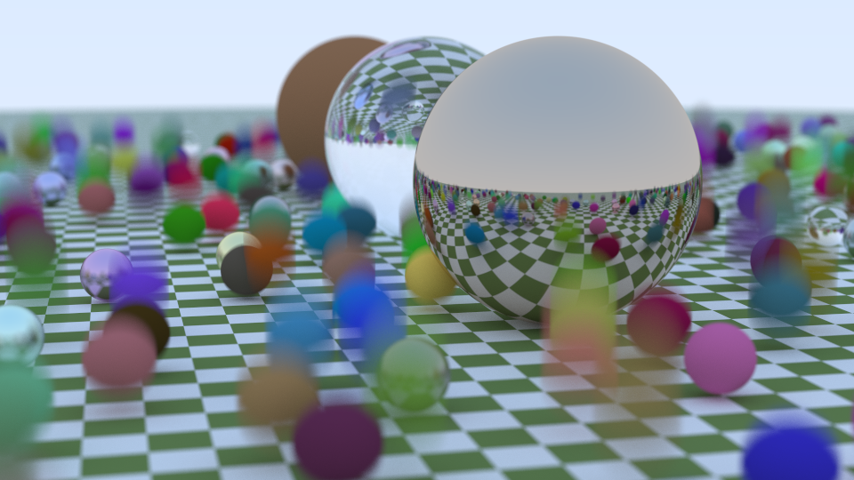
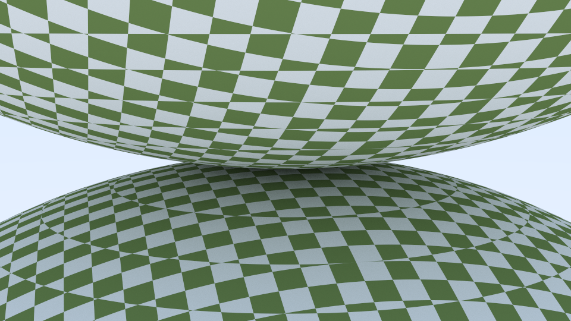
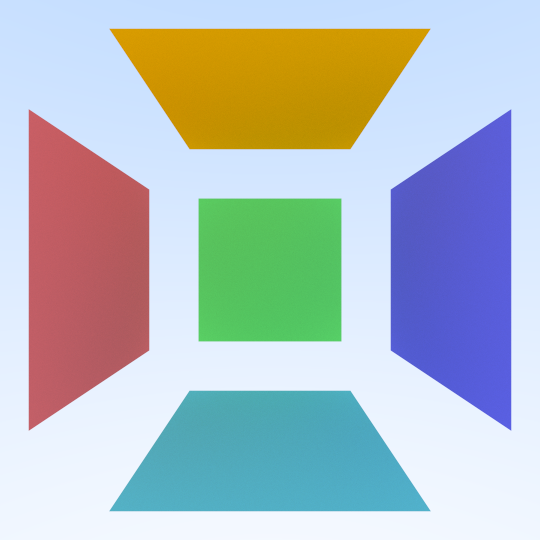
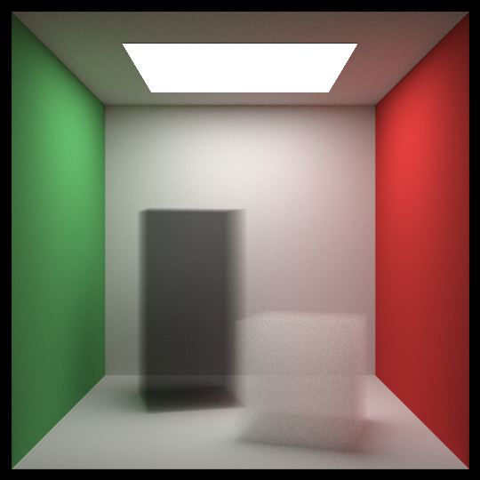
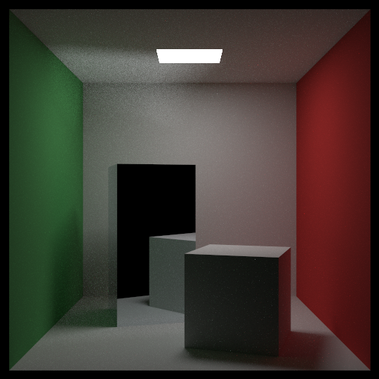
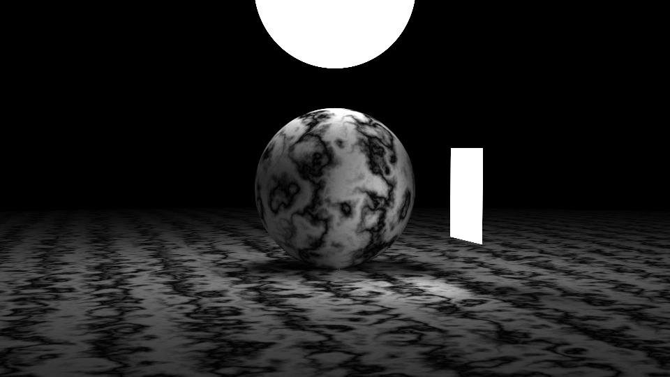
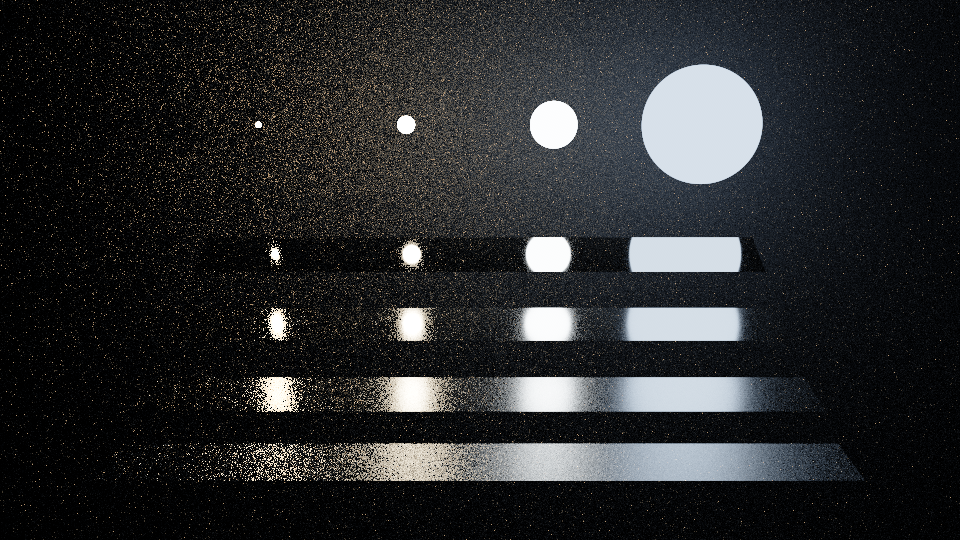
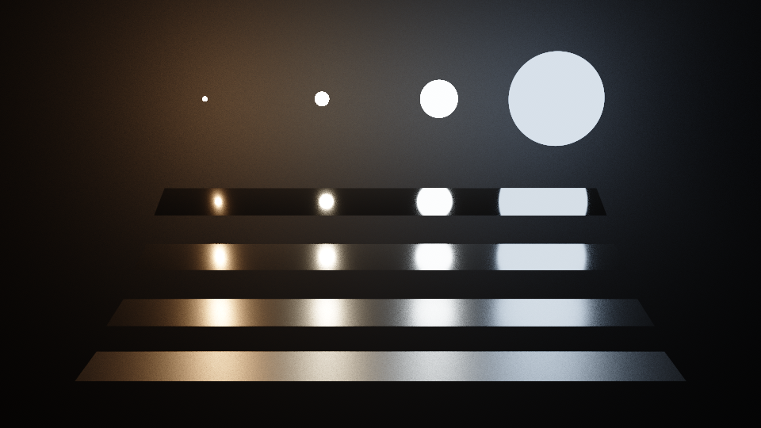
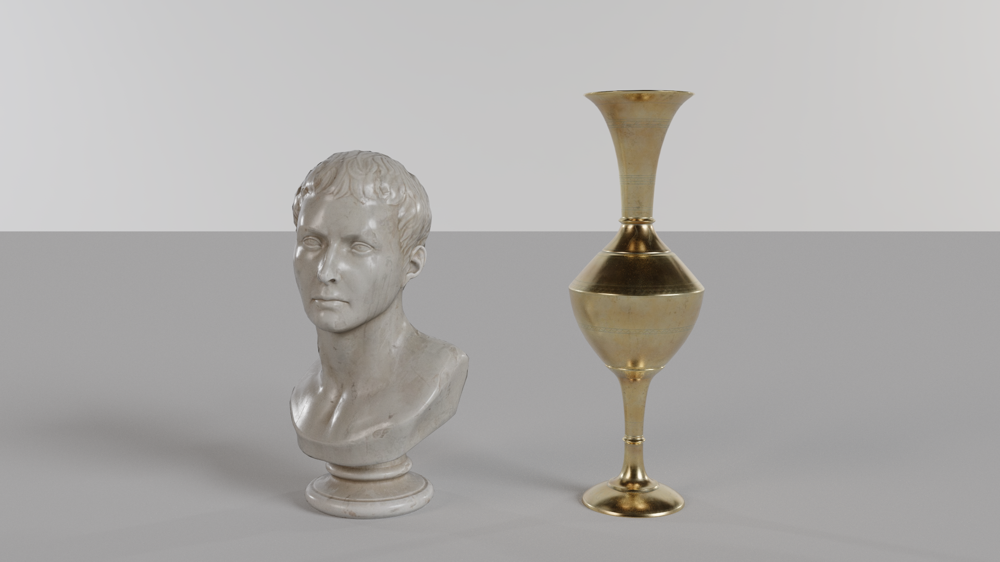

# RayTracing

A Monte Carlo path tracer in modern C++23, and a CUDA renderer for the same scenes that is statistically verified against it and shows them in an interactive window.

The CPU renderer implements the scenes and algorithms of Peter Shirley, Trevor David Black and Steve Hollasch's ["Ray Tracing in One Weekend"](https://raytracing.github.io/books/RayTracingInOneWeekend.html) series, all three books, rewritten in C++23 with modules. The rest is the project's own: a CUDA renderer [60 to 190 times faster](#performance) than the CPU renderer on the same desktop machine, a statistical test that proves the two render the same pictures, light and materials beyond the books, NVIDIA's OptiX with glTF models and an AI denoiser, and a window with a panel of controls.

|  |  |
|---|---|
| *The second book's final scene: 1080×1080, 10,000 rays per pixel, 39 minutes on the CPU.* | *The third book's final scene, a glass sphere sampled like a light: 1080×1080, 4096 rays per pixel, 8 minutes on the CPU.* |

## Highlights

- **The three books on the CPU:** all 13 scenes, a BVH, importance sampling with four strategies, and five of the third book's mistakes fixed rather than repeated. [Sampling](docs/sampling.md)
- **A CUDA renderer for every scene,** built by the CPU renderer's own scene code, in `float` or `double`, with seven single-precision pitfalls handled. [The CUDA renderer](docs/gpu.md)
- **Statistically verified:** `ImageCompare` tests whether two renders differ by more than Monte Carlo noise; the GPU's renders agree with the CPU's on every scene of the books. [The verification](docs/gpu.md#verification)
- **Beyond the books:** next-event estimation with multiple importance sampling, GGX rough metals and glossy coats, HDR environment maps, AgX tone mapping. [Light and materials](docs/quality.md)
- **OptiX:** the same integrator on the ray tracing hardware, glTF 2.0 models, and an AI denoiser for what you look at, never for what is measured. [OptiX, meshes and the denoiser](docs/optix.md)
- **An interactive window** that refines the image while the camera stands still, with a Dear ImGui panel; any view it shows can be rendered again offline, bit for bit. [The viewer](docs/viewer.md)
- **Deterministic and tested:** a seed fixes every image, in Debug as in Release (with OptiX, on the same graphics driver); numerical tests run on the GPU, and scripted recordings of the window replay byte for byte.

**Tech stack:** C++23 with modules and `import std;` (MSVC) · CUDA 13, device code in C++20 · OptiX 9.0 · CMake presets and Ninja · [SDL3](https://libsdl.org) · [Dear ImGui](https://github.com/ocornut/imgui) · [stb](https://github.com/nothings/stb) · [cgltf](https://github.com/jkuhlmann/cgltf)

## The window


*Replayed by `RayTracingViewer` from a camera script ([docs/viewer-tour.txt](docs/viewer-tour.txt)), not captured from the screen.*

`RayTracingViewer` shows any scene or glTF model and refines it while the camera stands still. Orbit, pan, fly and zoom with the mouse and the keys, double-click to focus, switch the sampling strategy, the tone map, OptiX and the denoiser. The panel at the right edge holds the same controls for the mouse, opens models, and renders the view to a file at up to 7680×4320. Every view can be saved with the `RayTracingGPU` command that renders it again, bit for bit (with OptiX or the denoiser, on the same graphics driver).


## Gallery

The books' 13 scenes, rendered by the CUDA renderer at their default settings and shown at half size. The scene's name is the first argument of each program, for example `RayTracingGPU cornell`.

| | |
|---|---|
|  **materials**: the first book's three materials up close, matte, fuzzy metal and hollow glass, through a wide-open lens |  **weekend**: the first book's cover ([Full HD, rendered on the CPU](docs/weekend.png)) |
|  **bouncing**: the matte spheres bounce, giving motion blur |  **checker**: a solid checker texture |
|  **earth**: an image wrapped around a sphere |  **perlin**: marble made of Perlin noise |
|  **quads**: quadrilaterals |  **cornell**: the Cornell box, with translated and rotated boxes |
|  **smoke**: blocks of smoke |  **final**: the second book's final scene, everything together |
|  **aluminum**: a mirror block; the light it throws onto the ceiling stays noisy |  **glass**: the third book's final scene, a glass sphere sampled like a light |
|  **light**: light sources | |

## Beyond the books

A third CUDA kernel adds what the books stop short of, and the books' own two kernels stay unchanged, instruction for instruction. Each feature was checked by numerical tests on the GPU and by `ImageCompare` against the strategies it improves on.

|  |  |
|---|---|
| *`RayTracingGPU veach -p material`: the materials' own samples.* | *`RayTracingGPU veach -p mis`: shadow rays and the materials' samples weighed by multiple importance sampling.* |

The same integrator then runs on OptiX (`--optix`), where the ray tracing cores traverse the hierarchy and intersect triangles, and the books' spheres and quads become custom primitives. glTF models load with their textures and metallic-roughness materials. [Light and materials](docs/quality.md), [OptiX, meshes and the denoiser](docs/optix.md)



*`RayTracingGPU still-life -w 1920 --height 1080 -s 1024`: two glTF models from [Poly Haven](https://polyhaven.com), 38,896 triangles, in the light of an HDR photograph.*

## Performance

The CPU renderer on all cores against the CUDA renderer, on the same desktop machine. The CPU computes in `double`. The GPU computes in `float` by default, 60 to 190 times faster, or in `double` with `--fp64`, still 1.8 to 8.0 times faster. Rays per pixel are the camera rays, one per path; the rays per second include [every ray traced](docs/building.md#raytracing-options), the camera rays and all their bounces: about 3.6 per path in `materials`.

| Scene | Size, rays per pixel | CPU, `double` | GPU, `float` | GPU, `double` (`--fp64`) |
|---|---|---|---|---|
| `materials` | 1920×1080, 484 | 51 s | **0.27 s, 189 times faster**: 13.4 billion rays per second | 8.7 s, 5.8 times faster |
| `weekend` | 1920×1080, 484 | 87 s | **0.81 s, 107 times faster**: 3.3 billion rays per second | 32 s, 2.7 times faster |
| `bouncing` | 1920×1080, 484 | ~1.6 min | **1.3 s, 74 times faster**: 2.0 billion rays per second | 37 s, 2.6 times faster |
| `checker` | 1920×1080, 484 | ~30 s | **0.25 s, 120 times faster**: 13.5 billion rays per second | 6.4 s, 4.7 times faster |
| `earth` | 1920×1080, 484 | ~6 s | **0.062 s, 97 times faster**: 22.7 billion rays per second | 0.75 s, 8.0 times faster |
| `perlin` | 1920×1080, 484 | ~33 s | **0.34 s, 97 times faster**: 6.7 billion rays per second | 9.3 s, 3.6 times faster |
| `quads` | 1080×1080, 484 | ~9 s | **0.075 s, 119 times faster**: 13.6 billion rays per second | 1.4 s, 6.5 times faster |
| `light` | 1920×1080, 1024 | ~47 s | **0.52 s, 90 times faster**: 6.2 billion rays per second | 9.5 s, 4.9 times faster |
| `cornell` | 1080×1080, 1024 | ~54 s | **0.83 s, 65 times faster**: 3.5 billion rays per second | 20 s, 2.7 times faster |
| `smoke` | 1080×1080, 1024 | ~1.4 min | **0.78 s, 108 times faster**: 4.6 billion rays per second | 30 s, 2.8 times faster |
| `final` | 1080×1080, 1024 | ~4 min | **3.7 s, 66 times faster**: 1.3 billion rays per second | 104 s, 2.3 times faster |
| `aluminum` | 1080×1080, 1024 | ~1 min | **0.91 s, 66 times faster**: 3.5 billion rays per second | 23 s, 2.6 times faster |
| `glass` | 1080×1080, 1024 | ~2 min | **2.0 s, 59 times faster**: 2.7 billion rays per second | 67 s, 1.8 times faster |

*Each scene at its default size, rays per pixel and sampling strategy. The times are the render times each program prints, from the scene to the finished image in memory; the GPU's are medians of 5 runs (3 in `double`). [How they were measured](docs/building.md#render-times)*

## Verified against the CPU

The GPU computes in `float` and draws different random numbers, so the two renderers can't agree pixel for pixel. What they must agree on is the picture both converge to, and [ImageCompare](docs/image-compare.md) tests exactly that, with the CPU against itself under another seed as the control. Every GPU render of the books' scenes, under their default and other strategies, in `float` and in `double`, was consistent with its CPU render; of 64 scenes built to provoke a difference, all but two agreed, and both differences are explained. [The full account](docs/gpu.md#verification)

## Quick start

Requirements: Visual Studio 2026 with "Desktop development with C++", and for the GPU programs an NVIDIA graphics card with the [CUDA Toolkit](https://developer.nvidia.com/cuda-downloads) 13 (tested with 13.4). Without CUDA, CMake builds the CPU programs and skips the rest. The first configure downloads SDL3, Dear ImGui and NVIDIA's OptiX headers; OptiX itself comes with the graphics driver. From a Developer PowerShell for VS:

```
cmake --preset x64-release
cmake --build --preset x64-release
out\build\x64-release\RayTracing.exe cornell -s 100
out\build\x64-release\RayTracingGPU.exe final
out\build\x64-release\RayTracingViewer.exe studio
out\build\x64-release\RayTracingViewer.exe assets\models\marble_bust_01\marble_bust_01_1k.gltf
```

Visual Studio, the offline downloads, the presets and every program's options: [Building and running](docs/building.md).

## Documentation

| Page | What it holds |
|---|---|
| [The CUDA renderer](docs/gpu.md) | how the GPU renders, the verification against the CPU, what `float` costs |
| [The viewer](docs/viewer.md) | the window: controls, the panel, progressive rendering, rendering to a file, scripts and recordings |
| [Light and materials](docs/quality.md) | multiple importance sampling, GGX, HDR environment maps, tone mapping, and how each was verified |
| [OptiX, meshes and the denoiser](docs/optix.md) | the integrator on the ray tracing hardware, glTF models, the AI denoiser, and how each was verified |
| [ImageCompare](docs/image-compare.md) | the statistical test, how it was validated and how to use it |
| [Sampling](docs/sampling.md) | the four sampling strategies, the fixes to the third book, the `MonteCarlo` program |
| [Building and running](docs/building.md) | requirements, presets, options, render times, all the scenes, the tests and the verification scripts |
| [Architecture](docs/architecture.md) | the features, the project's structure, the modules, modern C++ in the project, the history, the credits |

## Development history

The project was built in 107 steps, one commit each, whose messages record what was done, why and how it was checked ([the milestones in detail](docs/architecture.md#development-history)). The milestones are tagged:

| Tag | Milestone |
|---|---|
| `book-1` | "Ray Tracing in One Weekend" on the CPU, with the second book's BVH brought in early |
| `book-2` | "Ray Tracing: The Next Week" on the CPU |
| `book-3` | "Ray Tracing: The Rest of Your Life" on the CPU |
| `gpu-1` | the `materials` scene, the tools that compare renders, and the first book on CUDA, verified against the CPU |
| `gpu-2` | the second and third books on CUDA, each feature verified against the CPU |
| `gpu-3` | an SDL3 window with progressive rendering and camera control |
| `gpu-4` | light and materials beyond the books in a third kernel: next-event estimation with multiple importance sampling, GGX rough metals and glossy coats, HDR environment maps; and tone mapping |
| `gpu-5` | the same integrator on OptiX and the ray tracing hardware, triangle meshes and glTF models, and OptiX's AI denoiser |
| `gpu-6` | a panel in the window, with Dear ImGui: scenes, models and settings chosen with the mouse, and renders to a file |

## Roadmap

- **Meshes:** triangles that emit light, normal maps, mipmaps and alpha cutouts.
- **The denoiser:** a temporal one, for a moving camera.
- **Materials:** rough glass, the GGX microfacet model for refraction.

## Credits and license

The scenes and algorithms of the CPU renderer are the books' by Peter Shirley, Trevor David Black and Steve Hollasch, and its classes follow the books' C++ code. The project's code is under the [MIT license](LICENSE). Third-party code keeps its own license: stb (public domain or MIT) and cgltf (MIT) in `external`, and SDL3 (zlib), Dear ImGui (MIT) and NVIDIA's OptiX headers, which CMake downloads. The Earth map comes from the books' repository and the HDR maps and the glTF models from [Poly Haven](https://polyhaven.com), all CC0. Their licenses and notices, including the Apache 2.0 notice of the PCG random number generator the CUDA renderer ports, are in [THIRD_PARTY_NOTICES.md](THIRD_PARTY_NOTICES.md). The tone maps, the random number generator and the published methods are credited in [Third-party code and credits](docs/architecture.md#third-party-code-and-credits) and in the code's comments.
