# RayTracing

A learning ray tracer following all three books of Peter Shirley's series, ["Ray Tracing in One Weekend"](https://raytracing.github.io/books/RayTracingInOneWeekend.html), ["Ray Tracing: The Next Week"](https://raytracing.github.io/books/RayTracingTheNextWeek.html) and ["Ray Tracing: The Rest of Your Life"](https://raytracing.github.io/books/RayTracingTheRestOfYourLife.html), rewritten in modern C++23: modules, `import std;`, multithreading, concepts and `std::variant`. The first book's scenes also render on an NVIDIA graphics card with CUDA, [more than a hundred times faster](#the-gpu-the-first-book-on-cuda), and a statistical test shows that the GPU renders the same picture as the CPU.

| 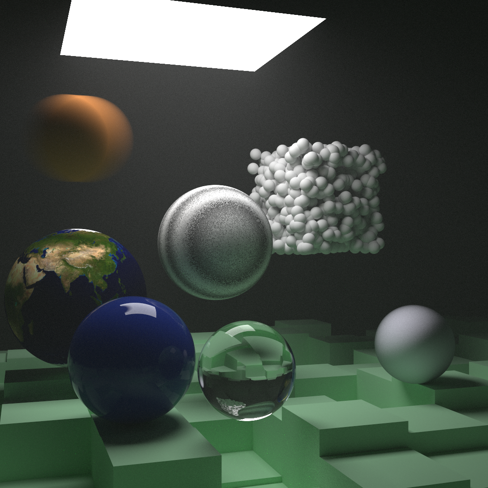 |  |
|---|---|
| *The second book's final scene, rendered with the third book's light sampling: 1080×1080, 10,000 rays per pixel, 39 minutes.* | *The third book's final scene: a glass sphere in the Cornell box, sampled like a light, which makes the caustic under it (the light the glass focuses onto the floor) less noisy: 1080×1080, 4096 rays per pixel, 8 minutes.* |

*Both rendered on the CPU, on all cores, in Release.*

## Scenes

All scenes from the three books; the scene name is the first argument: `RayTracing cornell`.

| | |
|---|---|
| 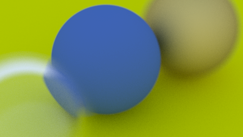 **materials**: the first book's three materials up close, as its chapters 9–13 leave them: matte, fuzzy metal and hollow glass, through a wide-open lens |  **weekend**: the first book's cover, spheres of three materials ([in Full HD](docs/weekend.png)) |
| 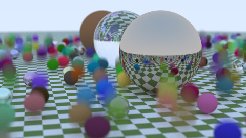 **bouncing**: the same, but the matte spheres bounce, giving motion blur | 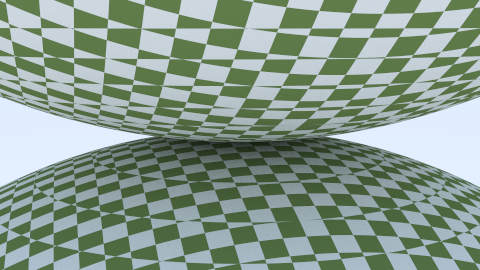 **checker**: a solid checker texture |
| 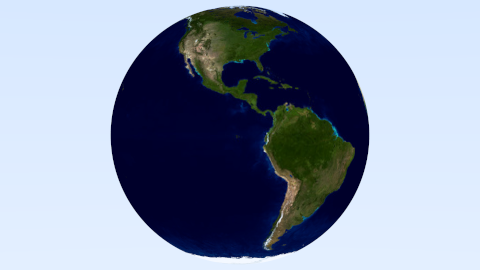 **earth**: an image wrapped around a sphere | 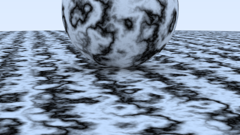 **perlin**: marble made of Perlin noise |
|  **quads**: quadrilaterals | 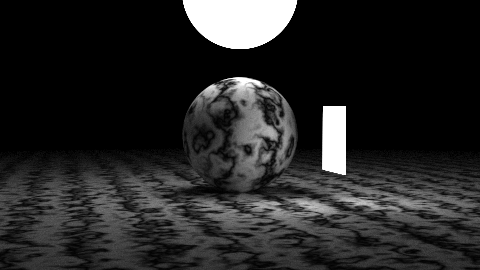 **light**: light sources |
| 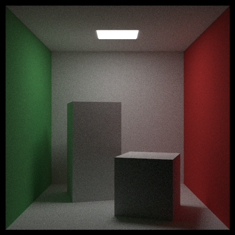 **cornell**: the Cornell box, translated and rotated objects | 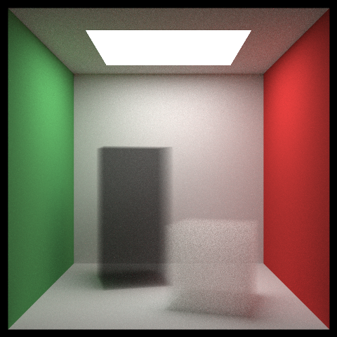 **smoke**: blocks of smoke |
|  **final**: the second book's final scene, everything together | 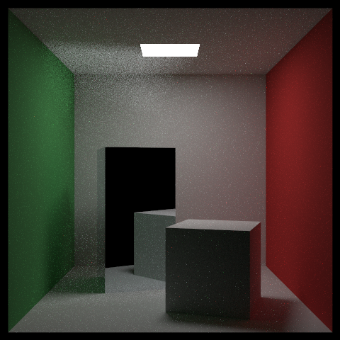 **aluminum**: a mirror block; the light it throws onto the ceiling stays noisy |
| 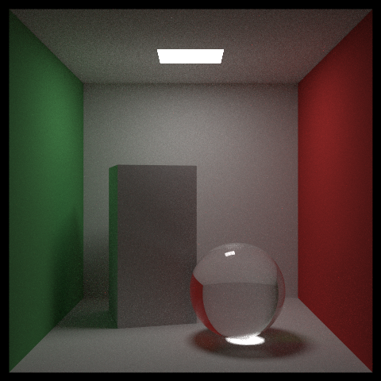 **glass**: the third book's final scene, a glass sphere sampled like a light | |

## Sampling: the third book in four pictures

The third book is about where to send a ray after a diffuse bounce, off a matte surface or a particle of smoke. The new direction may be drawn with any probability density p (a pdf: how likely each direction is to be drawn), if the light it brings back is then weighted by pScatter / p, where pScatter is the material's own density: how much of the light it scatters goes that way. A direction that p draws more often than the material would counts for less, and one that p draws less often counts for more. So the image converges to the same result whatever p is, as long as p > 0 wherever the material scatters light: the estimate is unbiased. What p changes is the noise, and choosing a p that lowers it is called importance sampling. The Cornell box with each strategy (`-p`), 480×480 and 64 rays per pixel:

| `-p uniform` | `-p material` | `-p lights` | `-p mixture` (default) |
|---|---|---|---|
| 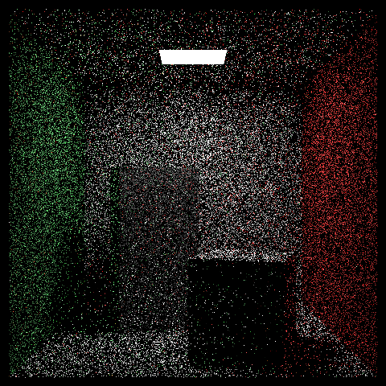 | 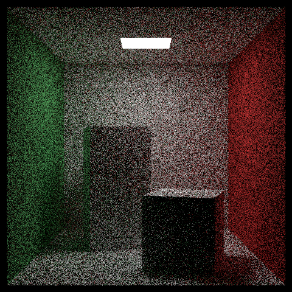 | 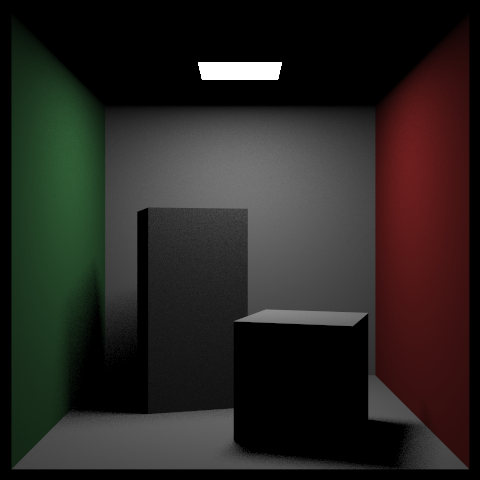 | 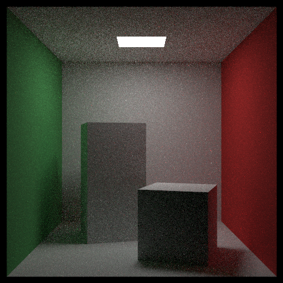 |
| the same density in every direction | as the surface scatters, as in the first two books | only toward the lamp | half as the material, half toward the lamp |
| error 0.175, 0.49 s | error 0.092, 2.0 s | error 0.045, 0.44 s, but the image is 21% too dark | error 0.022, 0.69 s |

*Error: the root-mean-square error (RMSE) of the pixels against a reference rendered with 16384 rays per pixel, in linear light (before gamma correction). Time: for these 64 rays per pixel on all cores.*

`uniform` is the noisiest: half of its directions point into the surface and bring nothing. `lights` is far less noisy than `material`, but wrong: p is 0 in every direction that misses the lamp, which breaks the rule above. Its error is mostly missing light, not noise: all the light bounced off the walls is lost, and the ceiling, which sees only the dark back of the lamp (lamps glow on their front side only), is black.

The mixture keeps most of the low noise of `lights` and stays unbiased: wherever the material scatters, p is at least half of pScatter, so p > 0 there and the weight pScatter / p is never more than 2. It is also faster for the same number of rays per pixel: half of the bounces aim at the lamp, and since a lamp reflects nothing, a path that reaches it ends there. Paths get shorter.

The mixture can't help everywhere. In `aluminum` it aims at the lamp, not at its reflection in the mirror, so the light the mirror throws onto the ceiling stays noisy (the book shows the same). And smoke and fog don't mix the lamps in at all, which goes beyond the book: deep in a dense volume, light comes from other particles rather than straight from a lamp, and the mixture's weights of up to 2 per bounce would multiply along a path that scatters again and again, giving rare paths huge weights. In the final scene's blue fog that showed as bright specks and more than doubled the error, so volumes sample with their own density, where every weight is exactly 1.

## The GPU: the first book on CUDA

`RayTracingGPU` renders the first book's scenes, `materials` and `weekend`, on an NVIDIA graphics card with CUDA. It has no scenes of its own: it builds them with the very modules `RayTracing` uses, the same objects and the same camera, and hands them to its renderer in `src/gpu` as plain numbers. So the CPU program stays the reference, and the two differ only in how they render.

### CPU and GPU: one picture, 112 times faster

| 1920×1080, 484 rays per pixel | CPU, all cores, `double` | GPU, `float` | GPU, `double` (`--fp64`) |
|---|---|---|---|
| `weekend`: the first book's cover, 485 spheres | 87 s, 31 million rays per second | **0.78 s, 112 times faster: 3.4 billion rays per second** | 31 s, 2.8 times faster |
| `materials`: five spheres up close | 51 s, 71 million rays per second | **0.27 s, 190 times faster: 13.6 billion rays per second** | 8.5 s, 6 times faster |

*The render time each program prints: from the scene to the finished image in memory; on the GPU it includes building its BVH and the copies to and from the card (the CPU builds its BVH just before its clock starts). A whole run takes about 0.3 s more in both programs, to start, build the scene and save the PNG (on the GPU that includes starting CUDA): `RayTracingGPU weekend` runs for 1.1 s in all, `RayTracing weekend` for 88 s. The GPU's times are medians of 5 runs (3 in `double`); the CPU's are single runs, which vary by a percent or two.*

| CPU | GPU, `float` |
|---|---|
|  | 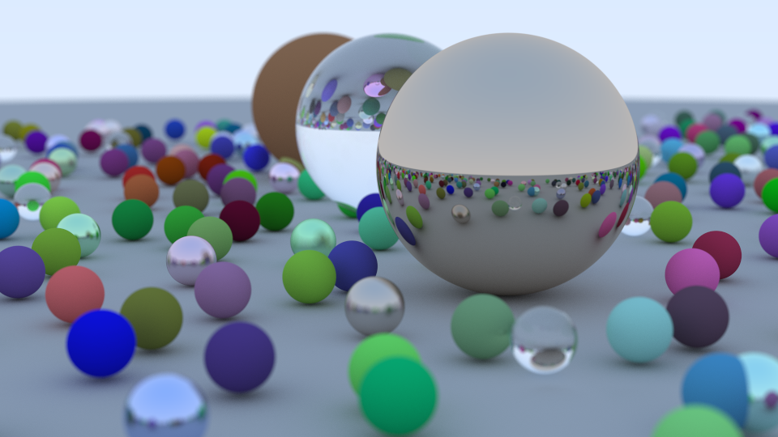 |
| **ImageCompare: CPU against CPU with another seed (the noise alone)** | **ImageCompare: CPU against GPU, `float`** |
| 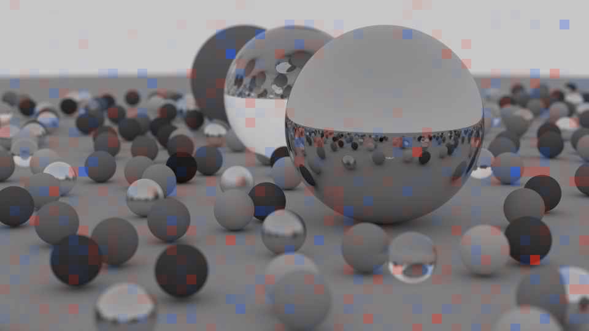 | 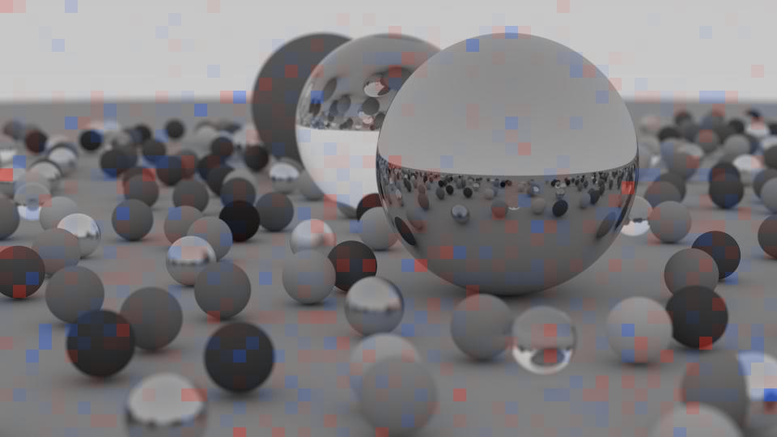 |

*`weekend` at 1920×1080 with 484 rays per pixel, shown at half size: each pixel here is the average of 2×2 pixels of the render. Each map is the CPU's image (A) in gray, tinted red where the other render (B) is brighter and blue where it is darker, by tiles of 32×32 pixels, in full color only where a tile differs by more than noise could explain. The two maps look alike: pale patchworks of noise, with no tile in full color.*

**One picture.** The two renderers can't agree pixel for pixel: the GPU computes in `float` and draws different random numbers, so every pixel's noise is different. What they must agree on is the expected value of every pixel, the picture both converge to as the rays per pixel grow, and the [ImageCompare program](#the-imagecompare-program) tests exactly that. A render on the GPU differs from one on the CPU just as much as two renders on the CPU with different seeds differ from each other:

| `weekend`, 1920×1080, 484 rays per pixel | Mean radiance | Mean of the difference, in standard errors | RMS of the difference | Verdict |
|---|---|---|---|---|
| CPU against CPU with another seed (the noise alone) | 0.379926 and 0.379927 | +0.28 | 0.006531 | consistent |
| CPU against GPU, `float` | 0.379926 and 0.379924 | −0.28 | 0.006537 | consistent |
| CPU against GPU, `double` | 0.379926 and 0.379923 | −0.42 | 0.006533 | consistent |

All 25 comparisons of this kind came out consistent: both scenes, `float` and `double`, 1920×1080 at 484 rays per pixel and 480×270 at 16,384, where the noise is 6 times smaller. So did the average length of a path, 2.676 rays per sample in `weekend` and 3.618 in `materials`: the CPU's and the GPU's differ by 10 and 7 parts per million, less than the noise of the measurement. Another verification went looking for a difference on purpose, in about 45 scenes made for it (the camera inside glass, nested glass with air bubbles, light trapped in a glass ball by total internal reflection, spheres of radius 0.001 and 100,000, contacts, a lens of 150°, paths of up to 1,500 rays; at 2,000 the CPU's recursive `ray_color` overflows its thread's stack, while the GPU's loop rendered paths of 20,000). In `double` the GPU agreed with the CPU in all of them but one, a sphere ten million times smaller than its distance, where the CPU's own arithmetic was the less accurate side; what it found in `float` is below.

### How the GPU renders

- **A thread per pixel.** The GPU runs the renderer's kernel in thousands of threads at once, one per pixel, grouped into blocks of 16×8 pixels that its multiprocessors share out. Each multiprocessor runs threads in warps of 32, which execute every instruction together; a warp whose rays hit different materials runs each case in turn (divergence). The materials are a short `switch` on plain data rather than virtual functions: the CPU's objects can't be copied to the GPU (their virtual function tables point into the CPU's code), a `switch` lets the compiler inline every case, and with short cases divergence costs little.
- **Passes.** Windows resets a graphics card when one kernel runs longer than about 2 seconds (TDR), and while a kernel runs, a card that drives a display can't redraw the desktop. So the image is rendered in passes, each adding one sample to every pixel, and the renderer measures how long a pass takes and gives every kernel launch about 50 ms of work. Inside a launch a thread starts its next sample as soon as one ends, rather than waiting for the longest path of its warp: the weekend scene renders 1.6 times faster than with one pass per launch.
- **Random numbers per sample.** Every sample, a camera ray with all its bounces, gets its own small generator (PCG32), started from a hash of the seed, the pixel and the pass. So the image doesn't depend on the order the threads run in or on how passes are grouped into launches: the same seed gives the same image, bit for bit, in Debug and in Release, as on the CPU.
- **`float`, not `double`.** A GeForce card does arithmetic on 64-bit doubles 64 times slower than on 32-bit floats. The device code is written once, as templates on the number type, and compiled twice; `--fp64` renders with doubles, 31 to 40 times slower than with floats on this card, though still faster than the CPU.
- **A BVH as flat arrays.** The tree of boxes is built on the CPU with the CPU's own rule (split in half along the longest axis) into arrays that refer to each other by index, and each thread walks it in a loop with a small stack, visiting the nearer of two boxes first.
- **Only the first book so far.** `RayTracingGPU` can't render the second and third books' features yet (moving spheres, textures, quadrilaterals, smoke, lamps); for such a scene it says which feature is missing.

### What `float` costs

A `float` keeps about 7 significant digits, and that matters in four places, each measured by comparing renders:

- **Self-intersection.** Near the ground sphere of radius 1000, centered 1000 units below the scene, a point is known relative to the sphere's center only to about 0.00003. So a ray that bounces off the ground can start slightly inside it, and the CPU's rule of ignoring hits closer than 0.001 isn't enough: rays leaving at grazing angles hit the ground again from inside and are lost. So for the sphere a ray starts on, the GPU goes by geometry instead of by distance: a ray leaving the sphere can't hit it again (a sphere is convex), and a ray going into it, into glass, can hit only its far side, still beyond t = 0.001. In exact arithmetic that is the same rule. Without it the `weekend` image is 0.011% too dark. That is invisible, but far beyond the noise: rendered at 480×270 with 4096 rays per pixel and the same random numbers, with and without the rule, the two images differ by well over 100 standard errors.
- **The horizon.** Whether a ray grazing the ground hits it depends on r² − |l|², the difference of two numbers near a million, where a `float` steps by 0.06. Rounded on its own, |l|² became exactly r² whenever it lay less than half a step above it, so rays passing up to 0.03 outside the ground got a discriminant of 0 and counted as hits, four times as often as the opposite error, and the horizon came out a little darker than the CPU's. Fused multiply-adds now subtract the three squares from r² one at a time, so |l|² is never rounded on its own: the rounding errs to both sides equally, and the darkening is gone.
- **Rays parallel to a box's faces.** The test of a ray against a box divides by the ray's direction. For a direction with a component of exactly 0 the faster form of that test computed ∞ − ∞ = NaN and skipped boxes the ray crossed; one pixel in 129,600 showed it.
- **Camera rays.** A camera ray's direction was the difference of two positions, the pixel's point and the lens point, each rounded to 10⁻⁷ of its distance from the origin. With a focus distance of 0.00001 neighboring pixels got the same direction, and the image came out blocky. Now the direction is built from vectors relative to the camera, which are rounded relative to their own length.

What `float` can't fix: it resolves about 10⁻⁷ of the largest coordinate, so details smaller than about 1/10,000 of the scene's coordinates come out measurably different: a ground of radius 10,000 or more, a scene 10,000 or more units from the origin, spheres of radius 0.001 about ten units from the origin. Such scenes need `--fp64`.

### Building and running it

`RayTracingGPU` needs an NVIDIA graphics card and the [CUDA Toolkit](https://developer.nvidia.com/cuda-downloads) 13 (`winget install Nvidia.CUDA`; tested with 13.4). Without it CMake builds everything else and says that it skipped the GPU program. After installing the toolkit, restart Visual Studio (or the terminal) and delete CMake's cache, which remembers that CUDA was missing: **Project → Delete Cache and Reconfigure** (or `cmake --fresh --preset x64-release`). Then choose the `RayTracingGPU.exe` startup item, or:

```
out\build\x64-release\RayTracingGPU.exe weekend -s 1024
```

```
RayTracingGPU [scene] [options]
  scene                materials or weekend (default weekend)
  -w, --width N        image width in pixels
  -s, --samples N      rays per pixel, rounded to the nearest square k²
      --fp64           compute in 64-bit doubles like the CPU instead of 32-bit floats
      --seed N         which random numbers to draw, from 0 (default) to 4294967295
  -o, --output FILE    where to save the image, a .png or a .pfm (default <scene>-gpu.png)
  -h, --help           help
```

The CUDA code is C++20 in ordinary headers: `nvcc`, NVIDIA's compiler, can't import modules, and with MSVC as its host compiler it doesn't take C++23 yet. The kernels are compiled for the card in the computer that builds them (`CMAKE_CUDA_ARCHITECTURES` is `native`; set it, e.g. `-DCMAKE_CUDA_ARCHITECTURES=89`, to build for another), and they are optimized in Debug too, so a Debug build renders on the GPU at full speed.

## The MonteCarlo program

Before the ray tracer learns to choose its rays, the third book studies Monte Carlo estimation (an integral as the average of random samples) on small problems with known answers. The `MonteCarlo` program runs those experiments. Every estimate is printed next to the exact value, its standard error SE (how far a correct estimate typically lands from the exact value) and the error in SEs: up to about 3 SE is noise, much more points to a bug. For example, `MonteCarlo importance` integrates x² over [0, 2] with four sampling densities. The end of its output repeats each estimate 1000 times and compares the RMS error of these runs with σ/√N, the error predicted from the spread σ of a single sample f/p:

```
  The RMS error of 1000 runs with N = 100 samples each, next to σ/√N:
  PDF         p(x)                 σ of f/p      σ/√N       RMS  largest x
  uniform     1/2                  2.385139  0.238514  0.242261   1.999991
  two halves  1/(2√2) | 1/(4-2√2)  1.503819  0.150382  0.151427   1.999983
  linear      x/2                  0.942809  0.094281  0.091921   1.999998
  quadratic   3x²/8                0.000000  0.000000  0.000000   1.999990
```

The closer the density p is in shape to the function being integrated, f(x) = x², the smaller the error; a p proportional to f gives the exact answer with every sample. The last column, the largest x drawn, catches a mistake in the book: its inverse CDF for the quadratic density (the formula that turns a uniform random number into an x with that density) draws numbers up to 8, outside [0, 2]. The estimate itself can't show this, because f(x) / p(x) = 8/3 for every x.

| Experiment | Book section | What it shows |
|---|---|---|
| `pi` | 2.1 | estimate π from random points in a square |
| `convergence` | 2.2 | the law of diminishing returns: the error falls as 1/√N |
| `stratified` | 2.3 | one random point in each cell of a grid (jittering) vs points anywhere |
| `integrate` | 3.2 | integrals as averages of random samples: x², sin⁵ x and ln(sin x) over [0, 2] |
| `halfway` | 3.5 | the point that halves the area under a curve, found by sorting the samples |
| `importance` | 3.7 | ∫ x² dx with four densities: the closer p is to f, the smaller the error |
| `sphere` | 4 | ∫ cos²θ dω over the sphere of directions, with densities per steradian |
| `sphere-plot` | 7.1 | 200 random directions as "x y z" lines, the input of a 3D scatter plot |
| `cos-cubed` | 7.2 | ∫ cos³θ dω over the hemisphere: uniform vs cosine-distributed directions |
| `light-pdfs` | 9.1 | beyond the book: do `pdf_value()` and `random()` agree for quads, spheres, lists and instances? |

Run without arguments, `MonteCarlo` takes about 6 s in Release and runs every experiment except `sphere-plot`; `MonteCarlo importance sphere` runs only the named ones, `MonteCarlo sphere-plot -o points.txt` writes the plot's points to a file, and `MonteCarlo -h` lists them all.

## The ImageCompare program

Every pixel of a render is a Monte Carlo estimate, an average of random samples, so two renders of one scene differ in every pixel unless they use the same random numbers. What correct renderers must share is each pixel's expected value: the picture both converge to as the rays per pixel grow. `ImageCompare` tests whether two renders differ by more than their noise explains. It reads PFM files, which keep the renderer's own linear numbers (a PNG's 8 bits after gamma correction would hide a difference of 0.1%), so render twice with different seeds and otherwise the same settings:

```
RayTracing materials -w 480 -s 64 -o a.pfm
RayTracing materials -w 480 -s 64 --seed 1 -o b.pfm
ImageCompare a.pfm b.pfm
```

```
A: a.pfm: 480×270, mean radiance 0.266767
B: b.pfm: 480×270, mean radiance 0.266774

The difference d = B - A in each pixel, over 129600 pixels:
              mean of d          SE        z   relative   RMS of d
  red       -0.00003300  0.00007180    -0.46   -0.0117%   0.025847
  green     -0.00005197  0.00007913    -0.65   -0.0145%   0.028485
  blue      +0.00010775  0.00008614    +1.25   +0.0671%   0.031009
  average   +0.00000759  0.00006400    +0.11   +0.0028%   0.023039
  SE: the standard error of the mean; z ≈ mean / SE, the mean in standard errors (less a rounding
  margin of a millionth of the pixel values); relative: the mean as a share of the pixel values;
  RMS: the typical size of d, the two images' noise together
  sign test: B is brighter in 50.10% of the 127341 pixels that differ by more than 0.1%,
  z = +0.69 (noise of the same shape in A and B gives 50%)

Tiles of 32×32 pixels (smaller at the right and bottom edges): 135 tested, by the channel average of d
  all tiles together: Σz/√T = +0.66
  largest |z|: 2.69 at x 96–127, y 96–127 (A is brighter there)
  tiles with |z| > 3: 0, while noise alone gives 0.4 on average

Checks (by chance alone each fails in at most 1 of 400 comparisons, any of the 4 in 1 of 100):
  whole image   the largest |z| of its 4 rows        1.25   fails above 3.42       passed
  all tiles     |Σz/√T| of the T tiles               0.66   fails above 3.02       passed
  largest tile  the largest |z| of a tile            2.69   fails above 4.28       passed
  tile count    the number of tiles with |z| > 3        0   fails at 4 or more     passed

Verdict: consistent: A and B differ by no more than noise
```

It looks at the difference d = B − A in every pixel. If A and B are the same picture, every d has the expected value 0, and the mean of N of them is as close to 0 as the standard error SE = s/√N predicts, where s is the spread of the d's: the √N law of the MonteCarlo program. z = mean / SE is that distance in standard errors. The image is also cut into tiles of 32×32 pixels (`--tile N`), each with its own z. Four checks look for four kinds of difference:

- **whole image:** the mean of d per channel and for their average, for a bias that covers the image, such as a render 0.1% too dark;
- **all tiles:** the tiles' z added up and divided by √T (Stouffer's method), where every tile weighs the same, so that one noisy region (glass, fireflies) can't drown a small bias everywhere else;
- **largest tile:** a difference confined to one object, against a threshold that grows with the number of tiles, as some tiles are far off by chance (Bonferroni's correction);
- **tile count:** more tiles with |z| > 3 than chance gives (a binomial test), for a weak difference spread over many tiles.

Each check fails by chance in at most 1 of 400 comparisons of the same picture, so the verdict is a false alarm in at most 1 of 100, and the exit code says it for scripts: 0 consistent, 1 different, 2 an error. `--zmap map.png` saves a map of the tiles' z: image A in gray, tinted red where B is brighter and blue where it is darker. The program was validated on thousands of synthetic pairs, with and without fireflies (rare samples far brighter than the rest), and on 1725 pairs of real renders with different seeds: it called the same picture different in 0.5–0.9% of the pairs, and it found a sky 0.1% too bright, or one sphere's albedo 1% too low, in 30 of 30 pairs of `materials` at 480×270 and 64 rays per pixel.

**How to use it.** A and B must be independent renders of the same scene at the same size, with the same rays per pixel and the same sampling method: renders with different seeds, or from different renderers (the CPU and the GPU draw unrelated random numbers; to compare the GPU's `float` and `double`, give them different seeds, as their generators are the same). Then their noise has the same distribution, which the checks assume. With different rays per pixel it doesn't: a pixel of 16 rays usually misses the rare bright samples that one of 1024 catches, and the checks can fail for the same picture. The `sign test` line watches for this (with noise of the same shape B is brighter in half the pixels, like heads in tosses of a fair coin), and the program prints a note when that looks like the cause. Identical files are refused. The source explains the statistics for a learner: the standard error, Student's t for small tiles, Bonferroni's correction, Stouffer's method and the sign test.

## Features

**First book:**

- Spheres of three materials: matte (Lambertian), metal with blurred reflections, and glass with refraction, total internal reflection and glare by Schlick's approximation. The `materials` scene shows all three up close, the glass one hollow: a smaller sphere inside it is the air.
- Antialiasing (several random rays per pixel) and gamma correction.
- A camera with any position, field of view and depth of field.

**Second book:**

- Motion blur: each ray is emitted at a random moment while the shutter is open, and spheres can move.
- BVH, a bounding volume hierarchy: speeds up rendering of the first book's cover about 8 times.
- Textures: checker, an image from a file (JPEG, PNG) and marble made of Perlin noise with turbulence.
- Quadrilaterals and boxes made of them.
- Light sources: emissive materials and a configurable background.
- Instances: any object can be translated and rotated around the vertical axis without recomputing it.
- Smoke and fog: volumes uniformly filled with particles.

**Third book:**

- Monte Carlo integration from the ground up, as a separate program (see above).
- Stratified pixel samples: the rays of a pixel form a k×k grid of cells with one random point each, which makes edges and textures less noisy (the noise of the lighting hardly changes).
- Importance sampling made explicit: materials describe how they scatter with a probability density, and every diffuse bounce is weighted by pScatter / p.
- Cosine-weighted directions drawn around the z axis by the inversion method (two random numbers, no rejection loop) and turned to point around the normal with an orthonormal basis.
- Light sampling: quads, spheres, lists of them and (beyond the book) translated or rotated instances know the density of the directions toward them and can draw such directions. Lamps glow on their front side only.
- A mixture of the material's density and the lamps' density, the default: the scenes lit by small lamps get far less noisy for the same number of rays, and most of them render faster too.
- Mirrors and glass stay a special case that skips the densities: the camera follows the one ray they choose, as in the first two books (a perfect mirror's density would be infinite in one direction and 0 in all others).
- Two new scenes: an aluminum block and a glass sphere in the Cornell box.

**Beyond the books:**

- Multithreaded rendering on all cores. The result is deterministic: for a given seed (`--seed`, 0 by default) it is identical on every run, in Debug and in Release. Renders with different seeds have independent noise around the same expected image, so two of them can be compared statistically: a difference larger than the noise explains is a real one.
- Choosing the scene, the quality, the sampling strategy and the seed from the command line; saving to PNG or to PFM (32-bit floats that keep the linear values, before gamma correction and clamping), and to several files from one render (`-o out.png -o out.pfm`).
- No heap allocation per bounce: the book creates its densities with `make_shared` at every bounce; here they are small values on the stack.
- Smoke and fog keep sampling with their own density under the default mixture: mixing the lamps in multiplies the weights along paths that scatter many times (see the sampling section).
- The program prints the image's mean radiance (its average brightness in linear light, before clamping): an unbiased sampling strategy changes the noise but leaves this number the same up to that noise, while a biased one, like `-p lights`, moves it.
- It also counts the rays it traces, the camera rays and all their bounces, and prints how many it traced per sample and per second (see the command-line options).
- `ImageCompare`, a statistical test of whether two renders are the same picture up to Monte Carlo noise (see above).
- Mistakes in the third book are fixed rather than repeated, each explained in a comment next to the fix: the inverse CDF of section 3.7 (it draws x up to 8 instead of 2), the uniform density of section 6.2 (it makes the image too bright, not just noisier), reading the first element of an empty list of lights, light directions hundreds of units long (the search for a hit starts at t = 0.001 of their length, so they skip the first half unit of their way and anything there), and NaN from the square root of a negative number for a point inside a spherical lamp.

**On the GPU:**

- The first book's scenes on an NVIDIA graphics card with CUDA, built by the same scene code and camera as on the CPU, more than a hundred times faster, and shown by `ImageCompare` to be the same picture (see the GPU section).
- One source for `float` and `double` (`--fp64`): the device code is templates on the number type, constrained by a concept.
- Deterministic like the CPU: every sample has its own random numbers, so the image doesn't depend on how the GPU schedules its threads.
- Robust in `float`: the self-intersection rule, a discriminant with fused multiply-adds, a slab test safe for directions with a zero component, camera rays built relative to the camera.

## Building and running

Requires Visual Studio 2026 with the "Desktop development with C++" workload: the MSVC compiler, CMake and Ninja come with it.

**In Visual Studio:** open the project folder, select the `x64 Release` preset and the `RayTracing.exe` startup item, press Ctrl+F5. The program renders the final scene and prints the path to the finished image. The `MonteCarlo.exe` startup item runs the Monte Carlo experiments, and `ImageCompare.exe` compares two renders. `RayTracingGPU.exe` is there if the CUDA Toolkit is installed (see [the GPU section](#building-and-running-it)).

**From the command line** (Developer PowerShell for VS):

```
cmake --preset x64-release
cmake --build --preset x64-release
out\build\x64-release\RayTracing.exe cornell -s 100
out\build\x64-release\MonteCarlo.exe
```

| Preset | Purpose |
|---|---|
| `x64 Debug` | step-by-step debugging; rendering is about 10 times slower |
| `x64 RelWithDebInfo` | optimizations plus debug information: profiling and debugging fast code |
| `x64 Release` | final rendering |

The program looks for the Earth texture in the `assets` folder, in the current folder and up the tree, so run it from the project root or from Visual Studio. If the texture isn't found, the Earth will be cyan, and the program will warn about it.

## Command-line options

```
RayTracing [scene] [options]
  scene                materials, weekend, bouncing, checker, earth, perlin, quads, light,
                       cornell, smoke, final, aluminum or glass (default final)
  -w, --width N        image width in pixels; the height follows the scene's aspect ratio
  -s, --samples N      rays per pixel, rounded to the nearest square k²: the rays form
                       a k×k grid in the pixel
  -p, --sampling NAME  how a diffuse bounce chooses the next direction: uniform, material,
                       lights or mixture (default)
      --seed N         which random numbers to draw, from 0 (default) to 4294967295
  -o, --output FILE    where to save the image, a .png or a .pfm (default <scene>.png);
                       give it several times to save several files
  -h, --help           help, the lists of scenes and sampling strategies
```

The same seed always gives the same image, bit for bit; another seed renders the same scene with independent noise. A `.pfm` (Portable Float Map) keeps the linear values as 32-bit floats, before gamma correction and clamping, so it can tell a lamp of brightness 15 from plain white and a difference of 0.1% from none, which a PNG can't; HDR viewers such as [tev](https://github.com/Tom94/tev) open it. After the render the program prints its time, the rays it traced and the image's mean radiance, e.g. for `RayTracing materials`:

```
Render time: 51.4 s
Rays traced: 3631.4 million (3.62 per sample), 70.6 million per second
Mean radiance (linear, before clamping): 0.266692
```

A ray traced is one search of the scene for the nearest hit: the camera ray or a bounce. Per sample, that's the average length of a path; per second, the renderer's speed.

Each scene has its own default size and number of rays. Time on all cores in Release:

| Scene | Size | Rays per pixel | Time |
|---|---|---|---|
| `materials` | 1920×1080 | 484 | ~50 s |
| `weekend` | 1920×1080 | 484 | ~1.5 min |
| `bouncing` | 1920×1080 | 484 | ~1.6 min |
| `checker` | 1920×1080 | 484 | ~30 s |
| `earth` | 1920×1080 | 484 | ~6 s |
| `perlin` | 1920×1080 | 484 | ~33 s |
| `quads` | 1080×1080 | 484 | ~9 s |
| `light` | 1920×1080 | 1024 | ~47 s |
| `cornell` | 1080×1080 | 1024 | ~54 s |
| `smoke` | 1080×1080 | 1024 | ~1.4 min |
| `final` | 1080×1080 | 1024 | ~4 min |
| `aluminum` | 1080×1080 | 1024 | ~1 min |
| `glass` | 1080×1080 | 1024 | ~2 min |

Time grows in proportion to the number of pixels and the number of rays per pixel: for a quick draft add `-s 16`. The scenes lit by small lamps (`light`, `cornell`, `smoke`, `final`, `aluminum`, `glass`) aim half of the diffuse bounces off their surfaces at the lamps (`glass` also at its glass sphere); with `-p material` they are sampled as in the first two books: noisier, and all but `light` slower. The other scenes are lit by the sky and have no lamps to aim at, so `-p lights` and `-p mixture` render them as `-p material` does, and the program says so.

`RayTracingGPU` takes the same options except `-p`, and adds `--fp64` (see [the GPU section](#building-and-running-it)); `ImageCompare` is described in its own section.

To pass options when launching from Visual Studio, open **Debug → Debug and Launch Settings for RayTracing** and add `"args": ["cornell", "-s", "100"]` to the configuration.

## Structure

Each `.ixx` file in `src/` is a C++20 module (`export module ...`). The modules are compiled once into a static library, `raytracer`, and the programs link it:

| Module | Contents |
|---|---|
| `vec3` | vector for points, directions and colors (`point3`, `color`), random vectors and directions, reflection and refraction |
| `ray` | the ray `P(t) = origin + t·direction` and the moment it is emitted |
| `interval` | the range `[min, max]` |
| `random` | random numbers: each thread has its own generator |
| `onb` | orthonormal basis: turns directions drawn around the z axis to point around a normal |
| `pdf` | densities of directions: the `direction_pdf` concept, uniform, cosine and mixture densities |
| `aabb` | axis-aligned box and a fast test of whether a ray hits it |
| `hittable` | hit record, the `hittable` and `material` interfaces, how a material scatters, object list, the density toward objects |
| `sphere` | sphere, possibly moving; can be sampled as a light |
| `quad` | quadrilateral and a box of six such faces; can be sampled as a light |
| `instance` | `translate` and `rotate_y`: a translated or rotated object; can be sampled as a light |
| `constant_medium` | smoke and fog |
| `bvh` | tree of boxes for fast intersection search |
| `texture` | textures: solid color, checker, image, marble |
| `perlin` | Perlin noise and turbulence |
| `material` | `lambertian`, `metal`, `dielectric`, `diffuse_light`, `isotropic` |
| `camera` | camera, background, stratified pixel samples, sampling strategies, multithreaded rendering, the seed, counting the rays traced |
| `image` | in-memory image, loading from a file (JPEG, PNG; PFM), gamma correction, saving as PNG or PFM, the mean radiance |
| `scenes` | all scenes from the three books and the list for choosing one by name |
| `cli` | helpers the programs share for their command lines: parsing numbers, checking output file names before rendering, paths as UTF-8 |

The programs: `main.cpp` (`RayTracing`, the command-line options), `monte_carlo.cpp` (`MonteCarlo`, the third book's numerical experiments), `image_compare.cpp` (`ImageCompare`: are two renders the same picture up to noise?) and `main_gpu.cpp` (`RayTracingGPU`: builds a scene with the modules above and renders it on the GPU).

The GPU renderer in `src/gpu` is ordinary C++20 headers and one `.cu` file, compiled by `nvcc`, which can't import modules. Its files mirror the modules they port:

| File | Contents | Ports |
|---|---|---|
| `renderer.h` | the interface between `main_gpu.cpp` and the renderer: the scene as plain numbers in, the image out | |
| `renderer.cu` | the kernel and the host code around it: the scene copied to the GPU, launches in passes, timing | `camera::render` |
| `camera.cuh` | camera rays, the sky, one step of a path | `camera` |
| `material.cuh` | the three materials, as a `switch` on plain data | `material`, `onb` |
| `sphere.cuh` | the ray-sphere test, made robust for `float` | `sphere` |
| `bvh.cuh` | the BVH as flat arrays, built on the CPU, walked on the GPU with a loop and a small stack | `bvh`, `aabb` |
| `random.cuh` | a PCG32 generator for every sample, random directions without loops | `random`, `vec3` |
| `vec3.cuh` | `vec3` and the math functions in both `float` and `double` | `vec3`, `ray` |

Third-party code: only [stb_image and stb_image_write](https://github.com/nothings/stb) in `external/stb`. The Earth map `assets/earthmap.jpg` comes from the [books' repository](https://github.com/RayTracing/raytracing.github.io) (CC0).

## Modern C++ in the project

- **Modules and `import std;`** (C++20/23) instead of headers. The `std` module is built from `std.ixx`, which ships with MSVC (see `CMakeLists.txt`). The stb libraries are included in the global module fragment of the `image` module and are not visible outside it. An `import` isn't passed on (only `export import` is): `image` imports `vec3`, but a file that imports `image` still has to import `vec3` to use `color`, so every file imports what it uses.
- **`constexpr` and `inline` in modules.** A function defined inside a class in a named module doesn't become `inline` by itself. Without this, `vec3` calls wouldn't be inlined into other modules (`vec3.ixx`).
- **Static and dynamic polymorphism side by side.** Objects and materials are open families of long-lived objects, so they use virtual functions. Densities of directions are a closed set of short-lived values on the hottest path, so they do without them: a **concept** (`direction_pdf`, C++20) instead of a base class, a class template `mixture_pdf` whose template arguments are deduced from the constructor's arguments (**CTAD**, C++17), a generic lambda with a constrained `auto` parameter (C++20), and **`std::variant` with `std::visit`** (C++17) for the density a material returns (`pdf.ixx`, `camera.ixx`).
- **`std::variant` and `std::get_if`** for what a material does with a ray: a diffuse scatter (with a density) or a specular one (with a ready ray), wrapped in `std::optional` for absorption.
- **Ranges.** C++20 algorithms with projections: `std::ranges::sort` when building the BVH and in MonteCarlo, `std::ranges::find(scene_list, name, &scene_entry::name)` when choosing a scene. C++23: `std::views::cartesian_product` for the cells of a pixel, `std::views::zip` in MonteCarlo's convergence table, `std::ranges::fold_left` for the image's mean, `std::ranges::contains` in MonteCarlo's command line, `std::ranges::iota` in Perlin noise, `std::ranges::to` to collect a lowercase file extension into a string (`image.ixx`).
- **`std::unreachable`** (C++23) after a `switch` that returns in every case.
- **Multidimensional `operator[]` and deducing this** (C++23): `img[x, y]` with one function for const and non-const (`image.ixx`).
- **`std::expected`** (C++23) for errors and **`std::optional`** instead of a "`bool` + out parameter" pair; `std::optional` and `value_or` for options the scene sets itself unless they are given.
- **Designated initializers** (C++20) for camera settings: `{.aspect_ratio = 1.0, .vfov = 40}`.
- **`std::jthread` and `std::atomic::wait`/`notify`** (C++20) in the multithreaded renderer (`camera.ixx`).
- **Tables of scenes, sampling strategies and experiments**: `constexpr std::array`s. A scene's entry holds a pointer to the function that builds it, so only the chosen scene gets built; an experiment's entry holds the function that runs it.
- **`std::unique_ptr` with a custom deleter** frees memory allocated by a C library (`image::load`).
- **Delegating constructors**: a stationary sphere is a special case of a moving one, a color is a special case of a texture.
- **Ref-qualifier `&&`** on a member function: `std::move(list).release_objects()`.
- **Ownership:** objects via `std::unique_ptr` (wrappers nest: `translate(rotate_y(box))`), shared materials and textures via `std::shared_ptr<const ...>`, and a non-owning `const material*` in the hot loop.
- **C++ on the GPU** (CUDA, C++20): device code written once as templates on the number type, constrained by a concept (`real_number`: `float` or `double`), with `if constexpr` for what differs; RAII classes for GPU memory and CUDA events; designated initializers for the plain structures that cross from the CPU to the GPU (`src/gpu`).
- **`std::bit_cast` and `std::byteswap`** (C++20, C++23) for the byte order of a PFM file, and **`std::print` into a stream** (C++23) for its header (`image.ixx`).
- **`dynamic_cast`** asks the CPU's objects what they really are when `RayTracingGPU` translates them into plain numbers, and C++23 **range formatting** (`{:n:}`) prints a list of scene names (`main_gpu.cpp`).
- **UTF-8 everywhere:** `/utf-8` for sources and strings, and the `src/utf8.manifest` manifest switches the process to UTF-8 (Windows 10 1903+), so paths with Cyrillic characters work in arguments too.

## Commit history as a lesson plan

Each step is one commit, roughly one book chapter, with a description of what was done and why: steps 1–17 follow the first book (step 16 brings in the second book's BVH early), 18–28 the second and 29–42 the third; 43–46 add the first book's `materials` scene and the tools that compare renders (seeds, PFM files, ImageCompare), port the first book to the GPU and verify it against the CPU.

```
git log --reverse
```

To see the project at any step: `git switch --detach <commit>`; to come back: `git switch main`.

## What's next

- The GPU, next milestones: the second and third books on CUDA (moving spheres, textures, quadrilaterals and instances, smoke, lamps and light sampling); a window with progressive rendering; OptiX, NVIDIA's ray tracing framework, with the RT cores, triangle meshes and a denoiser.
- CPU performance: `float` instead of `double`, SIMD, a BVH built with the surface area heuristic, rendering in tiles instead of rows.
- Multiple importance sampling: weighting the material's and the lamps' samples by the power heuristic instead of a fixed half-and-half mixture.
- A glossy material between matte and mirror (the third book's parting advice), and environment lighting from an HDR image.
