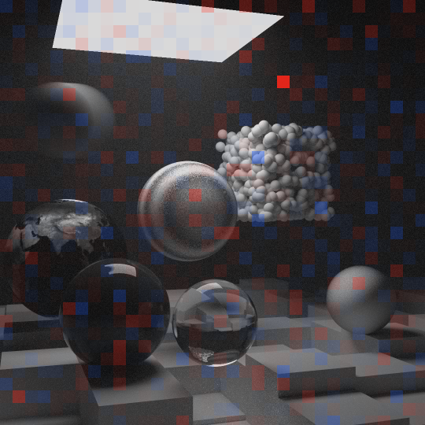
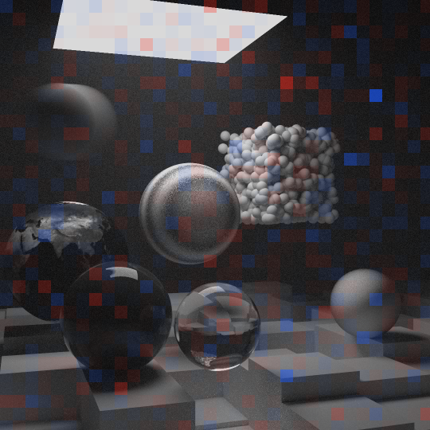

# RayTracing

A Monte Carlo path tracer in modern C++23, and a CUDA renderer for the same scenes that is statistically verified against it and shows them in an interactive window.

The CPU renderer implements the algorithms and scenes of the book series by Peter Shirley, Trevor David Black and Steve Hollasch: ["Ray Tracing in One Weekend"](https://raytracing.github.io/books/RayTracingInOneWeekend.html), ["Ray Tracing: The Next Week"](https://raytracing.github.io/books/RayTracingTheNextWeek.html) and ["Ray Tracing: The Rest of Your Life"](https://raytracing.github.io/books/RayTracingTheRestOfYourLife.html). It renders all 13 of their scenes, and its classes follow the books' C++ code (`hittable`, `material`, `bvh_node`, the shapes, materials and textures), rewritten in C++23 with modules, `import std;`, concepts and `std::variant`.

The rest is the project's own engineering. `RayTracingGPU` builds every scene with the same scene code and renders it on an NVIDIA graphics card with CUDA, [60 to 190 times faster](#performance) than the CPU renderer on the same desktop machine. `ImageCompare`, a statistical test, shows that the GPU renders the books' scenes as the CPU renderer does, up to Monte Carlo noise ([the verification](#verified-against-the-cpu)). `RayTracingViewer` puts the GPU renderer in [a window](#the-window) with a moving camera, and every frame it shows can be rendered again offline, bit for bit. The CPU renderer runs on all cores, rendering is seeded and deterministic on both renderers, renders can be saved as linear PFM images, and five mistakes of the third book are fixed rather than repeated.

|  |  |
|---|---|
| *The second book's final scene, rendered with the third book's light sampling: 1080×1080, 10,000 rays per pixel, 39 minutes.* | *The third book's final scene: a glass sphere in the Cornell box, sampled like a light. This makes the caustic under it (the light the glass focuses onto the floor) less noisy. 1080×1080, 4096 rays per pixel, 8 minutes.* |

*Both rendered by the CPU renderer on all cores, in a Release build.*

## Highlights

- **The three books on the CPU.** All 13 scenes and the books' techniques: moving spheres, quads, instances, smoke and fog, textures, depth of field, a BVH, and importance sampling. A diffuse bounce is sampled in one of [four ways](docs/sampling.md#four-strategies) (`-p`): uniformly, by the material's own density, toward the lamps, or, by default, with a half-and-half mixture of the last two. [Features and code](docs/architecture.md)
- **A CUDA renderer for every scene.** `RayTracingGPU` builds each scene with the CPU renderer's own code and renders it with all four sampling strategies, from one templated source for `float` and `double`. [The CUDA renderer](docs/gpu.md)
- **A window with a moving camera.** `RayTracingViewer` keeps a scene on the GPU in a rendering session and refines its image pass by pass, in rounds of stratified samples, at 90 to 99% of `RayTracingGPU`'s speed. Its input can be scripted and its frames recorded: a recording, replayed without a window, gives the same frames, byte for byte, which is how the window is tested. [The viewer](docs/viewer.md)
- **Statistically verified.** `ImageCompare` tests whether two renders differ by more than Monte Carlo noise. The GPU's renders of the books' scenes were consistent with the CPU's in every comparison, and 64 scenes built to provoke a difference agreed in all but two. [The verification](docs/gpu.md#verification)
- **Robust in `float`.** Seven single-precision pitfalls are handled, six of them measured by comparing renders, from self-intersection on a ground sphere of radius 1000 to hit points on the wrong side of a quad. [What float costs](docs/gpu.md#what-float-costs)
- **Deterministic and measurable.** On each renderer, a seed fixes the image bit for bit, in Debug as in Release. Renders are saved as PNG or as linear PFM, and every run prints its time, the rays it traced and the image's mean radiance. [Options and output](docs/building.md#raytracing-options)
- **Beyond the third book.** Its mistakes are fixed rather than repeated. Translated and rotated instances can be sampled as lights. `MonteCarlo` puts error bars on the book's experiments and adds a test the book doesn't have: whether each light's `pdf_value()` is really the density of the directions its `random()` draws, for quads, spheres, lists and instances. Under the mixture, smoke and fog still sample with their own density, since mixing the lamps in more than doubled the error in the blue fog of the second book's final scene; the price is a little more noise in thin haze. [Sampling](docs/sampling.md)
- **Modern C++.** Objects and materials, open families of long-lived objects, keep the books' virtual functions. Densities of directions, a closed set of short-lived values on the hottest path, use a concept, CTAD and `std::variant` instead and live on the stack, whereas the third book allocates them with `make_shared` at every bounce. The CPU code is built from modules with `import std;` and uses ranges and C++23 views, `std::expected`, deducing this and `std::jthread`; the CUDA device code is C++20 templates constrained by a concept. [Modern C++](docs/architecture.md#modern-c)

**Tech stack:** C++23 with modules and `import std;` (MSVC) · CUDA 13, device code in C++20 · CMake 3.28+ with presets and Ninja · Visual Studio 2026 · [stb](https://github.com/nothings/stb) for PNG and JPEG · [SDL3](https://libsdl.org) for the window (zlib license, downloaded by CMake)

## The window


*Replayed by `RayTracingViewer` from a camera script ([docs/viewer-tour.txt](docs/viewer-tour.txt)), not captured from the screen. While the camera moves, each frame holds the samples the window renders live in a frame of 1/60 s at this size; while it stands still, each frame adds those it renders in the GIF's 80 ms. So the noise of every frame and the pace of the refining are the live window's, on the machine the timings below come from.*

`RayTracingViewer` shows any of the 13 scenes in a window and refines the image while the camera stands still: orbit, look, pan, dolly, fly and zoom with the mouse and the keys, open the lens and double-click to focus, Tab to the next scene. Its waits for the GPU sleep, so the CPU stays nearly idle. Every view it shows can be rendered again by `RayTracingGPU`, bit for bit: P saves the image and prints the command. [The viewer](docs/viewer.md)

```
out\build\x64-release\RayTracingViewer.exe final
```

## Gallery

The 13 scenes, rendered by the CUDA renderer in `float` at each scene's default size, rays per pixel and sampling strategy. They are shown at half size: each pixel here is the average of 2×2 pixels of the render. The scene name is the first argument of each of the three rendering programs, for example `RayTracing cornell`, `RayTracingGPU cornell` or `RayTracingViewer cornell`. The CPU renderer's images of the same scenes are in [Building and running](docs/building.md#scenes).

| | |
|---|---|
|  **materials**: the first book's three materials up close, matte, fuzzy metal and hollow glass, through a wide-open lens |  **weekend**: the first book's cover ([Full HD, rendered on the CPU](docs/weekend.png)) |
|  **bouncing**: the matte spheres bounce, giving motion blur |  **checker**: a solid checker texture |
|  **earth**: an image wrapped around a sphere |  **perlin**: marble made of Perlin noise |
|  **quads**: quadrilaterals |  **cornell**: the Cornell box, with translated and rotated boxes |
|  **smoke**: blocks of smoke |  **final**: the second book's final scene, everything together |
|  **aluminum**: a mirror block; the light it throws onto the ceiling stays noisy |  **glass**: the third book's final scene, a glass sphere sampled like a light |
|  **light**: light sources | |

## Performance

The CPU renderer on all cores against the CUDA renderer, on the same desktop machine. The CPU computes in `double`. The GPU computes in `float` by default, 60 to 190 times faster, or in `double` with `--fp64`, still 1.8 to 8.0 times faster. Rays per pixel are the camera rays, one per path; the rays per second include [every ray traced](docs/building.md#raytracing-options), the camera rays and all their bounces: about 3.6 per path in `materials`.

| Scene | Size, rays per pixel | CPU, `double` | GPU, `float` | GPU, `double` (`--fp64`) |
|---|---|---|---|---|
| `materials` | 1920×1080, 484 | 51 s | **0.27 s, 189 times faster**: 13.4 billion rays per second | 8.7 s, 5.8 times faster |
| `weekend` | 1920×1080, 484 | 87 s | **0.81 s, 107 times faster**: 3.3 billion rays per second | 32 s, 2.7 times faster |
| `bouncing` | 1920×1080, 484 | ~1.6 min | **1.3 s, 74 times faster**: 2.0 billion rays per second | 37 s, 2.6 times faster |
| `checker` | 1920×1080, 484 | ~30 s | **0.25 s, 120 times faster**: 13.5 billion rays per second | 6.4 s, 4.7 times faster |
| `earth` | 1920×1080, 484 | ~6 s | **0.062 s, 97 times faster**: 22.7 billion rays per second | 0.75 s, 8.0 times faster |
| `perlin` | 1920×1080, 484 | ~33 s | **0.34 s, 97 times faster**: 6.7 billion rays per second | 9.3 s, 3.6 times faster |
| `quads` | 1080×1080, 484 | ~9 s | **0.075 s, 119 times faster**: 13.6 billion rays per second | 1.4 s, 6.5 times faster |
| `light` | 1920×1080, 1024 | ~47 s | **0.52 s, 90 times faster**: 6.2 billion rays per second | 9.5 s, 4.9 times faster |
| `cornell` | 1080×1080, 1024 | ~54 s | **0.83 s, 65 times faster**: 3.5 billion rays per second | 20 s, 2.7 times faster |
| `smoke` | 1080×1080, 1024 | ~1.4 min | **0.78 s, 108 times faster**: 4.6 billion rays per second | 30 s, 2.8 times faster |
| `final` | 1080×1080, 1024 | ~4 min | **3.7 s, 66 times faster**: 1.3 billion rays per second | 104 s, 2.3 times faster |
| `aluminum` | 1080×1080, 1024 | ~1 min | **0.91 s, 66 times faster**: 3.5 billion rays per second | 23 s, 2.6 times faster |
| `glass` | 1080×1080, 1024 | ~2 min | **2.0 s, 59 times faster**: 2.7 billion rays per second | 67 s, 1.8 times faster |

*Each scene was rendered at its default size, rays per pixel and sampling strategy (the mixture for the scenes lit by lamps). The times are the render times each program prints, from the scene to the finished image in memory. On the GPU this includes building its BVH and the copies to and from the card; the CPU builds its BVH just before its clock starts. A whole run takes a little longer, to start, build the scene and save the PNG: about 0.3 s more on the GPU, which also starts CUDA, and 0.15 s more on the CPU. The GPU's times are medians of 5 runs (3 in `double`) on a quiet machine, and vary by a few percent from run to run. The CPU's are single runs: measured during the first GPU milestone (`gpu-1`) for `materials` and `weekend`, and taken from [the CPU renderer's render times](docs/building.md#render-times) for the others, rounded as they are there.*

In the window, a still view refines at 90 to 99% of `RayTracingGPU`'s speed, with about 3% of one CPU core, and a moving camera gets a median of 256 rays per pixel in a frame of 1/60 s at 1280×720 in `earth`, down to 3 in `final`, on the same desktop machine ([the viewer's numbers](docs/viewer.md#performance)).

## Verified against the CPU

Both programs build each scene with the same code, so they differ only in how they render. They can't agree pixel for pixel: the GPU computes in `float` and draws different random numbers, so every pixel's noise is different. What they must agree on is each pixel's expected value, the picture both converge to as the rays per pixel grow, and [ImageCompare](docs/image-compare.md) tests exactly that. The control is the CPU against itself: two CPU renders with different seeds differ by noise alone, and a render on the GPU differs from one on the CPU just as much:

| CPU | GPU, `float` |
|---|---|
|  |  |
| **ImageCompare: CPU against CPU with another seed (the noise alone)** | **ImageCompare: CPU against GPU, `float`** |
|  |  |

*`final` at 1080×1080 with 1024 rays per pixel and the mixture, shown at half size. Each map shows the CPU's render in gray, tinted red where the other render is brighter and blue where it is darker, in tiles of 32×32 pixels. A tile turns full color only where it differs by more than noise could explain. The two maps look alike: of the 1156 tiles, 2 in the first map and 3 in the second differ by more than 3 standard errors, where noise alone gives 3.1 on average, and none is in full color.*

| `final`, 1080×1080, 1024 rays per pixel | Mean radiance | Mean of the difference, in standard errors | RMS of the difference | Verdict |
|---|---|---|---|---|
| CPU against CPU with another seed (the noise alone) | 0.442442 and 0.442441 | −0.01 | 0.027938 | consistent |
| CPU against GPU, `float` | 0.442442 and 0.442403 | −1.49 | 0.027972 | consistent |
| CPU with another seed against GPU, `double` | 0.442441 and 0.442437 | −0.16 | 0.028057 | consistent |

The same test covered 22 configurations of the second and third books' 11 scenes: each scene under its default strategy, and the scenes lit by lamps under other strategies too. Every configuration was rendered in `float` and in `double`, and every GPU render was consistent with its CPU render; the first book's two scenes passed 25 such comparisons. Another 64 scenes were built to provoke a difference, from nested checkers and degenerate quads to the camera inside smoke or inside a sphere lamp. All but two agreed, and both differences are explained:

- a close-up of where the checkered ground sphere touches the plane y = 0, from a camera whose offset to the ground's center rounds the same way for all its rays: a limit of `float`, so such views need `--fp64`;
- a matte ball sampled like a light, rendered with `-p lights`: whether a point on the ball's own surface tests inside it comes down to the last bit, which the two renderers round differently, and `-p lights`, biased by design, gives the two cases different answers, so the GPU's image comes out 0.3% brighter, even in `double`. Under the default mixture, which is unbiased, both cases give the same expected image, and the two agree.

[The full account](docs/gpu.md#verification)

## Documentation

| Page | What it holds |
|---|---|
| [The CUDA renderer](docs/gpu.md) | how the GPU renders, the full verification against the CPU, what `float` costs and how each pitfall is handled, the known differences, building and running `RayTracingGPU` |
| [The viewer](docs/viewer.md) | `RayTracingViewer`: its controls, how it renders progressively and paces its frames, its speed, rendering a view again, scripts and recordings, how it is verified |
| [ImageCompare](docs/image-compare.md) | the statistical test: usage, sample output, its four checks, how it was validated and how to use it correctly |
| [Sampling](docs/sampling.md) | the four sampling strategies with pictures and errors, where the mixture can't help and why smoke and fog don't mix the lamps in, the fixes to the third book, the `MonteCarlo` program |
| [Building and running](docs/building.md) | requirements, presets, `RayTracing`'s options and output, render times, the 13 scenes as the CPU renders them |
| [Architecture](docs/architecture.md) | the full feature list, the library and its programs, the modules, the CUDA renderer's files, modern C++ in the project, third-party code and credits |

## Quick start

Requirements: Visual Studio 2026 with the "Desktop development with C++" workload, which brings the MSVC compiler, CMake and Ninja. The GPU programs also need an NVIDIA graphics card and the [CUDA Toolkit](https://developer.nvidia.com/cuda-downloads) 13 (`winget install Nvidia.CUDA`; tested with 13.4). Without the toolkit, CMake builds everything else and says that it skipped the GPU programs. With it, the first configure also downloads SDL3 for the window (offline: [building](docs/building.md#sdl3-for-the-window)).

From a Developer PowerShell for VS, in the project folder:

```
cmake --preset x64-release
cmake --build --preset x64-release
out\build\x64-release\RayTracing.exe cornell -s 100
out\build\x64-release\RayTracingGPU.exe final
out\build\x64-release\RayTracingViewer.exe final
```

In Visual Studio, open the project folder, select the `x64 Release` preset and the `RayTracing.exe` startup item, and press Ctrl+F5: the program renders the `final` scene, its default, and prints the path to the finished image. `MonteCarlo.exe`, `ImageCompare.exe` and, with the CUDA Toolkit, `RayTracingGPU.exe` and `RayTracingViewer.exe` are startup items too.

After installing the CUDA Toolkit, restart Visual Studio (or the terminal) and delete CMake's cache, which remembers that CUDA was missing: **Project → Delete Cache and Reconfigure**, or `cmake --fresh --preset x64-release`. Presets, options and render times are in [Building and running](docs/building.md).

## Project structure

| Path | Contents |
|---|---|
| `src/*.ixx` | 24 C++ modules. Twenty, compiled once into the static library `raytracer`, are the renderer (vectors, shapes, BVH, materials, textures, densities, camera, images, scenes) and the programs' shared command-line helpers; the other four belong to the GPU programs (below) |
| `src/main.cpp` | `RayTracing`: renders a scene on the CPU |
| `src/main_gpu.cpp`, `src/gpu/` | `RayTracingGPU`: renders a scene with the CUDA renderer, whose C++20 headers and two `.cu` files mirror the modules they port |
| `src/gpu_scene.ixx`, `src/view_options.ixx` | shared by the GPU programs: a scene built with the same modules and turned into plain numbers, and the camera's options |
| `src/main_viewer.cpp`, `src/viewer_*.ixx` | `RayTracingViewer`: the window, its camera moves and its scripts |
| `src/image_compare.cpp` | `ImageCompare`: are two renders the same picture up to noise? |
| `src/monte_carlo.cpp` | `MonteCarlo`: the third book's numerical experiments, and a test of the light sampling |
| `external/stb`, `assets` | stb_image and stb_image_write; the Earth texture |
| `cmake/sdl3.cmake` | downloads SDL3 and builds it as a static library, for the window |
| `scripts/make-gif.ps1` | remakes the GIF of the window from its camera script |
| `docs` | these pages, the renders and the GIF |

The module and file tables are in [Architecture](docs/architecture.md#modules).

## Development history

The project was built in 70 incremental steps, one commit each, with a message that records what was done and why. The three books came first, on the CPU. Then came the first book's `materials` scene and the tools that make renders comparable: seeds, PFM files, ray counters and `ImageCompare`. The CUDA port followed: the first book, then the other two a feature at a time, each verified against the CPU. A last round of the second GPU milestone (`gpu-2`) won back the speed the first book's kernel had lost and measured the kernels' occupancy and determinism. The third GPU milestone (`gpu-3`) put the GPU renderer in a window: a session keeps the scene on the GPU and refines the image pass by pass in rounds of strata, and every frame the window shows can be rendered again offline, bit for bit. The milestones are tagged:

| Tag | Milestone |
|---|---|
| `book-1` | "Ray Tracing in One Weekend" on the CPU, with the second book's BVH brought in early |
| `book-2` | "Ray Tracing: The Next Week" on the CPU |
| `book-3` | "Ray Tracing: The Rest of Your Life" on the CPU |
| `gpu-1` | the `materials` scene, the tools that compare renders, and the first book on CUDA, verified against the CPU |
| `gpu-2` | the second and third books on CUDA, each feature verified against the CPU |
| `gpu-3` | an SDL3 window with progressive rendering and camera control |

`git log --reverse` lists the steps in order; `git switch --detach gpu-1` (or any other tag above) checks out a milestone, and `git switch main` comes back.

## Roadmap

- **The GPU:** OptiX, NVIDIA's ray tracing framework, with the RT cores, triangle meshes and a denoiser.
- **CPU performance:** `float` instead of `double`, SIMD, a BVH built with the surface area heuristic, rendering in tiles instead of rows.
- **Multiple importance sampling:** weighting the material's and the lamps' samples by the power heuristic instead of a fixed half-and-half mixture.
- **Materials and lighting:** a glossy material between matte and mirror (the third book's parting advice), and environment lighting from an HDR image.

## Credits and license

The CPU renderer implements the algorithms and scenes of the books by Peter Shirley, Trevor David Black and Steve Hollasch, listed at the top, and its classes follow the books' C++ code; the project's own additions are listed under [Beyond the books](docs/architecture.md#beyond-the-books). The project's code is under the [MIT license](LICENSE). The third-party libraries are [stb_image and stb_image_write](https://github.com/nothings/stb) in `external/stb`, which keep their own license (public domain or MIT, as their files say), and [SDL3](https://libsdl.org) (zlib license), which CMake downloads when it configures. The CUDA renderer's random number generator is PCG32 by Melissa O'Neill ([pcg-random.org](https://www.pcg-random.org)), ported from her minimal C implementation. The Earth map `assets/earthmap.jpg` comes from the [books' repository](https://github.com/RayTracing/raytracing.github.io) and is CC0, like that repository.
