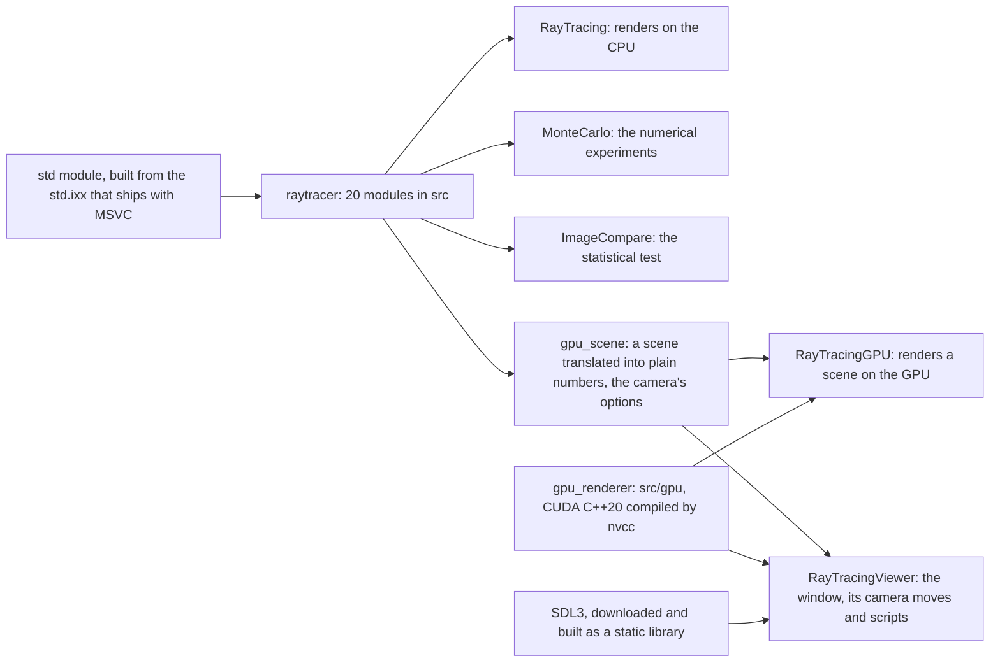

# Architecture

[RayTracing](../README.md) › Architecture

- [Features](#features)
- [Library and programs](#library-and-programs)
- [Modules](#modules)
- [The CUDA renderer's files](#the-cuda-renderers-files)
- [Modern C++](#modern-c)
- [Third-party code and credits](#third-party-code-and-credits)

## Features

### From the books

The CPU renderer implements the techniques of [the three books](#third-party-code-and-credits), in classes that follow the books' C++ code:

- **Shapes:** spheres, which can move while the shutter is open (motion blur: each ray is emitted at a random moment of the exposure); quadrilaterals, and boxes made of them.
- **Instances:** any object can be translated and rotated around the vertical axis without recomputing it.
- **Acceleration:** a BVH, a bounding volume hierarchy, which speeds up rendering of the first book's cover about 8 times.
- **Materials:** matte (Lambertian), metal with blurred reflections, and glass with refraction, total internal reflection, and angle-dependent (Fresnel) reflection by Schlick's approximation. The `materials` scene shows all three up close, the glass one hollow: a smaller sphere inside it is the air.
- **Textures:** checker, an image from a file (JPEG, PNG), and marble made of Perlin noise with turbulence.
- **Light:** emissive materials and a configurable background. Lamps glow on their front side only.
- **Volumes:** smoke and fog, volumes uniformly filled with particles.
- **Camera:** any position, field of view and depth of field; antialiasing (several random rays per pixel) and gamma correction.
- **Stratified pixel samples:** the rays of a pixel form a k×k grid of cells with one random point each. That makes edges and textures less noisy; the noise of the lighting hardly changes.
- **Importance sampling, made explicit:** materials describe how they scatter with a probability density, and every diffuse bounce is weighted by pScatter / p.
- **Cosine-weighted directions,** drawn around the z axis by the inversion method (two random numbers, no rejection loop) and turned to point around the normal with an orthonormal basis.
- **Light sampling:** quads, spheres and lists of them know the density of the directions toward them (`pdf_value()`) and can draw such directions (`random()`).
- **A mixture** of the material's density and the lamps' density, the default. The scenes lit by small lamps get far less noisy for the same number of rays, and most of them render faster too. Mirrors and glass stay a special case that skips the densities: the path continues along the one ray they choose, as in the first two books (a perfect mirror's density would be infinite in one direction and 0 in all others).
- **Monte Carlo integration** from the ground up: the third book's experiments on small problems with known answers, run as a separate program, [`MonteCarlo`](sampling.md#the-montecarlo-program).

### Beyond the books

- **Multithreaded rendering on all cores, deterministic.** Each image row's random numbers come from a generator seeded with the seed and the row's number, so the image doesn't depend on which thread renders the row or when. For a given seed (`--seed`, 0 by default) the result is identical on every run, in Debug and in Release. Renders with different seeds have independent noise around the same expected image, so two of them can be compared statistically: a difference larger than the noise explains is a real one.
- **A command line** for the scene, the quality, the sampling strategy and the seed. Images are saved as PNG or as PFM (32-bit floats that keep the linear values, before gamma correction and clamping), and one render can be saved to several files (`-o out.png -o out.pfm`).
- **Measurements in every run.** The program prints the image's mean radiance (its average brightness in linear light, before clamping). An unbiased sampling strategy changes the noise but leaves this number the same up to that noise, while a biased one, like `-p lights`, moves it. It also counts the rays it traces, the camera rays and all their bounces, and prints how many it traced per sample and per second.
- **`ImageCompare`,** a statistical test of whether two renders are the same picture up to Monte Carlo noise ([ImageCompare](image-compare.md)).
- **Light sampling for instances:** translated or rotated instances can be sampled as lights, like quads, spheres and lists of them.
- **A test of the light sampling:** `MonteCarlo light-pdfs` checks that each light's `pdf_value()` is the density of the directions its `random()` draws, for quads, spheres, lists and instances, since a mismatch would bias the image ([the experiments](sampling.md#the-montecarlo-program)).
- **Error bars for the third book's Monte Carlo experiments,** whose listings print no standard errors: `MonteCarlo` prints every estimate, the halfway point included, next to the exact value, its standard error and its error in standard errors, and compares the RMS error of repeated runs with σ/√N, or with an exact standard error for stratified samples. It also lists the largest x each density draws, a check that catches the book's inverse CDF for the quadratic density, which draws x up to 8 ([an example](sampling.md#the-montecarlo-program)).
- **No heap allocation per bounce:** the book creates its densities with `make_shared` at every bounce; here they are small values on the stack.
- **Smoke and fog sample with their own density** under the default mixture, because mixing the lamps in multiplies the weights along paths that scatter many times ([why, and the price](sampling.md#where-the-mixture-cant-help)).
- **The third book's mistakes, fixed** rather than repeated, each explained in a comment next to the fix ([the list](sampling.md#fixes-to-the-third-book)).
- **The CUDA renderer** ([details](gpu.md)):
  - every scene of the three books on an NVIDIA graphics card, with all four sampling strategies, built by the same scene code and camera as on the CPU, [60 to 190 times faster](../README.md#performance) than the CPU renderer on the same machine, and shown by `ImageCompare` to render the books' scenes as the CPU renderer does, up to Monte Carlo noise;
  - one source for `float` and `double` (`--fp64`): the device code is templates on the number type, constrained by a concept;
  - two kernels from that source: the first book's scenes keep a kernel of their own, as fast as before the second and third books were ported, and on that machine the general kernel renders them 17 to 28% slower;
  - deterministic like the CPU: every sample has its own random numbers, so the image doesn't depend on how the GPU schedules its threads;
  - robust in `float`: self-intersection rules for spheres and quads, a discriminant with fused multiply-adds, a slab test safe for directions with a zero component, camera rays built relative to the camera, the hit point moved onto the sphere for a checker, and quad points computed as on the CPU ([what float costs](gpu.md#what-float-costs)).
- **The viewer** ([details](viewer.md)):
  - `RayTracingViewer` shows any scene in an SDL3 window and refines it while the camera stands still, through a rendering session that keeps the scene on the GPU and adds samples pass by pass;
  - rounds of strata: grid after grid of stratified samples, each with random numbers of its own, so a render can have any number of samples, and `RayTracingGPU --strata K -s N` renders the same ones;
  - camera control with the mouse and the keys (orbit, look, pan, dolly, fly, zoom), the lens and click-to-focus, scene and precision switches, the numbers and the help on screen;
  - every frame it shows can be rendered again, bit for bit: by `RayTracingGPU` from the command P prints, or by the viewer itself without a window from a recording;
  - frames paced to the display while the camera moves and 50 ms of GPU work each while it stands still; waits for the GPU that sleep, so the CPU stays nearly idle;
  - camera scripts and scripted input, which make the window's behavior testable: a recording of a live window driven by scripted events, replayed without a window, gives the same frames.

## Library and programs

Each `.ixx` file in `src/` is a C++20 module (`export module ...`). Twenty of them are compiled once into a static library, `raytracer`, and every program links it. The CUDA renderer is a separate static library, `gpu_renderer`, compiled by `nvcc`, and `gpu_scene` is a library of two modules shared by the GPU programs: `gpu_scene`, which translates a scene for the renderer, and `view_options`, the camera's options. These, `RayTracingGPU` and `RayTracingViewer` are built only when CMake finds the CUDA Toolkit; the viewer also needs SDL3, which CMake downloads ([building](building.md#sdl3-for-the-window)).

| Program | Source | What it does |
|---|---|---|
| `RayTracing` | `main.cpp` | renders a scene on the CPU; the command-line options |
| `RayTracingGPU` | `main_gpu.cpp` | builds a scene with the modules, translates it into plain numbers (`gpu_scene.ixx`), with its instances moved into the world once, and renders it on the GPU |
| `RayTracingViewer` | `main_viewer.cpp` | shows a scene in a window and refines it on the GPU while the camera stands still; the window's events, frames, keys, scripts and recordings |
| `ImageCompare` | `image_compare.cpp` | are two renders the same picture up to noise? |
| `MonteCarlo` | `monte_carlo.cpp` | the third book's numerical experiments, with the renderer's own random numbers, directions and densities, and a test of the light sampling |

## Modules

| Module | Contents |
|---|---|
| `vec3` | vector for points, directions and colors (`point3`, `color`), random vectors and directions, reflection and refraction |
| `ray` | the ray `P(t) = origin + t·direction` and the moment it is emitted |
| `interval` | the range `[min, max]` |
| `random` | random numbers: each thread has its own generator |
| `onb` | orthonormal basis: turns directions drawn around the z axis to point around a normal |
| `pdf` | densities of directions: the `direction_pdf` concept, uniform, cosine and mixture densities |
| `aabb` | axis-aligned box and a fast test of whether a ray hits it |
| `hittable` | hit record, the `hittable` and `material` interfaces, how a material scatters, object list, the density toward objects |
| `sphere` | sphere, possibly moving; can be sampled as a light |
| `quad` | quadrilateral and a box of six such faces; can be sampled as a light |
| `instance` | `translate` and `rotate_y`: a translated or rotated object; can be sampled as a light |
| `constant_medium` | smoke and fog |
| `bvh` | tree of boxes for fast intersection search |
| `texture` | textures: solid color, checker, image, marble |
| `perlin` | Perlin noise and turbulence |
| `material` | `lambertian`, `metal`, `dielectric`, `diffuse_light`, `isotropic` |
| `camera` | camera, background, stratified pixel samples, sampling strategies, multithreaded rendering, the seed, counting the rays traced |
| `image` | in-memory image, loading from a file (JPEG, PNG; PFM), gamma correction, saving as PNG or PFM, the mean radiance |
| `scenes` | all scenes from the three books and the list for choosing one by name |
| `cli` | helpers the programs share for their command lines: parsing numbers, checking output file names before rendering, paths as UTF-8 |

The GPU programs' own modules:

| Module | Contents |
|---|---|
| `gpu_scene` | a scene built with the CPU's modules and translated into the renderer's plain structures; the camera's frame for the GPU |
| `view_options` | the camera's options (`--height`, `--lookfrom`, `--lookat`, `--vfov`, `--defocus-angle`, `--focus-dist`), the checks a view must pass, and the `View:` line that prints a view as options |
| `viewer_camera` | the window's camera moves as pure functions of the camera's settings: orbit, look, pan, dolly, zoom, fly, the lens and the focus, shared by the mouse, the keys and the scripts |
| `viewer_script` | the window's camera scripts, recordings and input files, as text: parsing them and writing them |

## The CUDA renderer's files

The CUDA renderer in `src/gpu` is ordinary C++20 headers and two `.cu` files, compiled by `nvcc`, which can't import modules. Its files mirror the modules they port:

| File | Contents | Ports |
|---|---|---|
| `renderer.h` | the interface between the GPU programs (`gpu_scene.ixx`) and the renderer: the scene as plain numbers in (shapes, materials, textures, volumes, the lights list), the image out; a rendering session | |
| `renderer.cu` | the two kernels and the host code around them: the scene checked and copied to the GPU, the session (views, rounds of strata, launches in passes, the image's bytes for the screen, waits that sleep), timing | `camera::render` |
| `display.cu`, `display.cuh` | the image's bytes for the screen, computed on the GPU as `image::save_png` computes a PNG's (compiled without fused multiply-adds, and apart from the kernels, so it can't change how they compile) | `image` |
| `scene.cuh` | the scene as each of the two kernels sees it | |
| `camera.cuh` | camera rays, the sky, one step of a path, the four sampling strategies | `camera` |
| `material.cuh` | the materials, as a `switch` on plain data | `material`, `onb` |
| `texture.cuh` | solid colors, checkers, images and marble | `texture` |
| `perlin.cuh` | Perlin noise and turbulence on the CPU's own tables | `perlin` |
| `sphere.cuh` | the ray-sphere test, made robust for `float`; a sphere's texture coordinates | `sphere` |
| `quad.cuh` | the ray-quad test | `quad` |
| `constant_medium.cuh` | smoke and fog | `constant_medium` |
| `bvh.cuh` | the BVH over spheres, moving spheres and quads as flat arrays, built on the CPU, walked on the GPU with a loop and a small stack | `bvh`, `aabb` |
| `lights.cuh` | the lights list: the density of a direction toward its quads and spheres, and drawing such directions | `hittable` (`hittable_list`), `quad`, `sphere` |
| `pdf.cuh` | densities of directions | `pdf` |
| `random.cuh` | a PCG32 generator for every sample, random directions without loops | `random`, `vec3` |
| `vec3.cuh` | `vec3` and the math functions in both `float` and `double` | `vec3`, `ray` |

How these pieces render a scene, and why they are built this way: [the CUDA renderer](gpu.md#how-it-renders).

## Modern C++

| Standard | Used for |
|---|---|
| C++23 | `import std;`; `std::expected` for errors; deducing this and a multidimensional `operator[]` (`img[x, y]`); `std::views::cartesian_product` and `std::views::zip`; `std::ranges::fold_left`, `contains`, `iota` and `to`; `std::unreachable`; `std::byteswap` and `std::print` for PFM files |
| C++20 | modules; concepts (`direction_pdf`, `real_number`); ranges with projections and `std::views::split`; designated initializers; `std::jthread` and `std::atomic::wait`/`notify`; `std::bit_cast`; a defaulted `operator==`; a generic lambda with a constrained `auto` parameter |
| C++17 | `std::variant` with `std::visit` and `std::get_if`; `std::optional`; class template argument deduction; `if constexpr` |
| CUDA, C++20 | device code written once as templates on the number type, constrained by a concept; RAII classes for GPU memory and CUDA events |

Where each one is used, and why:

- **Modules and `import std;`** (C++20/23) instead of headers. The `std` module is built from `std.ixx`, which ships with MSVC (see `CMakeLists.txt`). The stb libraries are included in the global module fragment of the `image` module and are not visible outside it. An `import` isn't passed on (only `export import` is): `image` imports `vec3`, but a file that imports `image` still has to import `vec3` to use `color`, so every file imports what it uses.
- **`constexpr` and `inline` in modules.** In a named module, unlike in a header, a function defined inside a class doesn't become `inline` by itself. So every function of the `vec3` module is declared `constexpr` (which implies `inline`) or `inline`; otherwise the compiler couldn't inline `vec3` calls into other modules' code, and a ray tracer makes billions of them (`vec3.ixx`).
- **Static and dynamic polymorphism side by side.** Objects and materials are open families of long-lived objects, so they keep the books' virtual functions. Densities of directions, derived from an abstract base class in the book, are a closed set of short-lived values on the hottest path, so here they do without virtual functions: a **concept** (`direction_pdf`, C++20) instead of a base class, a class template `mixture_pdf` whose template arguments are deduced from the constructor's arguments (**CTAD**, C++17), a generic lambda with a constrained `auto` parameter (C++20), and **`std::variant` with `std::visit`** (C++17) for the density a material returns (`pdf.ixx`, `camera.ixx`).
- **`std::variant` and `std::get_if`** for what a material does with a ray: a diffuse scatter (with a density) or a specular one (with a ready ray), wrapped in `std::optional` for absorption. The viewer's camera scripts are lists of `std::variant`s too, one alternative per command, from lines cut with `std::views::split` (`viewer_script.ixx`).
- **Ranges.** C++20 algorithms with projections: `std::ranges::sort` when building the BVH and in MonteCarlo, `std::ranges::find(scene_list, name, &scene_entry::name)` when choosing a scene. C++23: `std::views::cartesian_product` for the cells of a pixel, `std::views::zip` in MonteCarlo's convergence table, `std::ranges::fold_left` for the image's mean, `std::ranges::contains` in MonteCarlo's command line, `std::ranges::iota` in Perlin noise, `std::ranges::to` to collect a lowercase file extension into a string (`image.ixx`).
- **`std::unreachable`** (C++23) after a `switch` that returns in every case.
- **Multidimensional `operator[]` and deducing this** (C++23): `img[x, y]` with one function for const and non-const (`image.ixx`).
- **`std::expected`** (C++23) for errors, and **`std::optional`** instead of a "`bool` + out parameter" pair; `std::optional` and `value_or` for options the scene sets itself unless they are given.
- **Designated initializers** (C++20) for camera settings: `{.aspect_ratio = 1.0, .vfov = 40}`.
- **`std::jthread` and `std::atomic::wait`/`notify`** (C++20) in the multithreaded renderer (`camera.ixx`).
- **Tables of scenes, sampling strategies and experiments** are `constexpr std::array`s. A scene's entry holds a pointer to the function that builds it, so only the chosen scene gets built; an experiment's entry holds the function that runs it.
- **`std::unique_ptr` with a custom deleter** frees memory allocated by a C library (`image::load`).
- **Delegating constructors:** a stationary sphere is a special case of a moving one, and a color is a special case of a texture.
- **Ref-qualifier `&&`** on a member function: `std::move(list).release_objects()`.
- **Ownership:** objects via `std::unique_ptr` (wrappers nest: `translate(rotate_y(box))`), shared materials and textures via `std::shared_ptr<const ...>`, and a non-owning `const material*` in the hot loop.
- **C++ on the GPU** (CUDA, C++20): device code written once as templates on the number type, constrained by a concept (`real_number`: `float` or `double`), with `if constexpr` for what differs; RAII classes for GPU memory and CUDA events; designated initializers for the plain structures that cross from the CPU to the GPU (`src/gpu`).
- **`std::bit_cast` and `std::byteswap`** (C++20, C++23) for the byte order of a PFM file, and **`std::print` into a stream** (C++23) for its header (`image.ixx`).
- **`dynamic_cast`** asks the CPU's objects what they really are when the GPU programs translate them into plain numbers, walking lists, BVHs and instances (`gpu_scene.ixx`), and when the viewer's click-to-focus looks through smoke (`main_viewer.cpp`). `std::conditional_t` gives each of the GPU's two kernels its own scene type, and a defaulted `operator==` (C++20) compares the lights list's shapes with the world's (`src/gpu`).
- **UTF-8 everywhere:** `/utf-8` for sources and strings, and the `src/utf8.manifest` manifest switches the process to UTF-8 (Windows 10 1903+), so paths with Cyrillic characters work in arguments too.

## Third-party code and credits

The CPU renderer implements the algorithms and scenes of the book series by Peter Shirley, Trevor David Black and Steve Hollasch: ["Ray Tracing in One Weekend"](https://raytracing.github.io/books/RayTracingInOneWeekend.html), ["Ray Tracing: The Next Week"](https://raytracing.github.io/books/RayTracingTheNextWeek.html) and ["Ray Tracing: The Rest of Your Life"](https://raytracing.github.io/books/RayTracingTheRestOfYourLife.html). Its classes follow the books' C++ code; the project's own additions are listed above under [Beyond the books](#beyond-the-books).

The third-party libraries are [stb_image and stb_image_write](https://github.com/nothings/stb) in `external/stb`, which keep their own license (public domain or MIT, as their files say), and [SDL3](https://libsdl.org) (zlib license), which CMake downloads and builds for the viewer's window. The README's GIF of the viewer is made with [gifski](https://gif.ski), run as a separate program by `scripts/make-gif.ps1`. The CUDA renderer's random number generator is PCG32 by Melissa O'Neill ([pcg-random.org](https://www.pcg-random.org)), ported from her minimal C implementation. The Earth map `assets/earthmap.jpg` comes from the [books' repository](https://github.com/RayTracing/raytracing.github.io) and is CC0, like that repository. The project's own code is under the [MIT license](../LICENSE).

Published methods are credited in the comments where the code uses them. Among them, the CUDA renderer uses the SplitMix64 finalizer (Steele, Lea and Flood, 2014) to hash the seed, the pixel and the pass into each sample's generator, the ray-sphere discriminant of Haines et al. (*Ray Tracing Gems*, 2019, chapter 7), Aila and Laine's guard against zero direction components in the slab test, and the orthonormal basis of Duff et al. (JCGT, 2017); `ImageCompare` computes Student's t distribution through the incomplete beta function as in *Numerical Recipes* (section 6.4).
