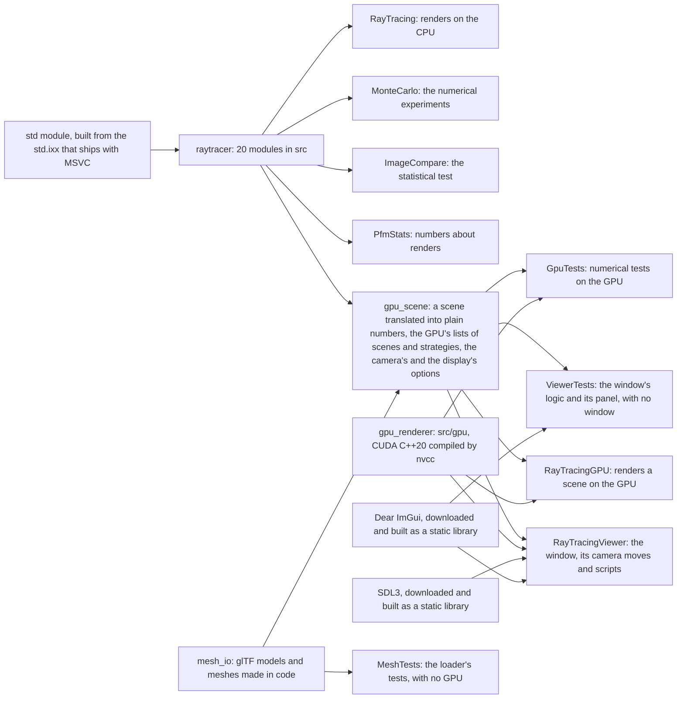

# Architecture

[RayTracing](../README.md) › Architecture

- [Features](#features)
- [Project structure](#project-structure)
- [Library and programs](#library-and-programs)
- [Modules](#modules)
- [The CUDA renderer's files](#the-cuda-renderers-files)
- [Modern C++](#modern-c)
- [Development history](#development-history)
- [Third-party code and credits](#third-party-code-and-credits)

## Features

### From the books

The CPU renderer implements the techniques of [the three books](#third-party-code-and-credits), in classes that follow the books' C++ code:

- **Shapes:** spheres, which can move while the shutter is open (motion blur: each ray is emitted at a random moment of the exposure); quadrilaterals, and boxes made of them.
- **Instances:** any object can be translated and rotated around the vertical axis without recomputing it.
- **Acceleration:** a BVH, a bounding volume hierarchy, which speeds up rendering of the first book's cover about 8 times.
- **Materials:** matte (Lambertian), metal with blurred reflections, and glass with refraction, total internal reflection, and angle-dependent (Fresnel) reflection by Schlick's approximation. The `materials` scene shows all three up close, the glass one hollow: a smaller sphere inside it is the air.
- **Textures:** checker, an image from a file (JPEG, PNG), and marble made of Perlin noise with turbulence.
- **Light:** emissive materials and a configurable background. Lamps glow on their front side only.
- **Volumes:** smoke and fog, volumes uniformly filled with particles.
- **Camera:** any position, field of view and depth of field; antialiasing (several random rays per pixel) and gamma correction.
- **Stratified pixel samples:** the rays of a pixel form a k×k grid of cells with one random point each. That makes edges and textures less noisy; the noise of the lighting hardly changes.
- **Importance sampling, made explicit:** materials describe how they scatter with a probability density, and every diffuse bounce is weighted by pScatter / p.
- **Cosine-weighted directions,** drawn around the z axis by the inversion method (two random numbers, no rejection loop) and turned to point around the normal with an orthonormal basis.
- **Light sampling:** quads, spheres and lists of them know the density of the directions toward them (`pdf_value()`) and can draw such directions (`random()`).
- **A mixture** of the material's density and the lamps' density, the default. The scenes lit by small lamps get far less noisy for the same number of rays, and most of them render faster too. Mirrors and glass stay a special case that skips the densities: the path continues along the one ray they choose, as in the first two books (a perfect mirror's density would be infinite in one direction and 0 in all others).
- **Monte Carlo integration** from the ground up: the third book's experiments on small problems with known answers, run as a separate program, [`MonteCarlo`](sampling.md#the-montecarlo-program).

### Beyond the books

- **Multithreaded rendering on all cores, deterministic.** Each image row's random numbers come from a generator seeded with the seed and the row's number, so the image doesn't depend on which thread renders the row or when. For a given seed (`--seed`, 0 by default) the result is identical on every run, in Debug and in Release. Renders with different seeds have independent noise around the same expected image, so two of them can be compared statistically: a difference larger than the noise explains is a real one.
- **A command line** for the scene, the quality, the sampling strategy and the seed. Images are saved as PNG or as PFM (32-bit floats that keep the linear values, before gamma correction and clamping), and one render can be saved to several files (`-o out.png -o out.pfm`).
- **Measurements in every run.** The program prints the image's mean radiance (its average brightness in linear light, before clamping). An unbiased sampling strategy changes the noise but leaves this number the same up to that noise, while a biased one, like `-p lights`, moves it. It also counts the rays it traces, the camera rays and all their bounces, and prints how many it traced per sample and per second.
- **`ImageCompare`,** a statistical test of whether two renders are the same picture up to Monte Carlo noise ([ImageCompare](image-compare.md)).
- **Light sampling for instances:** translated or rotated instances can be sampled as lights, like quads, spheres and lists of them.
- **A test of the light sampling:** `MonteCarlo light-pdfs` checks that each light's `pdf_value()` is the density of the directions its `random()` draws, for quads, spheres, lists and instances, since a mismatch would bias the image ([the experiments](sampling.md#the-montecarlo-program)).
- **Error bars for the third book's Monte Carlo experiments,** whose listings print no standard errors: `MonteCarlo` prints every estimate, the halfway point included, next to the exact value, its standard error and its error in standard errors, and compares the RMS error of repeated runs with σ/√N, or with an exact standard error for stratified samples. It also lists the largest x each density draws, a check that catches the book's inverse CDF for the quadratic density, which draws x up to 8 ([an example](sampling.md#the-montecarlo-program)).
- **No heap allocation per bounce:** the book creates its densities with `make_shared` at every bounce; here they are small values on the stack.
- **Smoke and fog sample with their own density** under the default mixture, because mixing the lamps in multiplies the weights along paths that scatter many times ([why, and the price](sampling.md#where-the-mixture-cant-help)); under the GPU's `-p nee` and `-p mis` they take light samples of their own ([what that changes](sampling.md#what-next-event-estimation-changes)).
- **The third book's mistakes, fixed** rather than repeated, each explained in a comment next to the fix ([the list](sampling.md#fixes-to-the-third-book)).
- **The CUDA renderer** ([details](gpu.md)):
  - every scene of the three books on an NVIDIA graphics card, with all four sampling strategies, built by the same scene code and camera as on the CPU, [60 to 190 times faster](../README.md#performance) than the CPU renderer on the same machine, and shown by `ImageCompare` to render the books' scenes as the CPU renderer does, up to Monte Carlo noise;
  - one source for `float` and `double` (`--fp64`): the device code is templates on the number type, constrained by a concept;
  - two kernels from that source: the first book's scenes keep a kernel of their own, as fast as before the second and third books were ported, and on that machine the general kernel renders them 17 to 28% slower;
  - deterministic like the CPU: every sample has its own random numbers, so the image doesn't depend on how the GPU schedules its threads;
  - robust in `float`: self-intersection rules for spheres and quads, a discriminant with fused multiply-adds, a slab test safe for directions with a zero component, camera rays built relative to the camera, the hit point moved onto the sphere for a checker, and quad points computed as on the CPU ([what float costs](gpu.md#what-float-costs)).
- **The viewer** ([details](viewer.md)):
  - `RayTracingViewer` shows any scene in an SDL3 window and refines it while the camera stands still, through a rendering session that keeps the scene on the GPU and adds samples pass by pass;
  - rounds of strata: grid after grid of stratified samples, each with random numbers of its own, so a render can have any number of samples, and `RayTracingGPU --strata K -s N` renders the same ones;
  - camera control with the mouse and the keys (orbit, look, pan, dolly, fly, zoom), the lens and click-to-focus, scene and precision switches, the numbers and the help on screen;
  - every frame it shows can be rendered again, bit for bit (with OptiX or the denoiser, on the same graphics driver): by `RayTracingGPU` from the command P prints, or by the viewer itself without a window from a recording;
  - frames paced to the display while the camera moves and 50 ms of GPU work each while it stands still; waits for the GPU that sleep, so the CPU stays nearly idle;
  - camera scripts and scripted input, which make the window's behavior testable: a recording of a live window driven by scripted events, replayed without a window, gives the same frames;
  - actions, the window's settings asked for by name and value, which lead exactly where the keys lead, through the keys' own functions or their twins that take a value;
  - a panel drawn with Dear ImGui, a function of a snapshot of the window that returns actions, so it can be drawn and clicked in a test with no window: scenes and models in a list, `Open...` and files dropped on the window, the settings, greyed controls with their reasons, and renders to a file at another size, in the window's own session, equal to their `RayTracingGPU` commands' bytes ([the panel](viewer.md#the-panel)).
- **Light and materials beyond the books,** in a third CUDA kernel, in `float`, beside the books' two, which stay unchanged, instruction for instruction ([details](quality.md)):
  - next-event estimation, a shadow ray toward a lamp or the environment map at every bounce (`-p nee`), and multiple importance sampling, which weighs that light sample against the material's own sample of the same light by Veach's power heuristic (`-p mis`) ([how](quality.md#next-event-estimation-and-multiple-importance-sampling));
  - shadow rays through smoke and fog: an any-hit search of the same BVH, and the transmittance of the media along the ray in closed form, the expected value of the books' own test of a volume, with no random number drawn; particles of smoke take light samples too ([how](quality.md#shadow-rays-through-smoke-and-fog));
  - rough metals with the GGX microfacet model, sampled among the facets the viewer can see, with Turquin's compensation for the light that leaves after bouncing between facets, which the model alone loses; and glossy coats, a GGX coat over a matte base ([how](quality.md#rough-metals-and-glossy-coats));
  - HDR photographs of the surroundings as the sky, sampled by their brightness with an alias table over cells of exact solid angle, so that a sun of a few texels is found by shadow rays rather than by chance ([how](quality.md#the-environment-map));
  - tone mapping on the GPU, in a kernel of its own that serves every scene: AgX, Khronos PBR Neutral or the plain sRGB curve, with an exposure and a dither, for the PNGs and the window; the books' scenes keep the books' bytes by default, and PFM files stay linear ([how](quality.md#tone-mapping));
  - four scenes of its own, `cornell-ggx`, `veach`, `studio` and `sunlit`, and test scenes: white furnaces, where every pixel must come out exactly 1, or as much light as a material keeps, and `sun-test`, matte spheres in the sun, where `-p nee` and `-p mis` must agree.
- **OptiX, meshes and a denoiser,** around the same integrator ([details](optix.md)):
  - the quality kernel's integrator as an OptiX program: a second `tracer`, its own hierarchy built by OptiX on the GPU, traversed on the ray tracing cores where the GPU has them, with no closest-hit program;
  - the books' spheres and quads as custom primitives, through intersection programs that apply the books' own rules; statistically the quality kernel's images, and the same hits ray by ray;
  - triangle meshes, intersected in hardware on GPUs with ray tracing cores, a hierarchy per mesh under one of instances, rays that leave a triangle moved off it, and an absorber for those that would go through;
  - glTF 2.0 models read with cgltf, glTF's metallic-roughness materials mapped texel by texel on the GGX metal and the glossy coat, their textures read by the texture hardware;
  - OptiX's AI denoiser with albedo and normal guides from a pass of their own, for what you look at only; its error measured against references.
- **A verification toolkit,** committed with the code ([how it was used](quality.md#how-it-was-verified)):
  - `GpuTests` runs numerical tests of the GPU renderer's own device functions on the GPU, with fixed seeds: Pearson's χ² of the samplers' draws against their densities, Monte Carlo means against closed forms, Veach's conditions on the weights, the tables against their definitions, and planted faults that the same checks must reject. `ctest` runs every test kernel on a few samples, and skips them on a computer without an NVIDIA GPU;
  - `MeshTests`, with no GPU, tests the glTF loader and the generated meshes: glTF files built in the test, every limit and refusal;
  - `ViewerTests`, with no window and no GPU, tests the viewer's input files, scripts, camera moves and actions, and clicks through the panel drawn by Dear ImGui's null backend;
  - `PfmStats` gives the numbers about renders that `ImageCompare` doesn't: the noise of one render from two seeds, the RMS rule for two strategies of unequal noise, a patch's mean against a value, how many values are exactly 1, whether two renders are the same bytes, and the error of a denoised image against references;
  - the scripts in `scripts/verify` prove the books' kernels unchanged by their sources and their machine code (disassembled by `cuobjdump`), without rendering them, and the programs' host behavior by small renders and replays of the window ([the gates](gpu.md#the-books-kernels-unchanged)); they also run `ImageCompare`'s protocol for two strategies and compute-sanitizer's memory checks, every GPU run through one queue that logs it.

## Project structure

| Path | Contents |
|---|---|
| `src/*.ixx` | 37 C++ module files (four of them partitions of `gpu_scenes`). Twenty, compiled once into the static library `raytracer`, are the renderer (vectors, shapes, BVH, materials, textures, densities, camera, images, scenes) and the programs' shared command-line helpers; two read models (below); the other fifteen belong to the GPU programs (below) |
| `src/main.cpp` | `RayTracing`: renders a scene on the CPU |
| `src/main_gpu.cpp`, `src/gpu/` | `RayTracingGPU`: renders a scene with the CUDA renderer. Its C++20 headers mirror the modules they port; `renderer.cu` holds the books' two kernels, `quality.cu` the third (its path in `quality_path.cuh`, with the lamps, the shadow rays, the weights, GGX and the environment map in headers of their own), `display.cu` and `tonemap.cu` turn the image into bytes, and `lamp_table.cu` and `environment_table.cu` build the light set's tables on the CPU |
| `src/gpu/optix/` | the OptiX path: its device programs (`programs.cu`, the integrator's ray-generation program, the books' intersection programs, the triangles' surfaces), the host code that starts OptiX and builds its hierarchies, the meshes' tables and the denoiser |
| `src/meshes.ixx`, `src/gltf.ixx` | the library `mesh_io`: meshes made in code and glTF 2.0 models read with cgltf, tested without a GPU by `MeshTests` |
| `src/gpu_scene.ixx`, `src/gpu_scene_parts.ixx`, `src/gpu_scenes*.ixx`, `src/strategy_options.ixx`, `src/view_options.ixx`, `src/tone_options.ixx` | shared by the GPU programs: a scene built with the same modules and turned into plain numbers, the programs' own lists of scenes (the books' 13, the seven beyond them and the test scenes) and of sampling strategies, and the camera's and the display's options |
| `src/main_viewer.cpp`, `src/viewer_*.ixx` | `RayTracingViewer`: the window, its camera moves, its scripts, its actions, and the panel (`viewer_panel.ixx` draws it with Dear ImGui from a snapshot of the window; `viewer_panel_host.ixx` puts it in the window, or `viewer_panel_absent.ixx` in a build without it) |
| `src/image_compare.cpp` | `ImageCompare`: are two renders the same picture up to noise? |
| `src/monte_carlo.cpp` | `MonteCarlo`: the third book's numerical experiments, and a test of the light sampling |
| `tests` | `GpuTests`, numerical tests of the GPU's own functions (densities, samplers, weights, tables, OptiX's hits and the denoiser) run on the GPU with fixed seeds; `MeshTests`, the loader's and the generators' tests, with no GPU; `PfmStats`, statistics of renders; `ViewerTests`, the window's logic and its panel, with no window and no GPU; the window's regression scripts and scripted input |
| `scripts/verify` | the gates that prove the books' kernels unchanged without rendering them, and the protocols that compare renders, each run through a queue that logs its GPU time |
| `external/stb`, `external/cgltf`, `assets` | stb_image and stb_image_write; cgltf; the Earth texture, two HDR environment maps and, in `assets/models`, two glTF models |
| `cmake/sdl3.cmake`, `cmake/imgui.cmake`, `cmake/optix.cmake` | download SDL3 and Dear ImGui and build them as static libraries, for the window and its panel; download NVIDIA's OptiX headers |
| `scripts/make-gif.ps1` | remakes the GIF of the window from its camera script |
| `docs` | these pages, the renders and the GIF |

## Library and programs

Each `.ixx` file in `src/` is a C++20 module (`export module ...`) or a [partition](#modern-c) of one. Twenty of them are compiled once into a static library, `raytracer`, and every program links it. The CUDA renderer is a separate static library, `gpu_renderer`, compiled by `nvcc`, and `gpu_scene` is a library of nine module files shared by the GPU programs: `gpu_scene`, which translates a scene for the renderer; `gpu_scenes` with its four partitions, the programs' own list of scenes; `strategy_options`, their sampling strategies; and `view_options` and `tone_options`, the camera's and the display's options. A third library, `mesh_io`, holds the model loader (`meshes` and `gltf`), with no CUDA, so it and its tests build on any computer. `gpu_renderer` and the libraries above it, `RayTracingGPU`, `RayTracingViewer` and `GpuTests` are built only when CMake finds the CUDA Toolkit; the viewer also needs SDL3, which CMake downloads ([building](building.md#sdl3-for-the-window)), its panel Dear ImGui, downloaded too ([building](building.md#dear-imgui-for-the-panel)), and OptiX comes in as headers, which it downloads too ([building](building.md#optix)).

| Program | Source | What it does |
|---|---|---|
| `RayTracing` | `main.cpp` | renders a scene on the CPU; the command-line options |
| `RayTracingGPU` | `main_gpu.cpp` | builds a scene with the modules, translates it into plain numbers (`gpu_scene.ixx`), with its instances moved into the world once, and renders it on the GPU |
| `RayTracingViewer` | `main_viewer.cpp` | shows a scene in a window and refines it on the GPU while the camera stands still; the window's events, frames, keys, scripts and recordings |
| `ImageCompare` | `image_compare.cpp` | are two renders the same picture up to noise? |
| `MonteCarlo` | `monte_carlo.cpp` | the third book's numerical experiments, with the renderer's own random numbers, directions and densities, and a test of the light sampling |
| `GpuTests` | `tests/gpu_tests.cpp`, `tests/*_tests.cu`, `tests/mesh_gpu_tests.cu` | numerical tests of the GPU renderer's own device functions and OptiX's programs, run on the GPU with fixed seeds |
| `MeshTests` | `tests/mesh_tests.cpp` | the glTF loader and the generated meshes, with no GPU |
| `ViewerTests` | `tests/viewer_tests.cpp`, `tests/panel_tests.cpp` | the viewer's modules, compiled from the viewer's own files: input files, scripts, camera moves, actions, and the panel clicked on Dear ImGui's null backend; no window, no GPU |
| `PfmStats` | `tests/pfm_stats.cpp` | the numbers about renders that `ImageCompare` doesn't give: the noise of one render, the RMS rule, exact values, identical bytes, a denoised image's error |

## Modules

| Module | Contents |
|---|---|
| `vec3` | vector for points, directions and colors (`point3`, `color`), random vectors and directions, reflection and refraction |
| `ray` | the ray `P(t) = origin + t·direction` and the moment it is emitted |
| `interval` | the range `[min, max]` |
| `random` | random numbers: each thread has its own generator |
| `onb` | orthonormal basis: turns directions drawn around the z axis to point around a normal |
| `pdf` | densities of directions: the `direction_pdf` concept, uniform, cosine and mixture densities |
| `aabb` | axis-aligned box and a fast test of whether a ray hits it |
| `hittable` | hit record, the `hittable` and `material` interfaces, how a material scatters, object list, the density toward objects |
| `sphere` | sphere, possibly moving; can be sampled as a light |
| `quad` | quadrilateral and a box of six such faces; can be sampled as a light |
| `instance` | `translate` and `rotate_y`: a translated or rotated object; can be sampled as a light |
| `constant_medium` | smoke and fog |
| `bvh` | tree of boxes for fast intersection search |
| `texture` | textures: solid color, checker, image, marble |
| `perlin` | Perlin noise and turbulence |
| `material` | `lambertian`, `metal`, `dielectric`, `diffuse_light`, `isotropic` |
| `camera` | camera, background, stratified pixel samples, sampling strategies, multithreaded rendering, the seed, counting the rays traced |
| `image` | in-memory image, loading from a file (JPEG, PNG; PFM), gamma correction, saving as PNG or PFM, the mean radiance |
| `scenes` | all scenes from the three books and the list for choosing one by name |
| `cli` | helpers the programs share for their command lines: parsing numbers, checking output file names before rendering, paths as UTF-8 |

The GPU programs' own modules:

| Module | Contents |
|---|---|
| `gpu_scene` | a scene built with the CPU's modules and translated into the renderer's plain structures, with its GGX side entries and its environment map; the camera's frame for the GPU; which kernel renders it, and what that kernel refuses |
| `gpu_scenes` | the GPU programs' list of scenes: the books' 13 in their order, built by the CPU's own code, then the GPU's own, each with its role (the books', beyond the books, a test), its strategy and its display; the white furnace; the help's lists of scenes |
| `gpu_scenes:parts` (`gpu_scene_parts.ixx`) | the list's types: a scene as the CPU's objects and camera, plus what the CPU's classes can't describe (GGX side entries found by their placeholder material's address, an environment map with its turn and scale) |
| `gpu_scenes:materials` (`gpu_scenes_materials.ixx`) | the scenes of rough metals and glossy coats: `ggx-furnace`, `gloss-furnace`, `cornell-ggx`, `veach` |
| `gpu_scenes:environments` (`gpu_scenes_environments.ixx`) | the scenes lit by an environment map: `env-furnace`, `studio`, `sunlit`, `sun-test` |
| `gpu_scenes:meshes` (`gpu_scenes_meshes.ixx`) | the scenes with triangle meshes: the three showcases and the test scenes of triangles, instances and glTF materials |
| `strategy_options` | the GPU programs' sampling strategies (`-p`): the books' four, named and described as in `RayTracing`'s list, then `nee` and `mis`; the choice of kernel (`--all-books-kernel`, `--quality-kernel`) |
| `tone_options` | `--tonemap` and `--exposure`: the tone maps' names for the options, the window's keys and the scripts, and what a scene shows (what the options choose, the scene's own display for the rest) |
| `view_options` | the camera's options (`--height`, `--lookfrom`, `--lookat`, `--vfov`, `--defocus-angle`, `--focus-dist`), the checks a view must pass, and the `View:` line that prints a view as options |
| `viewer_camera` | the window's camera moves as pure functions of the camera's settings: orbit, look, pan, dolly, zoom, fly, the lens and the focus, shared by the mouse, the keys and the scripts |
| `viewer_script` | the window's camera scripts, recordings and input files, as text: parsing them and writing them |
| `viewer_actions` | the window's actions by name and value (`scene cornell`, `exposure 0.5`, `render 1920 1080 1024`) as types, read and written as one line each, and `panel_state`, the snapshot of the window the panel is drawn from; no SDL, no GPU |
| `viewer_panel` | the panel, drawn with Dear ImGui from a `panel_state`, returning what was asked for as actions; it knows nothing of SDL, so `ViewerTests` draws and clicks it |
| `viewer_panel_host` (`viewer_panel_host.ixx`, or `viewer_panel_absent.ixx` in a build without Dear ImGui) | the panel in the window: SDL's events given to Dear ImGui by hand, the display's scale, the drawing through SDL's renderer, and a device reset |

The library `mesh_io`'s two modules:

| Module | Contents |
|---|---|
| `meshes` | the model as the renderer takes it (meshes, placements, glTF's materials, images), the limits a model's file is held to, and generated meshes: an icosphere, a torus, quads as triangles, a mesh baked into the world |
| `gltf` | `load_gltf`: a `.glb` or a `.gltf` read through cgltf and a private copy of stb_image, every size checked before anything is allocated |

## The CUDA renderer's files

The CUDA renderer in `src/gpu` is ordinary C++20 headers and eight `.cu` files, compiled by `nvcc`, which can't import modules. The books' files mirror the modules they port. The files beyond the books, the third kernel's and the tone maps' from `quality.cu` down, have nothing on the CPU to port, and they stay apart from the books' kernels: `renderer.cu` includes none of their device code, and each of the new `.cu` files is a translation unit of its own, so `nvcc` compiles the books' kernels as before.

| File | Contents | Ports |
|---|---|---|
| `renderer.h` | the interface between the GPU programs (`gpu_scene.ixx`) and the renderer: the scene as plain numbers in (shapes, materials, textures, volumes, the lights list, and for the third kernel GGX side entries, an environment map and how light samples are weighed), the image out; a rendering session; the display transforms | |
| `renderer.cu` | the books' two kernels and the host code around them: the scene checked and copied to the GPU, the choice of kernel, the session (views, rounds of strata, launches in passes, the image's bytes for the screen, waits that sleep), timing | `camera::render` |
| `device_memory.h` | CUDA's errors as exceptions, and an array in the GPU's memory that owns it: host code, shared by `renderer.cu`, `quality.cu` and `GpuTests` | |
| `display.cu`, `display.cuh` | the image's bytes for the screen, computed on the GPU as `image::save_png` computes a PNG's (compiled without fused multiply-adds, and apart from the kernels, so it can't change how they compile) | `image` |
| `scene.cuh` | the scene as each of the two kernels sees it | |
| `camera.cuh` | camera rays, the sky, one step of a path, the four sampling strategies | `camera` |
| `material.cuh` | the materials, as a `switch` on plain data | `material`, `onb` |
| `texture.cuh` | solid colors, checkers, images and marble | `texture` |
| `perlin.cuh` | Perlin noise and turbulence on the CPU's own tables | `perlin` |
| `sphere.cuh` | the ray-sphere test, made robust for `float`; a sphere's texture coordinates | `sphere` |
| `quad.cuh` | the ray-quad test | `quad` |
| `constant_medium.cuh` | smoke and fog | `constant_medium` |
| `bvh.cuh` | the BVH over spheres, moving spheres and quads as flat arrays, built on the CPU, walked on the GPU with a loop and a small stack | `bvh`, `aabb` |
| `lights.cuh` | the lights list: the density of a direction toward its quads and spheres, and drawing such directions | `hittable` (`hittable_list`), `quad`, `sphere` |
| `pdf.cuh` | densities of directions | `pdf` |
| `random.cuh` | a PCG32 generator for every sample, random directions without loops | `random`, `vec3` |
| `vec3.cuh` | `vec3` and the math functions in both `float` and `double` | `vec3`, `ray` |
| `quality.cu`, `quality.cuh` | the third kernel, the quality kernel, with the host code that uploads its own arrays and launches it; `renderer.cu` sees only `quality.cuh`'s host functions and an opaque handle | |
| `quality_view.cuh` | the scene as the quality kernel sees it: the books' tables, read as the kernel for all three books reads them, and its own beside them | |
| `quality_path.cuh` | its integrator: a path as the books trace it, plus a light sample at every vertex with a density, a running sum of the light found, and the density each ray was drawn with | |
| `tracer.cuh` | how the integrator finds what a ray meets: the `tracer` concept and the BVH's tracer, so that the shading code never names the BVH | |
| `shadow.cuh` | the shadow ray: an any-hit search of the BVH up to the light, and the transmittance of the smoke and fog along it | |
| `bsdf.cuh` | the materials as one interface: draw a direction with its density and weight, evaluate f·cos θ and the density of a direction drawn otherwise, or say there is no density (a mirror, glass) | |
| `ggx.cuh` | the GGX microfacet model of rough metals and glossy coats, as pure functions: the lobe, its sampling by visible normals with spherical caps, the energy compensation | |
| `ggx_energy.cuh` | a 32×32 table of the light a white GGX metal keeps after one bounce off its facets, by roughness and angle, written by `GpuTests ggx-energy --write` | |
| `lamps.cuh`, `lamp_table.cu` | the lamps the quality kernel samples, the world's glowing quads and spheres that stand still: a direction toward each with its density; the set built on the host | |
| `light_sampler.cuh` | the lamps and the environment map as one set of lights, one picked uniformly per light sample | |
| `mis.cuh` | the weights of multiple importance sampling: Veach's power heuristic, and those of `-p nee` | |
| `environment.cuh` | the environment map: from a direction to its texel and back, and its radiance | |
| `environment_data.h`, `environment_table.cu` | the map's tables, built on the host in `double`: cells of exact solid angle, each texel's density, the alias table | |
| `background.cuh` | what a ray that hits nothing sees, the camera's sky or the map (its nearest texel, or four blended for camera rays and rays off mirrors and glass), and the map as a light | |
| `lamps_on_device.cuh`, `microfacets_on_device.cuh`, `environment_on_device.cuh` | the quality kernel's own arrays on the GPU, a class for each part | |
| `tonemap.cu`, `tonemap.cuh` | the image's bytes through a tone map, a kernel of its own compiled without fused multiply-adds, and `renderer.cu`'s view of it | |
| `tone_curves.cuh` | the tone curves (the sRGB curve, AgX, PBR Neutral), the rounding to bytes and its dither | |
| `guides.cuh`, `guides.cu` | the albedo and normal guides of the denoiser, one template over either tracer, and the CUDA kernel of the BVH's | |
| `denoise.cu` | the image to denoise, as floats, and the denoised floats widened for the display kernels | |
| `quality_access.cuh` | the one accessor of the quality kernel's view that OptiX's programs read it through | |

The files of the OptiX path, in `src/gpu/optix`. Every call of OptiX's host API is in the three that `cl.exe` compiles:

| File | Contents |
|---|---|
| `programs.cu` | the device programs, one module: it includes the ray-generation programs and the intersection programs below |
| `optix_tracer.cuh` | the `tracer` the integrator uses under OptiX: `optixTraverse`, its hit object, the media's loop, the through-rule |
| `raygen_render.cuh`, `raygen_guides.cuh`, `raygen_pick.cuh` | the ray-generation programs: the integrator's loop, the denoiser's guides, the window's double-click on a triangle |
| `intersections.cuh` | the books' spheres and quads as intersection programs, with the books' own tests |
| `triangles.cuh`, `mesh_tables.h` | a hit on a triangle: its point, normals, texture coordinates and glTF material; the origin's offset; the tables they read |
| `optix_params.h` | the launch's parameters, shared by the host and the programs |
| `runtime.cpp`, `runtime_core.h`, `core.h` | OptiX's context, module and pipeline, in plain types, and what to say when OptiX can't run |
| `accel.cpp` | builds the acceleration structures: the books' custom primitives, a triangle structure per mesh, the instances |
| `denoiser.cpp` | the AI denoiser, its tiles and its memory plan |
| `scene.cu` | the runtime the programs hold, a scene in OptiX's acceleration structures, and its launches: compiled by `nvcc` because it fills the device structures |
| `meshes.cu`, `mesh_scene.cuh` | the meshes on the GPU: uploads, texture objects and scratch slots, the memory plan, every material and texture checked before anything is allocated |
| `embedded.h`, `absent.cpp` | the embedded module; what the programs say in a build without OptiX |

How these pieces render a scene, and why they are built this way: [the CUDA renderer](gpu.md#how-it-renders), for the third kernel's, [light and materials](quality.md), and for OptiX's, [OptiX, meshes and the denoiser](optix.md).

## Modern C++

| Standard | Used for |
|---|---|
| C++23 | `import std;`; `std::expected` for errors; deducing this and a multidimensional `operator[]` (`img[x, y]`); `std::views::cartesian_product` and `std::views::zip`; `std::ranges::fold_left`, `contains`, `iota` and `to`; `std::unreachable`; `std::byteswap` and `std::print` for PFM files |
| C++20 | modules and module partitions; concepts (`direction_pdf`, `real_number`); ranges with projections and `std::views::split`; designated initializers; `std::jthread` and `std::atomic::wait`/`notify`; `std::bit_cast`; a defaulted `operator==`; a generic lambda with a constrained `auto` parameter; `consteval` |
| C++17 | `std::variant` with `std::visit` and `std::get_if`; `std::optional`; class template argument deduction; `if constexpr` |
| CUDA, C++20 | device code written once as templates on the number type, constrained by a concept; the third kernel's integrator as a template on a `tracer` concept; RAII classes for GPU memory and CUDA events |

Where each one is used, and why:

- **Modules and `import std;`** (C++20/23) instead of headers. The `std` module is built from `std.ixx`, which ships with MSVC (see `CMakeLists.txt`). The stb libraries are included in the global module fragment of the `image` module and are not visible outside it. An `import` isn't passed on (only `export import` is): `image` imports `vec3`, but a file that imports `image` still has to import `vec3` to use `color`, so every file imports what it uses.
- **Module partitions** (C++20): parts of one module, each in a file of its own. The GPU programs' list of scenes, the module `gpu_scenes`, has three: `gpu_scenes:parts` holds the list's types, `gpu_scenes:materials` the scenes of rough metals and glossy coats, and `gpu_scenes:environments` those lit by an environment map, so each kind of scene beyond the books was written in a file of its own, and adding one edits no other. The primary interface, `gpu_scenes.ixx`, holds the list and re-exports the partitions (`export import :materials;`), as the standard requires of an interface partition. The two partitions of scenes export nothing themselves: their scenes' functions have module linkage, visible to the module's other units, where the list takes their addresses, and to no file that imports the module. An internal partition (`module gpu_scenes:materials;`, without `export`) would say so in its first line, but MSVC compiles a `.ixx` file only as an interface. Each partition keeps its helpers in an unnamed namespace, so two of them can have helpers of the same name.
- **`constexpr` and `inline` in modules.** In a named module, unlike in a header, a function defined inside a class doesn't become `inline` by itself. So every function of the `vec3` module is declared `constexpr` (which implies `inline`) or `inline`; otherwise the compiler couldn't inline `vec3` calls into other modules' code, and a ray tracer makes billions of them (`vec3.ixx`).
- **Static and dynamic polymorphism side by side.** Objects and materials are open families of long-lived objects, so they keep the books' virtual functions. Densities of directions, derived from an abstract base class in the book, are a closed set of short-lived values on the hottest path, so here they do without virtual functions: a **concept** (`direction_pdf`, C++20) instead of a base class, a class template `mixture_pdf` whose template arguments are deduced from the constructor's arguments (**CTAD**, C++17), a generic lambda with a constrained `auto` parameter (C++20), and **`std::variant` with `std::visit`** (C++17) for the density a material returns (`pdf.ixx`, `camera.ixx`).
- **`std::variant` and `std::get_if`** for what a material does with a ray: a diffuse scatter (with a density) or a specular one (with a ready ray), wrapped in `std::optional` for absorption. The viewer's camera scripts are lists of `std::variant`s too, one alternative per command, from lines cut with `std::views::split` (`viewer_script.ixx`).
- **Ranges.** C++20 algorithms with projections: `std::ranges::sort` when building the BVH and in MonteCarlo, `std::ranges::find(scene_list, name, &scene_entry::name)` when choosing a scene. C++23: `std::views::cartesian_product` for the cells of a pixel, `std::views::zip` in MonteCarlo's convergence table, `std::ranges::fold_left` for the image's mean, `std::ranges::contains` in MonteCarlo's command line, `std::ranges::iota` in Perlin noise, `std::ranges::to` to collect a lowercase file extension into a string (`image.ixx`).
- **`std::unreachable`** (C++23) after a `switch` that returns in every case.
- **Multidimensional `operator[]` and deducing this** (C++23): `img[x, y]` with one function for const and non-const (`image.ixx`).
- **`std::expected`** (C++23) for errors, and **`std::optional`** instead of a "`bool` + out parameter" pair; `std::optional` and `value_or` for options the scene sets itself unless they are given.
- **Designated initializers** (C++20) for camera settings: `{.aspect_ratio = 1.0, .vfov = 40}`.
- **`std::jthread` and `std::atomic::wait`/`notify`** (C++20) in the multithreaded renderer (`camera.ixx`).
- **Tables of scenes, sampling strategies and experiments** are `constexpr std::array`s. A scene's entry holds a pointer to the function that builds it, so only the chosen scene gets built; an experiment's entry holds the function that runs it. The GPU programs' tables are made by **`consteval`** functions (C++20), which run only at compile time: their strategies take the books' four names and descriptions from the CPU's table, where a missing one is a compile error, so their help prints `RayTracing`'s lines exactly (`strategy_options.ixx`); their list of scenes begins with a function template's instantiations, one per index of the CPU's list (`std::index_sequence`), each a function of its own whose address the list holds beside the GPU's own scenes' (`gpu_scenes.ixx`).
- **`std::unique_ptr` with a custom deleter** frees memory allocated by a C library (`image::load`).
- **Delegating constructors:** a stationary sphere is a special case of a moving one, and a color is a special case of a texture.
- **Ref-qualifier `&&`** on a member function: `std::move(list).release_objects()`.
- **Ownership:** objects via `std::unique_ptr` (wrappers nest: `translate(rotate_y(box))`), shared materials and textures via `std::shared_ptr<const ...>`, and a non-owning `const material*` in the hot loop.
- **C++ on the GPU** (CUDA, C++20): device code written once as templates on the number type, constrained by a concept (`real_number`: `float` or `double`), with `if constexpr` for what differs; RAII classes for GPU memory and CUDA events; designated initializers for the plain structures that cross from the CPU to the GPU (`src/gpu`). The third kernel's integrator is a template on the way it finds what a ray meets, constrained by a concept, `tracer` (the closest hit, the surface at it, and how much of a light gets through to a point), so the shading code never names the BVH and another tracer can take its place (`tracer.cuh`, `quality_path.cuh`).
- **`std::bit_cast` and `std::byteswap`** (C++20, C++23) for the byte order of a PFM file, and **`std::print` into a stream** (C++23) for its header (`image.ixx`).
- **`dynamic_cast`** asks the CPU's objects what they really are when the GPU programs translate them into plain numbers, walking lists, BVHs and instances (`gpu_scene.ixx`), and when the viewer's click-to-focus looks through smoke (`main_viewer.cpp`). `std::conditional_t` gives each of the GPU's two kernels its own scene type, and a defaulted `operator==` (C++20) compares the lights list's shapes with the world's (`src/gpu`).
- **UTF-8 everywhere:** `/utf-8` for sources and strings, and the `src/utf8.manifest` manifest switches the process to UTF-8 (Windows 10 1903+), so paths with Cyrillic characters work in arguments too.

## Development history

The project was built in 107 incremental steps, one commit each, with a message that records what was done and why. The three books came first, on the CPU. Then came the first book's `materials` scene and the tools that make renders comparable: seeds, PFM files, ray counters and `ImageCompare`. The CUDA port followed: the first book, then the other two a feature at a time, each verified against the CPU. A last round of the second GPU milestone (`gpu-2`) won back the speed the first book's kernel had lost and measured the kernels' occupancy and determinism.

The third GPU milestone (`gpu-3`) put the GPU renderer in a window: a session keeps the scene on the GPU and refines the image pass by pass in rounds of strata, and every frame the window shows can be rendered again offline, bit for bit. The fourth (`gpu-4`) went past the books in a third kernel, a feature at a time, each checked by numerical tests on the GPU and by `ImageCompare` against the strategies it improves on. It began with the tools that let the books' kernels stay as they are: a gate on their source and a comparison of their compiled machine code with the previous milestone's, which show them unchanged without rendering them, and small renders and replays of the window for the programs around them.

The fifth (`gpu-5`) put that kernel's integrator on OptiX as a second tracer, unchanged, first the books' shapes, checked ray by ray against the BVH, then triangles and glTF materials, each held to the quads and the scene materials they replace by `ImageCompare`, and the denoiser; every earlier kernel stayed the same, instruction for instruction. The sixth (`gpu-6`) gave the window a panel without touching the renderer: first actions, the window's settings asked for by name and value and shown to lead exactly where the keys lead, then the panel that asks for them, models opened and dropped, and renders to a file held to the bytes of their `RayTracingGPU` commands.

The milestones are tagged ([the list](../README.md#development-history)): `git log --reverse` lists the steps in order; `git switch --detach gpu-1` (or any other tag) checks out a milestone, and `git switch main` comes back.

## Third-party code and credits

The CPU renderer implements the algorithms and scenes of the book series by Peter Shirley, Trevor David Black and Steve Hollasch: ["Ray Tracing in One Weekend"](https://raytracing.github.io/books/RayTracingInOneWeekend.html), ["Ray Tracing: The Next Week"](https://raytracing.github.io/books/RayTracingTheNextWeek.html) and ["Ray Tracing: The Rest of Your Life"](https://raytracing.github.io/books/RayTracingTheRestOfYourLife.html). Its classes follow the books' C++ code; the project's own additions are listed above under [Beyond the books](#beyond-the-books).

The third-party libraries are [stb_image and stb_image_write](https://github.com/nothings/stb) in `external/stb`, which keep their own license (public domain or MIT, as their files say), [cgltf](https://github.com/jkuhlmann/cgltf) v1.15 in `external/cgltf`, as published (MIT license), [SDL3](https://libsdl.org) (zlib license), which CMake downloads and builds for the viewer's window, and [Dear ImGui](https://github.com/ocornut/imgui) 1.93.0 (MIT license), which CMake downloads and builds for the window's panel. [NVIDIA's OptiX 9.0 headers](https://github.com/NVIDIA/optix-dev) come under NVIDIA's licenses, eight of them proprietary and six BSD-3; CMake downloads them, and they aren't in the repository, and the programs use the OptiX runtime in NVIDIA's driver. The README's GIF of the viewer is made with [gifski](https://gif.ski), run as a separate program by `scripts/make-gif.ps1`. The CUDA renderer's random number generator is PCG32 by Melissa O'Neill ([pcg-random.org](https://www.pcg-random.org)), ported from her minimal C implementation (Apache License 2.0; its notice is in [THIRD_PARTY_NOTICES.md](../THIRD_PARTY_NOTICES.md)). The Earth map `assets/earthmap.jpg` comes from the [books' repository](https://github.com/RayTracing/raytracing.github.io) and is CC0, like that repository. The two HDR environment maps in `assets`, `studio_small_09_1k.hdr` (a photographer's studio lit by softboxes) and `kloofendal_48d_partly_cloudy_puresky_1k.hdr` (a partly cloudy sky with the sun 48° up), are [Poly Haven](https://polyhaven.com)'s, CC0, committed as published so that the programs and the tests need no download. So are the two models in `assets/models`, each the 1k glTF package with every texture it names, by the SHA-256 of its first file: `marble_bust_01` (`marble_bust_01_1k.gltf`, `B6F192FC01BE4349…`) and `brass_vase_01` (`brass_vase_01_1k.gltf`, `BECF6D52678C63D7…`); `MeshTests` pins every file's SHA-256. The AgX tone map follows Troy Sobotka's [AgX](https://github.com/sobotka/AgX): its matrices and structure come from iolite's Minimal AgX by Benjamin Wrensch (© 2024 Missing Deadlines), and the closed form of its curve from [linlin's AgX](https://github.com/bWFuanVzYWth/AgX) (© 2024 linlin), both under the MIT license, whose notice `src/gpu/tone_curves.cuh` carries. Khronos PBR Neutral is written from the equations of [Khronos's description](https://github.com/KhronosGroup/ToneMapping). The project's own code is under the [MIT license](../LICENSE).

Published methods are credited in the comments where the code uses them. Among them, the CUDA renderer uses the SplitMix64 finalizer (Steele, Lea and Flood, 2014) to hash the seed, the pixel and the pass into each sample's generator, the ray-sphere discriminant of Haines et al. (*Ray Tracing Gems*, 2019, chapter 7), Aila and Laine's guard against zero direction components in the slab test, and the orthonormal basis of Duff et al. (JCGT, 2017); `ImageCompare` computes Student's t distribution through the incomplete beta function as in *Numerical Recipes* (section 6.4). The third kernel is written from Veach's thesis (1997, chapter 9) for multiple importance sampling and the power heuristic; Walter et al. (2007) for the GGX microfacet model, with Heitz's height-correlated masking and shadowing (2014) and sampling of visible normals (2018), drawn by the spherical caps of Dupuy and Benyoub (2023); Schlick (1994) for the facets' reflectance and Burley (2012) for the roughness scale α = r²; Turquin (2019) for the energy compensation; Ashikhmin and Shirley (2000) for the coupled diffuse term under a glossy coat; Vose (1991) for the alias table; and Jimenez (2014) for the interleaved gradient noise of the tone maps' dither. Its code is re-derived from the papers' equations, with ideas but no code from pbrt-v4. The colors of gold, silver, copper and aluminum are the measured base colors of the Unreal Engine's documentation (Physically Based Materials), taken as linear colors. glTF's materials follow the mapping in the glTF 2.0 specification, appendix B, and the denoiser's guides follow Open Image Denoise's rule for what an albedo is at a coat and at a mirror.
