# Building and running

[RayTracing](../README.md) › Building and running

- [Requirements](#requirements)
- [SDL3 for the window](#sdl3-for-the-window)
- [Building](#building)
- [RayTracing options](#raytracing-options)
- [Render times](#render-times)
- [Scenes](#scenes)
- [Scenes beyond the books](#scenes-beyond-the-books)
- [The other programs](#the-other-programs)
- [Tests](#tests)
- [The verification scripts](#the-verification-scripts)

## Requirements

Visual Studio 2026 with the "Desktop development with C++" workload, which brings the MSVC compiler, CMake and Ninja. `RayTracingGPU`, `RayTracingViewer` and `GpuTests` also need an NVIDIA graphics card and the CUDA Toolkit 13; see [the CUDA renderer](gpu.md#building-and-running). `RayTracingViewer` also needs SDL3, which CMake downloads. The two HDR photographs that light the scenes beyond the books are in the repository ([the environment maps](#the-environment-maps)).

## SDL3 for the window

`RayTracingViewer` draws its window with [SDL 3.4.18](https://github.com/libsdl-org/SDL/releases/tag/release-3.4.18) (zlib license). The first configure downloads SDL's release archive (about 15 MiB) into `out/downloads`, where every preset's build finds it, checks its SHA-256, and builds SDL as a static library, so the program needs no DLL. SDL is downloaded and built only when the CUDA Toolkit is found, as the window has nothing to show without it.

The download never stops the configure: if it fails, or gets the wrong bytes, CMake warns that it skipped the window and builds everything else. Without a network, get `SDL3-3.4.18.tar.gz` from SDL's release page by hand and point CMake at it, or at an unpacked SDL source folder, or turn the window off:

```
cmake --preset x64-release -DRAYTRACING_SDL3_URL=file:///C:/Downloads/SDL3-3.4.18.tar.gz
cmake --preset x64-release -DFETCHCONTENT_SOURCE_DIR_SDL3=C:/src/SDL3-3.4.18
cmake --preset x64-release -DRAYTRACING_VIEWER=OFF
```

## Building

**In Visual Studio:** open the project folder, select the `x64 Release` preset and the `RayTracing.exe` startup item, and press Ctrl+F5. The program renders the `final` scene, its default, and prints the path to the finished image. The `MonteCarlo.exe` startup item runs the Monte Carlo experiments, `ImageCompare.exe` compares two renders, and `PfmStats.exe` measures them ([tests](#tests)). `RayTracingGPU.exe`, `RayTracingViewer.exe` and `GpuTests.exe` are there if the CUDA Toolkit is installed.

To pass options when launching from Visual Studio, open **Debug → Debug and Launch Settings for RayTracing** and add `"args": ["cornell", "-s", "100"]` to the configuration.

**From the command line** (Developer PowerShell for VS):

```
cmake --preset x64-release
cmake --build --preset x64-release
out\build\x64-release\RayTracing.exe cornell -s 100
out\build\x64-release\MonteCarlo.exe
```

| Preset | Purpose |
|---|---|
| `x64 Debug` | step-by-step debugging; rendering is about 10 times slower |
| `x64 RelWithDebInfo` | optimizations plus debug information: profiling and debugging fast code |
| `x64 Release` | final rendering |

The program looks for the Earth texture in the `assets` folder, in the current folder and up the tree, so run it from the project root or from Visual Studio. If the texture isn't found, the Earth will be cyan, and the program will warn about it. The GPU programs find the environment maps the same way, but a map that isn't found stops the render with an error: a scene lit by its map would have no light without it.

## RayTracing options

```
RayTracing [scene] [options]
  scene                materials, weekend, bouncing, checker, earth, perlin, quads, light,
                       cornell, smoke, final, aluminum or glass (default final)
  -w, --width N        image width in pixels; the height follows the scene's aspect ratio
  -s, --samples N      rays per pixel, rounded to the nearest square k²: the rays form
                       a k×k grid in the pixel
  -p, --sampling NAME  how a diffuse bounce chooses the next direction: uniform, material,
                       lights or mixture (default)
      --seed N         which random numbers to draw, from 0 (default) to 4294967295
  -o, --output FILE    where to save the image, a .png or a .pfm (default <scene>.png);
                       give it several times to save several files
  -h, --help           help, the lists of scenes and sampling strategies
```

The same seed always gives the same image, bit for bit; another seed renders the same scene with independent noise. A `.pfm` (Portable Float Map) keeps the linear values as 32-bit floats, before gamma correction and clamping. So it can tell a lamp of brightness 15 from plain white, and a difference of 0.1% from none, which a PNG can't. HDR viewers such as [tev](https://github.com/Tom94/tev) open it.

After the render the program prints its time, the rays it traced and the image's mean radiance. For example, for `RayTracing materials`:

```
Render time: 51.4 s
Rays traced: 3631.4 million (3.62 per sample), 70.6 million per second
Mean radiance (linear, before clamping): 0.266692
```

A ray traced is one search of the scene for the nearest hit: the camera ray or a bounce. Per sample, that is the average length of a path; per second, the renderer's speed. The mean radiance is the image's average brightness in linear light, before clamping. An unbiased sampling strategy changes the noise but leaves this number the same up to that noise, while a biased one, like `-p lights`, moves it.

## Render times

Each scene has its own default size and number of rays. These are the CPU renderer's times in Release, on all cores of the same desktop machine as [the performance table](../README.md#performance):

| Scene | Size | Rays per pixel | Time |
|---|---|---|---|
| `materials` | 1920×1080 | 484 | ~50 s |
| `weekend` | 1920×1080 | 484 | ~1.5 min |
| `bouncing` | 1920×1080 | 484 | ~1.6 min |
| `checker` | 1920×1080 | 484 | ~30 s |
| `earth` | 1920×1080 | 484 | ~6 s |
| `perlin` | 1920×1080 | 484 | ~33 s |
| `quads` | 1080×1080 | 484 | ~9 s |
| `light` | 1920×1080 | 1024 | ~47 s |
| `cornell` | 1080×1080 | 1024 | ~54 s |
| `smoke` | 1080×1080 | 1024 | ~1.4 min |
| `final` | 1080×1080 | 1024 | ~4 min |
| `aluminum` | 1080×1080 | 1024 | ~1 min |
| `glass` | 1080×1080 | 1024 | ~2 min |

Time grows in proportion to the number of pixels and the number of rays per pixel: for a quick draft, add `-s 16`. The scenes lit by small lamps render with the mixture by default; [Sampling](sampling.md#four-strategies) compares it with the other strategies and says how each scene responds to them. The CUDA renderer's times for the same scenes are in [the performance table](../README.md#performance).

## Scenes

The 13 scenes as the CPU renderer draws them, 480 pixels wide. The scene name is the first argument: `RayTracing cornell`. The CUDA renderer's images, larger, are in [the gallery](../README.md#gallery).

| | |
|---|---|
| 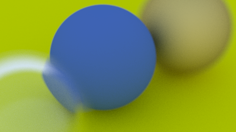 **materials**: the first book's three materials up close, matte, fuzzy metal and hollow glass, through a wide-open lens | 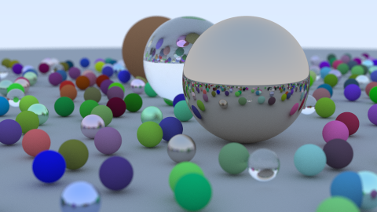 **weekend**: the first book's cover, spheres of three materials ([in Full HD](weekend.png)) |
| 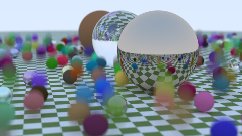 **bouncing**: the same, but the matte spheres bounce, giving motion blur | 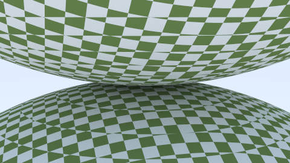 **checker**: a solid checker texture |
| 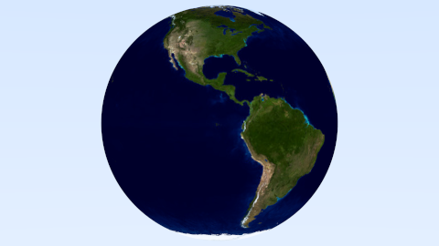 **earth**: an image wrapped around a sphere | 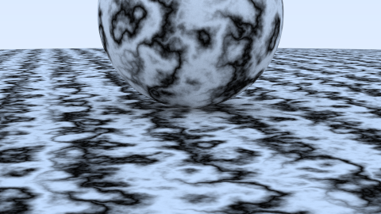 **perlin**: marble made of Perlin noise |
| 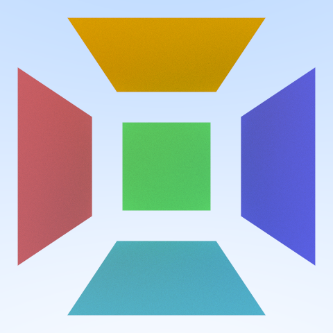 **quads**: quadrilaterals | 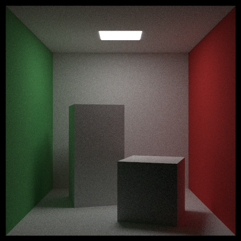 **cornell**: the Cornell box, translated and rotated objects |
| 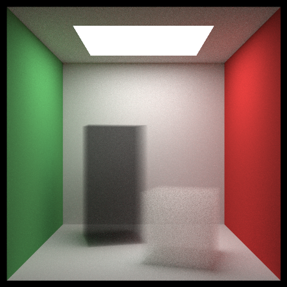 **smoke**: blocks of smoke | 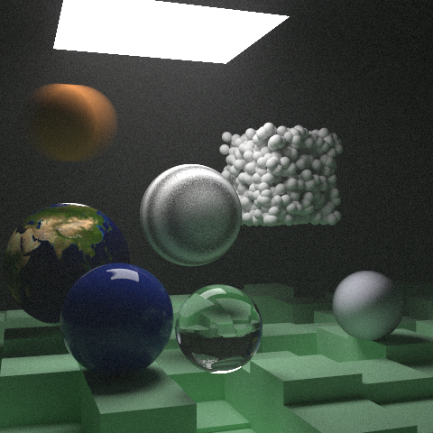 **final**: the second book's final scene, everything together |
| 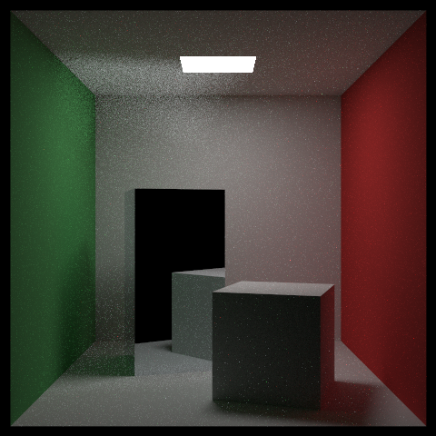 **aluminum**: a mirror block; the light it throws onto the ceiling stays noisy | 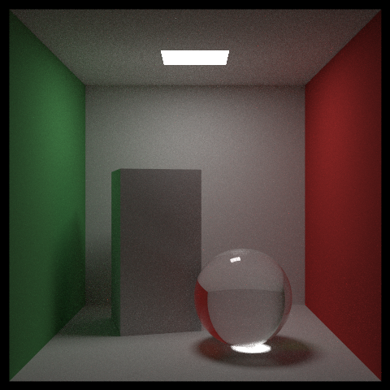 **glass**: the third book's final scene, a glass sphere sampled like a light |
| 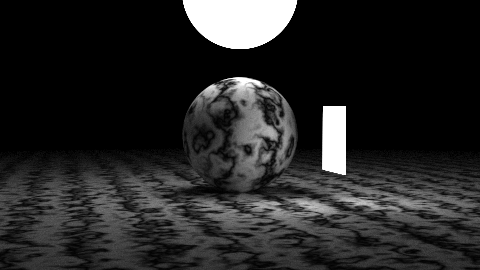 **light**: light sources | |

## Scenes beyond the books

The GPU programs render nine more scenes, which the CPU renderer doesn't have: four that show the [light and materials beyond the books](quality.md), and five that test the renderers. The help of both programs lists each group under its own heading, after the books' scenes. The four render with the quality kernel, in `float`, and open with their own strategy and display: `RayTracingGPU studio` renders `studio` with `-p mis`, multiple importance sampling, and AgX tone mapping, where the books' scenes have the mixture or the material's sampling and the books' bytes.

| | |
|---|---|
| 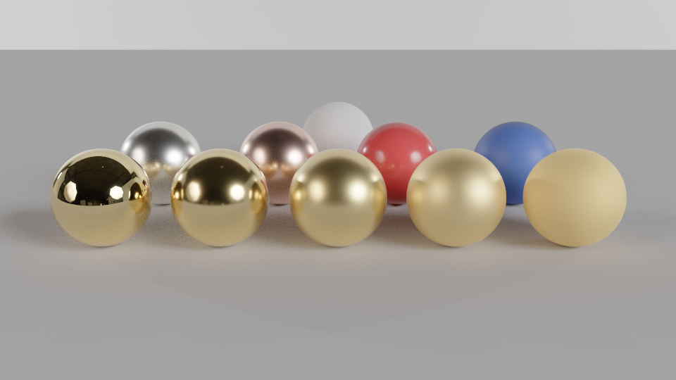 **studio**: gold from a mirror to rough in front; silver, copper, two glossy coats and a matte white sphere behind, in a photo studio's light | 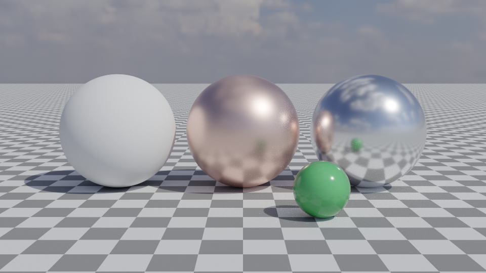 **sunlit**: matte, copper and aluminum spheres in the sunlight of an HDR sky |
| 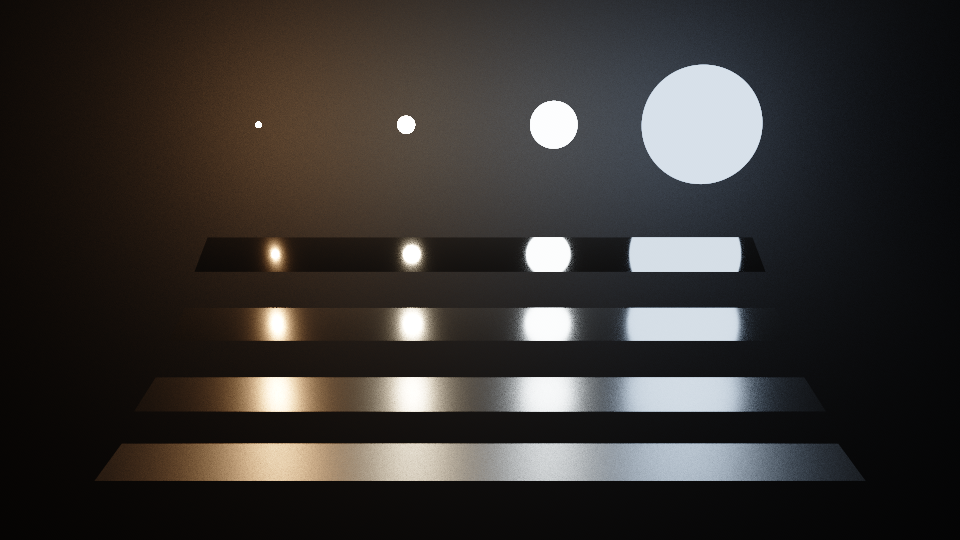 **veach**: Veach's four plates (1997), one metal from sharp to rough under four lamps of one power and four sizes | 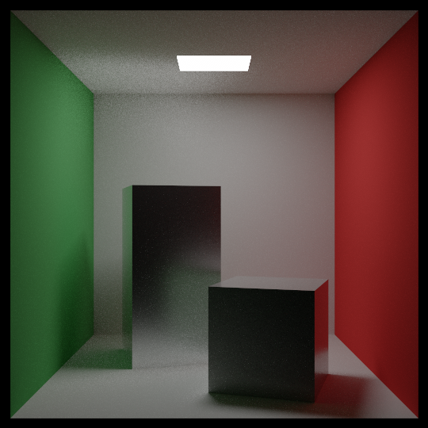 **cornell-ggx**: the Cornell box with a block of rough aluminum and a glossy white one |

*`studio` and `sunlit` at 960×540 with 4096 rays per pixel, `veach` at 960×540 with 256, `cornell-ggx` at 540×540 with 1024, each with its own strategy and display; the commands are in [Light and materials](quality.md).*

Each of the four is 1920×1080 by default (`cornell-ggx` 1080×1080, the Cornell box's square), with 1024 rays per pixel, and opens with `-p mis` and AgX: at 0 EV in `cornell-ggx` and `studio`, −1 EV in `veach` and −0.5 EV in `sunlit`. The rough metals and the glossy coats are GGX microfacet materials ([rough metals and glossy coats](quality.md#rough-metals-and-glossy-coats)), and `studio` and `sunlit` are lit by an HDR photograph of real surroundings instead of the books' sky.

The test scenes are checks, each made so that a renderer that loses or adds light shows it:

| Scene | What it checks |
|---|---|
| `furnace` | a matte white sphere under a white sky: sampled as the material scatters, its strategy, every path ends in the sky with all of its light, so every pixel is exactly 1.0, in `float` too |
| `ggx-furnace` | white metals, a mirror and four GGX roughnesses, under a white sky: the light each keeps |
| `gloss-furnace` | white matte spheres under four glossy coats, under a white sky: the light each keeps |
| `env-furnace` | the white sphere under a white environment map instead of a sky: every pixel exactly 1.0 again under `-p material` |
| `sun-test` | matte spheres in the sunlight of `sunlit`'s sky, nothing but matte surfaces: `-p nee` against `-p mis`, a check of the light samples |

### The environment maps

`studio`, `sunlit` and `sun-test` are lit by two HDR photographs from [Poly Haven](https://polyhaven.com), under the CC0 license, which allows redistributing them: they are committed in `assets`, so neither the programs nor the tests download anything. They are the 1k Radiance `.hdr` files exactly as published, equirectangular, 1024×512 texels each:

| File | The surroundings | Scenes |
|---|---|---|
| `assets/studio_small_09_1k.hdr` | a photographer's studio lit by softboxes | `studio` |
| `assets/kloofendal_48d_partly_cloudy_puresky_1k.hdr` | a partly cloudy sky with the sun 48° above the horizon, its ground replaced by sky | `sunlit`, `sun-test` |

The programs read them with stb_image, as linear radiance, and take maps of at most 2048×1024 texels; `env-furnace`'s white map is made in code. How a map becomes the sky and a light, and how its sun is found: [the environment map](quality.md#the-environment-map).

## The other programs

- **`RayTracingGPU`** takes the same options, with the [scenes beyond the books](#scenes-beyond-the-books) and two more strategies, and adds the image's height and the camera (`--height`, `--lookfrom`, `--lookat`, `--vfov`, `--defocus-angle`, `--focus-dist`), `--strata`, `--fp64`, `--all-books-kernel`, `--quality-kernel`, `--tonemap`, `--exposure` and `--launch-ms`; see [the CUDA renderer](gpu.md#building-and-running) and [its options beyond the books](#raytracinggpus-options-beyond-the-books).
- **`RayTracingViewer`** shows a scene in a window and refines it while the camera stands still, with `RayTracingGPU`'s options for the scene, the size, the camera, the sampling, the precision and the display; see [the viewer](viewer.md).
- **`ImageCompare A.pfm B.pfm`** tests whether two renders are the same picture up to noise; see [ImageCompare](image-compare.md).
- **`PfmStats`** gives the numbers about renders that ImageCompare doesn't: the noise of one render, the RMS rule for two strategies, a patch's mean against a value, values exactly equal to a number, identical floats; see [tests](#tests) and [PfmStats](image-compare.md#pfmstats).
- **`GpuTests`** tests the GPU renderer's device functions on the GPU: its samplers, densities and estimators; see [tests](#tests).
- **`MonteCarlo [experiment...]`** runs the third book's numerical experiments; see [the MonteCarlo program](sampling.md#the-montecarlo-program).

### RayTracingGPU's options beyond the books

| Option | What it does |
|---|---|
| `-p nee` | a shadow ray to a light at every bounce: next-event estimation |
| `-p mis` | shadow rays and the material's own samples, weighed by multiple importance sampling: low noise. The default of the scenes beyond the books |
| `--quality-kernel` | render with the quality kernel, the third one, also the books' scenes under `-p material`: a check, the same image within its noise |
| `--all-books-kernel` | render the first book's scenes with the kernel for all three books: a check, the same image bit for bit |
| `--tonemap NAME` | the PNG's display transform: `books` (the books' square root, clamped: their scenes' default), `none` (the sRGB curve, clipped), `agx` (the default of the scenes beyond the books) or `neutral` (Khronos PBR Neutral); a `.pfm` stays linear |
| `--exposure EV` | the light times 2^EV before the tone map, from −24 to 24 (default 0, or the scene's); not with `books` |

The two strategies are [next-event estimation and multiple importance sampling](quality.md#next-event-estimation-and-multiple-importance-sampling), and the tone maps are compared in [tone mapping](quality.md#tone-mapping). The quality kernel renders whenever a strategy, a scene or `--quality-kernel` needs it, and computes in `float` only ([why a third kernel](quality.md#why-a-third-kernel)). What it can't render is refused in one line, before anything renders: `--fp64`, `--all-books-kernel`, and the books' strategies other than `material` on a scene beyond the books or under `--quality-kernel`. A tone map other than `books` is refused with `--fp64` too, and an exposure with `books`. Under `nee` or `mis`, a scene with no lamp and no environment map, such as the books' scenes lit by their sky, renders with `-p material` in the kernel the scene would otherwise take (the books', unless `--quality-kernel` asks for the third), with RayTracing's note.

The program prints, besides [the lines RayTracing prints](#raytracing-options) and the kernel that ran (`quality` for the third), a `Display:` line before the render for a tone map other than `books`, and after it, under `nee` and `mis`, a `Shadow rays:` line: the rays toward the lights, which look for any blocker rather than the nearest hit, counted apart so that the rays traced keep their meaning. In the Cornell box at 540×540 with 64 rays per pixel, `-p mis` traces 6.60 rays and 4.00 shadow rays per sample, against the mixture's 2.44 rays. A tone map changes only the PNG: `sunlit` at 480×270 with 256 rays per pixel gives the same PFM, byte for byte, under all four.

## Tests

`ctest`, after a build, runs the quick tests:

```
ctest --test-dir out\build\x64-release
```

They are two: PfmStats' check of its own arithmetic (`PfmStats self-test`), and GpuTests' quick run (`GpuTests all --quick`), every test kernel on a few samples with the statistical verdicts skipped. On a computer without an NVIDIA graphics card GpuTests exits with 77, which ctest reports as skipped. The full statistical runs, the renders and [the verification scripts](#the-verification-scripts) are run by hand.

**`GpuTests`** tests the GPU renderer's device functions on the GPU: the samplers draw what their densities say, the densities integrate to 1, the estimators converge to known values. The suites of the features beyond the books check them against their written specifications, with references of their own rather than copies of the code they test.

```
GpuTests [all | SUITE...] [--quick] [--list] [--write FILE] [--check FILE]
```

The suites are in the files `tests/*_tests.cu`, three of which hold two (`lamps` and `media` in `lamp_tests.cu`, `ggx` and `ggx-energy` in `ggx_tests.cu`, `env-map` and `env-sampling` in `env_tests.cu`), and `GpuTests --list` names the suites and their tests:

| Suite | What it tests |
|---|---|
| `bsdf` | the quality kernel's materials as the books define them, matte, smoke's particles, metal and glass: the density of each draw, and the draws against the books' own, number for number |
| `env-map`, `env-sampling` | the HDR environment map: its cells' solid angles and densities, the mapping of directions to texels, the lookups; and the map as a light, sampled by its brightness |
| `ggx`, `ggx-energy` | the GGX rough metal: its visible-normal samples against its density, its weights under the lamps; and the compensation for the light rough metals lose, with its table |
| `gloss` | the glossy coat over a matte base |
| `harness` | GpuTests' own machinery, on the books' samplers, which must pass, and on a density wrong on purpose, which it must reject |
| `lamps`, `media` | the light samples at every bounce, their densities and their weights in multiple importance sampling, the shadow ray; and shadow rays through smoke and fog |
| `routing` | which kernel a render takes, and what it refuses |
| `services` | the test programs' own tools |
| `tone` | the tone maps, the dither and the bytes, against references in `double` |

Each check prints a line: its estimate, the expected value, the statistic and its limit, and PASS, FAIL or SKIP. A Monte Carlo mean must be within 4 standard errors of its exact value; Pearson's χ² test of drawn samples against a density needs a p-value of at least 1 − 0.99^(1/T) for the suite's T tests, so that a suite fails by chance in at most 1 run of 100; a test on samples wrong on purpose must reject them below p = 10⁻⁶; an exact identity must hold within a tolerance; and events that mustn't happen, a NaN or a draw of zero density, are counted. `--quick` runs every kernel on at most 10⁴ samples per check, for CUDA's memory checker, and skips the statistical verdicts. `--write` and `--check` give a suite a file: `GpuTests ggx-energy --check src\gpu\ggx_energy.cuh` computes the rough metals' energy table again and compares it with the committed file, and `--write` writes it. The exit code: 0 every check passes, 1 a check fails, 2 an error, 77 no CUDA device.

**`PfmStats`** gives the numbers about renders saved as PFM files that ImageCompare doesn't: how noisy a render is, whether a white furnace is exactly 1, whether two renders are the same floats. Its commands, as its help lists them:

```
PfmStats stats A.pfm [--rect X0 Y0 X1 Y1 [--expect V T]]... [--equal V [--share F]] [--max V]
PfmStats noise A1.pfm A2.pfm [--trim F] [--tiles N]
PfmStats rule T1a T1b T2a T2b A1 A2 B1 B2 [--margin M] [--trim F]
PfmStats same A.pfm B.pfm [--rect X0 Y0 X1 Y1]... [--ulps N --max-share F]
PfmStats png-same a.png b.png
PfmStats self-test
```

[ImageCompare](image-compare.md#pfmstats) explains each and how they serve a comparison. The exit code: 0 the check passes, 1 it fails, 2 an error, such as a file that can't be read, sizes that differ, or a NaN or an infinity in a render.

## The verification scripts

`scripts/verify/` holds the scripts that checked the fourth GPU milestone (`gpu-4`) while it was built ([how it was verified](quality.md#how-it-was-verified)). They keep their state, the reference renders, the builds they compare with and a log of the GPU's time, in `out\m4\`, under the builds' folder `out`, which the repository doesn't hold, so they record how the checks were made more than they run on a fresh checkout. The first lines of each say what it does and how to call it.

| Script | What it does |
|---|---|
| `frozen.ps1` | gate F: the files the books' kernels, the display kernel and the CPU programs are built from are unchanged since `gpu-3`; it renders nothing |
| `sassgate.sh` | the books' four render kernels and the display kernel of a new build are the same machine code as at `gpu-3`, instruction for instruction and in their constants, read with cuobjdump; nothing runs on the GPU |
| `hostgate.ps1` | the GPU programs' host code behaves as before: what the command lines of `cli-cases.txt` print (with the window scripts in `cli-scripts\`), the window's frames of `tests\regress-viewer.txt` and `tests\regress-tone.txt`, five small renders and the README GIF's tour, against the previous build's |
| `compare.ps1` | the ImageCompare protocol for two strategies or two kernels: two seeds each, a control of each with itself, two cross-seed tests and the RMS rule ([comparing two strategies](image-compare.md#comparing-two-strategies)) |
| `carry.ps1` | configurations once verified statistically still render the same bytes, so their verification carries forward |
| `references.ps1` | the references of the statistical checks, rendered once by the `gpu-3` build: `cornell`, `light` and `final` under `material` and `mixture`, and all 13 scenes under `material` |
| `sanitize.ps1` | CUDA's memory checker, compute-sanitizer, with memcheck and initcheck, on a tiny render or `GpuTests --quick` |
| `gpu.ps1` | the one queue for builds and GPU work: one job at a time, each logged with its time, within a budget of GPU time |
| `docs.ps1` | the documentation: no dead link or anchor (to a file git keeps, with its case), no hardware named, no speed or time figure that the page didn't have at `gpu-3`, and the first `RayTracingGPU` command of each page runs |
