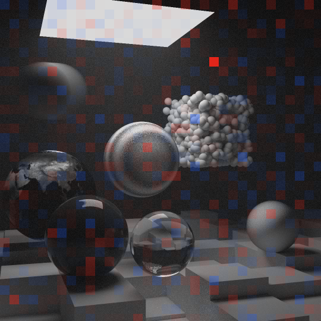
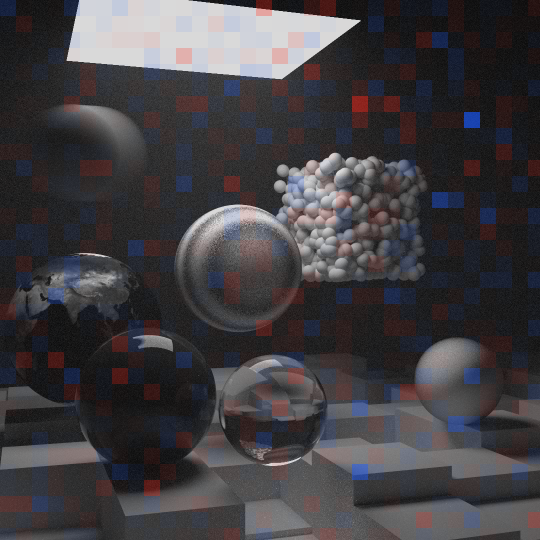

# The CUDA renderer

[RayTracing](../README.md) › The CUDA renderer

`RayTracingGPU` renders every scene of the three books on an NVIDIA graphics card with CUDA, with all four [sampling strategies](sampling.md#four-strategies). It has no scenes of its own: it builds them with the very modules `RayTracing` uses, the same objects and the same camera. So the CPU program stays the reference, and the two programs differ only in how they render. A render takes three steps:

1. `main_gpu.cpp` builds the scene with the `scenes` module, walks its lists, BVHs and instances (`dynamic_cast` asks each object what it really is) and translates every object into plain structures, with its instances moved into the world once.
2. The renderer in `src/gpu` checks the scene, builds its own BVH on the CPU, copies both to the card and launches the kernel in passes.
3. The pixels come back into the CPU's `image` class, so the mean radiance and the saved files are computed exactly as in `RayTracing`.

The port came in two milestones, tagged `gpu-1` (the first book) and `gpu-2` (the second and third books) in [the development history](../README.md#development-history). Its speed against the CPU renderer is in [the performance table](../README.md#performance), and its renders of the 13 scenes are in [the gallery](../README.md#gallery).

- [How it renders](#how-it-renders)
- [Verification](#verification)
- [What float costs](#what-float-costs)
- [Known differences](#known-differences)
- [Building and running](#building-and-running)

## How it renders

- **A thread per pixel.** The GPU runs the renderer's kernel in thousands of threads at once, one per pixel. The threads are grouped into blocks of 16×8 pixels, which the card's multiprocessors share out. Each multiprocessor runs threads in warps of 32, which execute every instruction together; a warp whose rays hit different materials runs each case in turn (divergence). Shapes, materials and textures are plain data and a short `switch`, rather than virtual functions. The CPU's objects can't be copied to the GPU, because their virtual function tables point into the CPU's code. A `switch` lets the compiler inline every case, and with short cases divergence costs little.
- **Two kernels.** A kernel gives all its threads the same number of registers, fixed when it is compiled: as many as the most demanding point of its code needs, whether a scene's paths ever get there or not. The more registers a thread takes, the fewer threads fit on a multiprocessor at once, and the lower the kernel's occupancy. Built for the card that [the performance table](../README.md#performance) was measured on, the code for all three books takes 95 registers in `float` (5 blocks of 128 threads per multiprocessor), and the first book's code alone takes 64 (8 blocks); in `double` they take 164 and 96 (3 and 5 blocks). So the scenes that need nothing beyond the first book get a kernel of their own, compiled from the same templates with `if constexpr`. It computes, bit for bit, what the GPU computed at `gpu-1`, before the second and third books were ported. `--all-books-kernel` renders these scenes with the general kernel instead: the same images, bit for bit too, but 17% (`weekend`) to 28% (`materials`) slower on that card. Builds for other architectures can get other counts; after every render the program prints which kernel ran, its registers per thread and how many of its blocks a multiprocessor holds at once, for the card it runs on.
- **Passes.** Windows resets a graphics card when one kernel runs longer than about 2 seconds (TDR), and while a kernel runs, a card that drives a display can't redraw the desktop. So the image is rendered in passes, each adding one sample to every pixel, and every kernel launch gets about 50 ms of work. The first pass is traced in bands of rows that measure how long the samples take; the later launches get as many whole passes as fit, or bands of rows when not even one pass fits. Each pixel adds up its samples in `double`, pass after pass. Inside a launch, a thread starts its next sample as soon as one ends, rather than waiting for the longest path of its warp.
- **Random numbers per sample.** Every sample, a camera ray with all its bounces, gets its own small generator (Melissa O'Neill's PCG32), started from a hash of the seed, the pixel and the pass. So the image doesn't depend on the order the threads run in, or on how passes are grouped into launches. The same seed gives the same image, bit for bit, in Debug and in Release. The CPU renderer gets there another way: it seeds each image row's generator with the seed and the row's number, so its image doesn't depend on which thread renders a row. Random directions are drawn by formulas with a fixed amount of work, rather than by the CPU's rejection loops, which would keep a warp looping until its unluckiest thread is done.
- **`float`, not `double`.** A GeForce card does arithmetic on 64-bit doubles 64 times slower than on 32-bit floats. The device code is written once, as templates on the number type constrained by a concept, and compiled twice. `--fp64` renders with doubles: in [the performance table](../README.md#performance), 12 to 40 times slower than with floats, but still faster than the CPU in every scene.
- **One BVH for three kinds of shapes.** The tree of boxes is built on the CPU with the CPU's own rule (an object-median split: the shapes are sorted by where their boxes start along the longest axis of their common box, and the list is cut in the middle), into arrays that refer to each other by index. Its leaves hold spheres that stand still, moving spheres or quadrilaterals, each kind in an array of its own. That way a sphere that stands still is read with one 16-byte load in `float` (two in `double`), as when the GPU rendered only the first book. Each thread walks the tree in a loop with a small stack, visiting the nearer of two boxes first. The median split halves the shapes at every level, so the tree is about log₂ n levels deep for n shapes, and the stack never holds more nodes than there are levels. A scene of at most 8 shapes gets no median split: all of them go into one leaf, whose shapes every ray tests. If such a scene mixes kinds, as `light` does, it gets one leaf per kind under a root instead, and a ray tests a leaf's shapes only if it enters that leaf's box. Larger scenes get one shape per leaf. On the card the performance table was measured on, `materials` renders 1.7 times faster as a single leaf than as a tree.
- **Instances baked once.** On the CPU, `translate` and `rotate_y` move every ray into the object's coordinates and the hit back out. The GPU program instead moves the objects themselves into the world, once, before the render. Nested instances add up to one turn about the vertical axis and one shift, so the kernel knows only world coordinates. A rigid motion keeps lengths and angles, so the hits are the same. The one exception is a sphere's texture coordinates, computed in the sphere's own coordinates, so a turned sphere keeps its turn for them.
- **Textures as tables.** A checker of checkers is a short chain of table entries, and an image is an array of texels. The marble's Perlin noise uses the CPU's own random tables, copied, so both programs draw the same marble.
- **Smoke after the surfaces.** The CPU tests a volume of smoke while it searches its BVH, against the closest hit found so far. The GPU first finds the closest surface, then lets every volume draw its distance to a particle, and the volume wins if the particle comes first. The picture is the same: the distance a volume draws to a particle doesn't depend on the limit it is tested against, the nearest hit found so far. The limit only decides whether a collision beyond it is reported, and such a collision would lose to that nearer hit anyway.
- **The lights list.** The shapes that the lights and mixture strategies aim at, quads and spheres, are flattened on the CPU into one list. Each has its chance of being aimed at: 1/n in a list of n, multiplied down nested lists. A random number picks one by the running sums of these chances, and the density of a direction is the weighted sum of every shape's density. A shape in the list may be the very surface a ray leaves (a matte object that is itself in the lights list). Then it follows the closest-hit search's self-intersection rule, described in [what float costs](#what-float-costs), with one exception. A ray can't hit the quad it leaves, so from there the quad's density is 0. For the sphere a ray leaves, rounding decides which side of its surface the ray starts on. From outside, the sphere counts only for directions into it. From inside, the rule doesn't apply: as on the CPU, the test for a point inside the sphere comes first, and then every direction gets the same density, 1/(4π), outward ones too (see [known differences](#known-differences)).

## Verification

The comparisons below use [ImageCompare](image-compare.md), which tests whether two renders differ by more than their Monte Carlo noise explains. A comparison of the two renderers looks like this:

```
RayTracing final -w 480 -s 1024 -o cpu.pfm
RayTracingGPU final -w 480 -s 1024 -o gpu.pfm
ImageCompare cpu.pfm gpu.pfm --zmap map.png
```

The CPU and the GPU draw unrelated random numbers, so their renders can share a seed. The GPU's `float` and `double` renders use the same generator, so they need different seeds.

### One picture, in detail

[The README](../README.md#verified-against-the-cpu) shows `final` as both programs render it. These are its two maps:

| ImageCompare: CPU against CPU with another seed (the noise alone) | ImageCompare: CPU against GPU, `float` |
|---|---|
|  |  |

*`final` at 1080×1080 with 1024 rays per pixel and the mixture, shown at half size. Each map is the CPU's image (A) in gray, tinted red where the other render (B) is brighter and blue where it is darker, in tiles of 32×32 pixels. A tile is in full color only where it differs by more than noise could explain. The two maps look alike: patchworks of faint red and blue over the dark scene, each with a few stronger tiles, about as many as noise alone gives. Of the 1156 tiles, 2 in the first map and 3 in the second differ by more than 3 standard errors, where noise alone gives 3.1 on average, and none is in full color. Both maps measure against the same CPU render, so its own noise shows in both. The reddest tile of the first map, above the cluster of white balls, is a place where that render came out darker by chance (by 4.41 standard errors, where full color takes 4.74), and it is red in the second map too.*

| `final`, 1080×1080, 1024 rays per pixel | Mean radiance | Mean of the difference, in standard errors | RMS of the difference | Verdict |
|---|---|---|---|---|
| CPU against CPU with another seed (the noise alone) | 0.442442 and 0.442441 | −0.01 | 0.027938 | consistent |
| CPU against GPU, `float` | 0.442442 and 0.442403 | −1.49 | 0.027972 | consistent |
| CPU with another seed against GPU, `double` | 0.442441 and 0.442437 | −0.16 | 0.028057 | consistent |

### Every scene

The second and third books' 11 scenes were compared this way at 480 pixels wide and 1024 rays per pixel. Each scene ran under its default strategy, the six lit by lamps also under `-p material`, four of them under `-p lights`, and the Cornell box under `-p uniform`: 22 configurations. Each configuration was rendered twice in `float` and once in `double`. Each GPU render was compared with a CPU render, and a `float` render with the `double` one. All of them came out consistent but for one false alarm: in `light`, the `float` render against the `double` one failed the [largest-tile check](image-compare.md#how-it-decides), as each of ImageCompare's four checks does by chance in at most 1 of 400 comparisons of the same picture, and new renders with other seeds passed. The average length of a path agreed too: the GPU traced as many rays per sample as the CPU, to 0.04%.

The first book's two scenes, `materials` and `weekend`, still render bit for bit as they did at the end of the first GPU milestone, tagged `gpu-1`. That milestone compared them with the CPU in 25 such comparisons, in `float` and in `double`, at 1920×1080 with 484 rays per pixel and at 480×270 with 16,384: all consistent.

### Scenes built to find a difference

Another verification went looking for a difference on purpose, in 64 scenes made for it, each compared in `float` and in `double`:

- **Textures:** nested checkers, a checker with cubes 0.001 wide, and checkers of images and of marble; the Earth seen from above a pole and at its seam; images of 1×1 and 3×2 texels; marble around (−500, −500, −500) and at frequencies 0.01 and 100.
- **Motion:** a sphere moving along the line of sight, and spheres moving ten times their radius.
- **Quads:** quads edge-on and degenerate, two mirror quads facing each other, a checker floor in the plane y = 0.
- **Lamps:** quad lamps seen from behind, the camera inside a sphere lamp, a lamp on a moving sphere.
- **Instances:** boxes inside nested turns and shifts, turned by up to 360 degrees, and a box inside a box.
- **Volumes:** the camera inside smoke, fog inside glass of the same shape, smoke bounded by one quad or by a box missing a face, overlapping and moving volumes; the second book's final scene without its haze, with a haze of radius 50,000, and seen from inside its fog.
- **Lights lists** (the shapes `-p lights` and the mixture aim at): a box of lamps in the lights list, the Cornell ceiling under `-p lights`; a sphere in the lights list around a ball, a moving sphere lamp, lists of two and three lamps, and a matte quad and a matte ball, each itself in the lights list.

They agreed in all but two cases, both described under [known differences](#known-differences): the close-up of the checker ground's contact with y = 0, a limit of `float`, and the matte ball in the lights list under `-p lights`, a difference that stays in `double`. Two more tests ran on the GPU alone. One traced paths of up to 2000 rays in `double`; the CPU's `ray_color` calls itself once per bounce, and 2000 calls would overflow its thread's stack. The other was one volume bounded by two separate boxes, which the GPU refuses with a message.

The first book's port had been tested the same way in about 45 scenes: the camera inside glass, nested glass with air bubbles, light trapped in a glass ball by total internal reflection, spheres of radius 0.001 and 100,000, contacts, a lens with a defocus angle of 150°. In `double` the GPU agreed with the CPU in all of them but one, a sphere ten million times smaller than its distance, where the CPU's own arithmetic was the less accurate side. What those scenes found in `float` is below.

## What float costs

A `float` keeps about 7 significant digits, and that mattered in seven places. All but the last were measured by comparing renders:

| Where | What went wrong in `float` | The fix |
|---|---|---|
| Self-intersection | Near the ground sphere of radius 1000, a point is known relative to the sphere's center only to about 0.00003. Rays leaving the ground at grazing angles hit it again from inside and were lost: `weekend` came out 0.011% too dark. Quads had the same problem: the Cornell box came out 0.4% too dark. | For the surface a ray leaves, geometry instead of a minimum distance: a ray can't hit a sphere it leaves, a ray going into a sphere can hit only its far side, and no ray hits the quad it leaves. |
| The horizon | Whether a grazing ray hits the ground depends on r² minus the squared distance from the sphere's center to the ray's line: a difference of two numbers near a million, where a `float` steps by 0.06. Rays passing up to 0.000016 outside the ground counted as hits, and the horizon came out a little darker than the CPU's. | Fused multiply-adds subtract the three squares that make up that squared distance from r² one at a time, so the rounding errs to both sides equally. |
| Rays parallel to a box's faces | For a direction with a component of exactly 0, the faster form of the box test computed ∞ − ∞ = NaN and skipped boxes the ray crossed: one pixel in 129,600. | A slab test safe for directions with a zero component. |
| Camera rays | A direction computed as the difference of two positions: with a focus distance of 0.00001, neighboring pixels got the same direction. | Directions built from vectors relative to the camera. |
| A checker at a contact | Where `bouncing`'s ground touches the plane y = 0, the `float` hit points lay off the surface often enough to swap the colors of the checker's squares around the contact: a close-up of it came out 0.95% too dark. | One Newton step moves the point onto the sphere, from about 0.00003 off its surface to about 10⁻¹¹ near the contact. |
| Points on a quad | The compiler fused t·direction + origin into one rounding, which moved points to the other side of a quad's plane: a checker floor at y = 0 came out gray, and a matte quad in the lights list 0.7% too bright under the mixture. | A quad's points computed as the CPU computes them, with two roundings. |
| Smoke's 0.0001 | The exit from a volume is searched for from 0.0001 beyond the entry, but above t = 2048, t + 0.0001 is t again, and the entry would be found as the exit. | The difference of the two crossings is tested instead. |

<details>
<summary>The seven pitfalls in full</summary>

- **Self-intersection.** Near the ground sphere of radius 1000, centered 1000 units below the scene, a point is known relative to the sphere's center only to about 0.00003. So a ray that bounces off the ground can start slightly inside it, and the CPU's rule of ignoring hits closer than 0.001 isn't enough: rays leaving at grazing angles hit the ground again from inside and are lost. So for the sphere a ray starts on, the GPU goes by geometry instead of by distance. A ray leaving the sphere can't hit it again (a sphere is convex), and a ray going into it, into glass, can hit only its far side, still beyond t = 0.001. In exact arithmetic that is the same rule. Without it the `weekend` image is 0.011% too dark, far beyond the noise of a long render. The same goes for quadrilaterals: a ray never hits the quad it leaves (a line meets a plane only once). Without that rule, the Cornell box came out 0.4% too dark in `float`.
- **The horizon.** Whether a ray grazing the ground hits it depends on r² − |l|², where |l| is the distance from the sphere's center to the ray's line. That is the difference of two numbers near a million, where a `float` steps by 0.06. Rounded on its own, |l|² became exactly r² whenever it lay less than half a step above it, so rays passing up to 0.000016 outside the ground counted as hits, and the horizon came out a little darker than the CPU's. Fused multiply-adds now subtract the three squares from r² one at a time, so the rounding errs to both sides equally.
- **Rays parallel to a box's faces.** The test of a ray against a box divides by the ray's direction. For a direction with a component of exactly 0, the faster form of that test computed ∞ − ∞ = NaN and skipped boxes the ray crossed; one pixel in 129,600 showed it.
- **Camera rays.** A camera ray's direction was the difference of two positions, each rounded to 10⁻⁷ of its distance from the origin; with a focus distance of 0.00001, neighboring pixels got the same direction. Now the direction is built from vectors relative to the camera.
- **A checker at a contact.** `bouncing`'s ground touches the plane y = 0 right under the glass ball, where the checker's cubes meet, and there a hit point's last bits decide its color. The `float` points lay off the surface often enough to swap the colors of the squares around the contact. For a checker on a sphere that stands still, the GPU first moves the point onto the sphere with one Newton step, from about 0.00003 off its surface to about 10⁻¹¹ near the contact. Without it, a close-up of the contact came out 0.95% too dark.
- **Points on a quad.** The CPU computes a hit point as t·direction, rounded, plus the origin, rounded again. The GPU's compiler fused the two into one rounding, and that moved points to the other side of a quad's plane. A checker floor in the plane y = 0, where the checker's cubes meet, got about half of its points on the wrong side and came out gray where the CPU's is checkered. A matte quad at y = 1, itself in the lights list, got a third of them below it, where the CPU's land on it, and came out 0.7% too bright under the mixture. A quad's points are now computed as the CPU computes them.
- **Smoke's 0.0001.** The CPU finds where a ray leaves a volume by searching again from 0.0001 beyond where it enters. In `float`, t + 0.0001 is t again once t is above 2048, and the entry would be found as the exit. The GPU tests the difference of the two crossings instead.

</details>

## Known differences

What `float` can't fix: it resolves about 10⁻⁷ of the largest coordinate, so details smaller than about 1/10,000 of the scene's coordinates come out measurably different. That happens with a ground of radius 10,000 or more, a scene 10,000 or more units from the origin, spheres of radius 0.001 about ten units from the origin, and a close-up of the checker ground's contact with y = 0 from a camera whose offset to the ground's center rounds the same way for all its rays. Such scenes need `--fp64`.

Two differences stay in `double`, both in scenes made to look for them:

- **A tiny, distant sphere.** In the first book's tests, a sphere ten million times smaller than its distance rendered differently, and there the CPU's own arithmetic was the less accurate side.
- **A matte sphere in the lights list, under `-p lights`.** Whether a point on the sphere's own surface tests inside it comes down to the last bit, and rounding decides it differently on the two renderers: about 40% of the CPU's points test inside, and about half of the GPU's. `-p lights` is biased by design and gives the two cases different answers, so that scene renders 0.3% brighter on the GPU. Under the mixture both cases give the same expected image, and the scene agrees.

## Building and running

`RayTracingGPU` needs an NVIDIA graphics card and the [CUDA Toolkit](https://developer.nvidia.com/cuda-downloads) 13 (`winget install Nvidia.CUDA`; tested with 13.4). Without it, CMake builds everything else and says that it skipped the GPU program. After installing the toolkit, restart Visual Studio (or the terminal) and delete CMake's cache, which remembers that CUDA was missing: **Project → Delete Cache and Reconfigure** (or `cmake --fresh --preset x64-release`). Then choose the `RayTracingGPU.exe` startup item, or run:

```
out\build\x64-release\RayTracingGPU.exe final
```

```
RayTracingGPU [scene] [options]
  scene                any of RayTracing's 13 scenes (default weekend)
  -w, --width N        image width in pixels
  -s, --samples N      rays per pixel, rounded to the nearest square k²
  -p, --sampling NAME  uniform, material, lights or mixture (default), as in RayTracing
      --fp64           compute in 64-bit doubles like the CPU instead of 32-bit floats
      --all-books-kernel
                       render the first book's scenes with the kernel for all three books
      --seed N         which random numbers to draw, from 0 (default) to 4294967295
  -o, --output FILE    where to save the image, a .png or a .pfm (default <scene>-gpu.png);
                       give it several times to save several files
  -h, --help           help, the lists of scenes and sampling strategies
```

For the options it shares with `RayTracing`, see [RayTracing options](building.md#raytracing-options). After a render it prints its time, the rays it traced and the image's mean radiance, counted and computed as on the CPU, and the kernel it ran.

The CUDA code is C++20 in ordinary headers: `nvcc`, NVIDIA's compiler, can't import modules, and with MSVC as its host compiler it doesn't take C++23 yet. The kernels are compiled for the card in the computer that builds them (`CMAKE_CUDA_ARCHITECTURES` is `native`). To build for other cards, name their architectures, for example `cmake --preset x64-release "-DCMAKE_CUDA_ARCHITECTURES=75;86;89"`, or set the `CUDAARCHS` environment variable and configure afresh (`cmake --fresh --preset x64-release`, or **Project → Delete Cache and Reconfigure** in Visual Studio): CMake reads `CUDAARCHS` only when a build folder is first configured. The kernels are optimized in Debug too, so a Debug build renders on the GPU at full speed. The program links the static CUDA runtime, so it needs only the graphics driver, no CUDA DLL.
