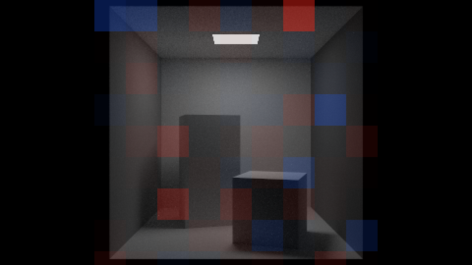
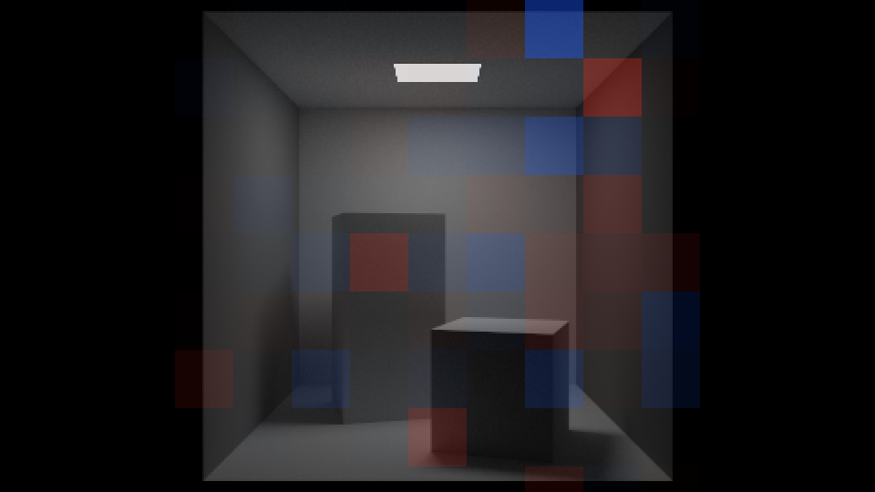

# ImageCompare

[RayTracing](../README.md) › ImageCompare

Every pixel of a render is a Monte Carlo estimate, an average of random samples. So two renders of one scene differ in every pixel unless they use the same random numbers. What correct renderers must share is each pixel's expected value: the picture both converge to as the rays per pixel grow. `ImageCompare` tests whether two renders differ by more than their noise explains. It is how the CUDA renderer was [verified against the CPU](gpu.md#verification), and how the third kernel's strategies were [verified against the books'](quality.md#how-it-was-verified) and OptiX [against the third kernel](optix.md#how-it-was-verified). Images denoised by OptiX's AI denoiser are biased, so they are never compared this way: every comparison uses the plain renders.

- [Usage](#usage)
- [How it decides](#how-it-decides)
- [Validation](#validation)
- [Using it correctly](#using-it-correctly)
- [Comparing two strategies](#comparing-two-strategies)
- [PfmStats](#pfmstats)

## Usage

`ImageCompare` reads PFM files, which keep the renderer's own linear numbers; a PNG's 8 bits after gamma correction would hide a difference of 0.1%. For example, render a scene twice to PFM, with different seeds and otherwise the same settings:

```
RayTracing materials -w 480 -s 64 -o a.pfm
RayTracing materials -w 480 -s 64 --seed 1 -o b.pfm
ImageCompare a.pfm b.pfm
```

```
A: a.pfm: 480×270, mean radiance 0.266767
B: b.pfm: 480×270, mean radiance 0.266774

The difference d = B - A in each pixel, over 129600 pixels:
              mean of d          SE        z   relative   RMS of d
  red       -0.00003300  0.00007180    -0.46   -0.0117%   0.025847
  green     -0.00005197  0.00007913    -0.65   -0.0145%   0.028485
  blue      +0.00010775  0.00008614    +1.25   +0.0671%   0.031009
  average   +0.00000759  0.00006400    +0.11   +0.0028%   0.023039
  SE: the standard error of the mean; z ≈ mean / SE, the mean in standard errors (less a rounding
  margin of a millionth of the pixel values); relative: the mean as a share of the pixel values;
  RMS: the typical size of d, the two images' noise together
  sign test: B is brighter in 50.10% of the 127341 pixels that differ by more than 0.1%,
  z = +0.69 (noise of the same shape in A and B gives 50%)

Tiles of 32×32 pixels (smaller at the right and bottom edges): 135 tested, by the channel average of d
  all tiles together: Σz/√T = +0.66
  largest |z|: 2.69 at x 96–127, y 96–127 (A is brighter there)
  tiles with |z| > 3: 0, while noise alone gives 0.4 on average

Checks (by chance alone each fails in at most 1 of 400 comparisons, any of the 4 in 1 of 100):
  whole image   the largest |z| of its 4 rows        1.25   fails above 3.42       passed
  all tiles     |Σz/√T| of the T tiles               0.66   fails above 3.02       passed
  largest tile  the largest |z| of a tile            2.69   fails above 4.28       passed
  tile count    the number of tiles with |z| > 3        0   fails at 4 or more     passed

Verdict: consistent: A and B differ by no more than noise
```

Its options, as its help lists them:

```
ImageCompare A.pfm B.pfm [options]
  --tile N         the side of the square tiles that are tested one by one, in pixels (default 32)
  --zmap FILE.png  save a map of the tiles' z-scores: image A in gray, tinted red where B is
                   brighter and blue where it is darker, in full color at the largest tile's
                   alarm threshold
  -h, --help       show this help
```

The exit code gives the verdict to scripts: 0 consistent, 1 different, 2 an error. The CUDA renderer's page shows [two such maps](gpu.md#one-picture-in-detail), of a CPU render against another CPU render and against a GPU render.

## How it decides

It looks at the difference d = B − A in every pixel. If A and B are the same picture, every d has the expected value 0. The mean of N of them is then as close to 0 as the standard error SE = s/√N predicts, where s is the spread of the d's. This is the √N law that the [MonteCarlo program](sampling.md#the-montecarlo-program) demonstrates. z = mean / SE is that distance in standard errors. The image is also cut into tiles of 32×32 pixels (`--tile N`), each with its own z. Four checks look for four kinds of difference:

- **Whole image:** the mean of d per channel and for their average. It catches a bias that covers the image, such as a render 0.1% too dark.
- **All tiles:** the tiles' z added up and divided by √T (Stouffer's method). Every tile weighs the same, so one noisy region (glass, fireflies) can't drown a small bias everywhere else.
- **Largest tile:** a difference confined to one object, against a threshold that grows with the number of tiles, because some tiles are far off by chance (Bonferroni's correction).
- **Tile count:** more tiles with |z| > 3 than chance gives (a binomial test), for a weak difference spread over many tiles.

Each check fails by chance in at most 1 of 400 comparisons of the same picture, so the verdict is a false alarm in at most 1 of 100. The source documents the statistics it relies on: the standard error, Student's t for small tiles, Bonferroni's correction, Stouffer's method and the sign test.

## Validation

The program was validated on thousands of synthetic pairs, with and without fireflies (rare samples far brighter than the rest), and on 1725 pairs of real renders with different seeds. It called the same picture different in 0.5–0.9% of the pairs. It found a sky 0.1% too bright, or one sphere's albedo 1% too low, in 30 of 30 pairs of `materials` at 480×270 and 64 rays per pixel.

## Using it correctly

A and B must be renders of the same scene at the same size, with the same rays per pixel and the same sampling method (two sampling methods need [a protocol of their own](#comparing-two-strategies)). Then their noise has the same distribution, which the checks assume. They must also be independent: renders with different seeds, or renders from different renderers, as the CPU and the GPU draw unrelated random numbers. To compare the GPU's `float` and `double`, give them different seeds, as their generators are the same.

With different rays per pixel the noise of A and B is distributed differently. A pixel of 16 rays usually misses the rare bright samples that one of 1024 catches, and the checks can fail for the same picture. The `sign test` line watches for this: with noise of the same shape, B is brighter in half the pixels, like heads in tosses of a fair coin. The program prints a note when that looks like the cause. Identical files are refused.

## Comparing two strategies

Two unbiased sampling strategies converge to the same picture, which is how a new one is checked: the books' mixture and the third kernel's multiple importance sampling (`-p mis`) must give the same expected image. But their noise has different shapes, as the noise of different rays per pixel has, and the checks' 1 false alarm in 100 holds for noise of one shape. Between two strategies they can fail with no real difference, or miss one. So two strategies are compared by a protocol (`scripts/verify/compare.ps1`) that measures each one's noise on the scene first, and whose rules were fixed before any result:

- **Two renders of each strategy,** A1, A2 and B1, B2, each with a seed of its own, at the same size and rays per pixel: 480×270 and 1024 rays per pixel in the third kernel's checks.
- **A control for each:** A1 against A2, and B1 against B2, each strategy against itself with another seed. Its noise has one shape, so the checks are on their own ground there. A control that fails says that the comparison can't be trusted on this scene, and voids it.
- **Two tests across seeds:** A1 against B1 and A2 against B2, every pair independent.
- **The RMS rule.** The checks compare means, of the image and of its tiles, so a difference that keeps a tile's mean passes them: a checker pattern turned into its average gray. The RMS of d sees it, as every pixel's difference adds to it. Between two renders of one strategy, d's mean square is twice one render's variance, 2σ², which the control measures as R², the square of its RMS of d. Between independent renders of A and B it is σ_A² + σ_B² = (R_A² + R_B²)/2, plus the square of any difference between the pictures. So each test's RMS of d must be at most 1.10 times √((R_A² + R_B²)/2), every RMS taken without the largest 1% of the d², as fireflies and the edges of lamps make the plain RMS vary from seed to seed ([`PfmStats rule`](#pfmstats)).
- **The re-run rule.** One failing test, or a failing RMS rule, renders both strategies again with seeds 10 higher and repeats all four comparisons and the rule, plus `--tile 64` on the pair that failed; the protocol passes if all of that passes. Two failures in the first run, or any in the re-run, fail it.

The protocol also prints the noise of one render of each strategy, σ = RMS(d)/√2 of its control (`PfmStats noise`). On the Cornell box at 480×270 with 1024 rays per pixel, the trimmed σ is 0.00315 under the mixture and 0.00125 under `mis` and under `nee`; on `light`, 0.00236, 0.00139 and 0.00142. That is the gain of the new strategies at equal samples, not equal time. The full protocol passed for `mis` against the mixture and for `nee` against `mis`, on both scenes.

### An example: the mixture against `mis`

One test and one control of that protocol on the Cornell box, with the commands that render them. `a.pfm` is the books' kernel's, `b.pfm` and `c.pfm` the quality kernel's:

```
RayTracingGPU cornell -w 480 --height 270 -s 1024 -p mixture --seed 1 -o a.pfm
RayTracingGPU cornell -w 480 --height 270 -s 1024 -p mis --seed 3 -o b.pfm
RayTracingGPU cornell -w 480 --height 270 -s 1024 -p mis --seed 4 -o c.pfm
ImageCompare a.pfm b.pfm --zmap cornell-zmap.png
ImageCompare b.pfm c.pfm --zmap cornell-zmap-control.png
```

| | The test: the mixture against `mis` | The control: `mis` against `mis` with another seed |
|---|---|---|
| the mean radiance of A and B | 0.087674 and 0.087681 | 0.087681 and 0.087676 |
| the mean of d, in standard errors | +0.58 | −0.67 |
| the RMS of d | 0.004107 | 0.002487 |
| all tiles, Σz/√T | +0.90 | −0.55 |
| the largest \|z\| of a tile | 2.75 | 2.74 |
| tiles with \|z\| > 3 | 0 | 0 |
| verdict | consistent | consistent |

|  |  |
|---|---|
| *The test: `a.pfm` in gray, each tile tinted red where `mis` is brighter and blue where it is darker.* | *The control: the noise alone.* |

*The maps are ImageCompare's at 480×270, enlarged 2× by repeating pixels. In the test, 81 tiles of 32×32 are tested: the other 54 of the 135, in the black margins on either side of the box, are identical in both renders and aren't tested. No tile is beyond 3 standard errors in either map; in the test, noise alone would give 0.2 such tiles on average.*

The test looks like the control. Its means are 0.58 standard errors apart, and its farthest tile, at 2.75, is as far out as the control's, from noise alone, at 2.74. Its RMS of d, 0.004107 against the control's 0.002487, is larger, as the RMS rule expects: it holds the mixture's noise as well as `mis`'s, and the mixture's is the larger.

One line moves: the sign test, at z = +12.11. `mis` is brighter than the mixture in more pixels than chance allows, while the means agree and the tiles' Σz/√T stays at +0.90; so where the mixture is brighter, it is brighter by more. A different picture would move the sign test and Σz/√T the same way and about as far; noise of two shapes moves the sign test alone, and ImageCompare prints its note saying so. The note doesn't change the verdict. It is the reason two strategies need their controls and the RMS rule, not a single comparison.

## PfmStats

`PfmStats` is ImageCompare's companion for the numbers of one render, or of two renders that should be the same: how noisy a render is, whether a white furnace is exactly 1, whether two renders are the same floats. Its commands (`PfmStats --help`, and the comment at the top of `tests/pfm_stats.cpp`):

| Command | What it gives |
|---|---|
| `stats A.pfm` | the mean, its standard error, the smallest and the largest value of each channel, of the whole image or of rectangles (`--rect X0 Y0 X1 Y1`, both corners included, row 0 at the top). `--expect V T`: a rectangle's mean must lie within 4 standard errors + T of V; `--equal V`: at least a share of the values (`--share F`, 0.9999 by default) must be exactly V; `--max V`: no value above V |
| `noise A1.pfm A2.pfm` | the noise of one render, from two that differ only in their seed: σ = RMS(d)/√2, plain and with the largest 1% of the d² left out (`--trim F`); `--tiles N` prints σ in tiles of N×N pixels, to see where the noise is |
| `rule T1a T1b T2a T2b A1 A2 B1 B2` | [the RMS rule](#comparing-two-strategies) for two strategies: both tests' trimmed RMS of d at most 1.10 times (`--margin M`) √((R_A² + R_B²)/2) of the controls |
| `same A.pfm B.pfm` | the same floats in every pixel, or in the rectangles; with `--ulps N --max-share F`, at most the share F of the pixels apart, by at most N units in the last place |
| `png-same a.png b.png` | the same decoded pixels: the window's frames are PNGs with an alpha channel, `RayTracingGPU`'s without one |
| `self-test` | its own arithmetic, on small images it writes; ctest runs it |

Its RMS of d is the one ImageCompare prints in its `average` row, and its `noise` gave the σ above. A white furnace is checked with `stats furnace.pfm --equal 1 --share 1`: `furnace` at 480×270 with 64 rays per pixel has 388800 of its 388800 values exactly 1.0, in the books' kernels and in the quality kernel. The exit code: 0 the check passes, 1 it fails, 2 an error, such as a file that can't be read, sizes that differ, or a NaN or an infinity in a render.
