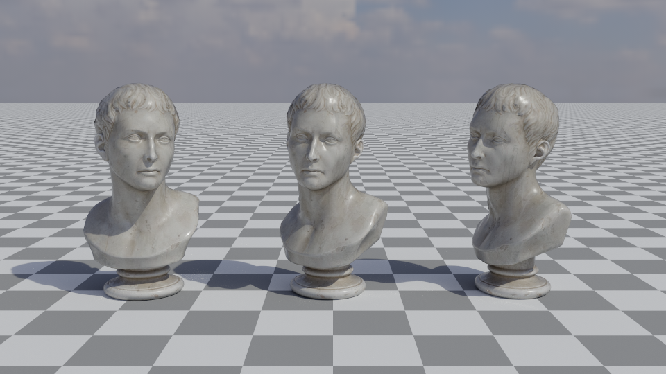
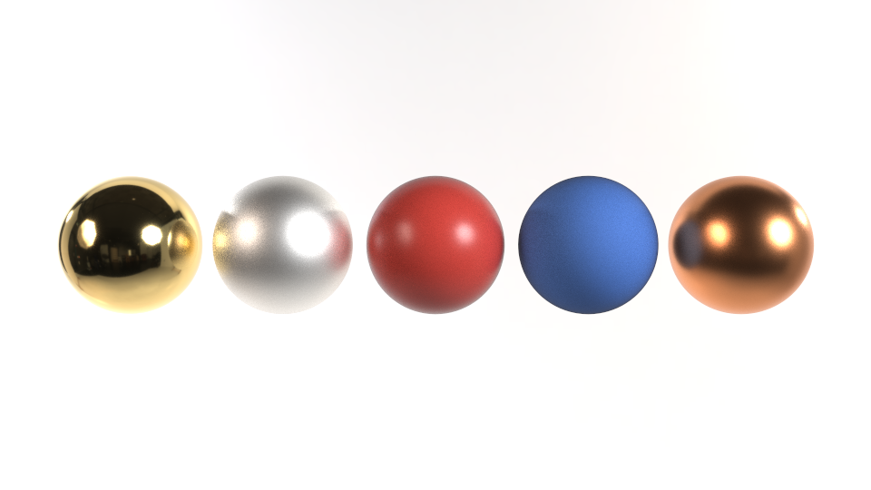
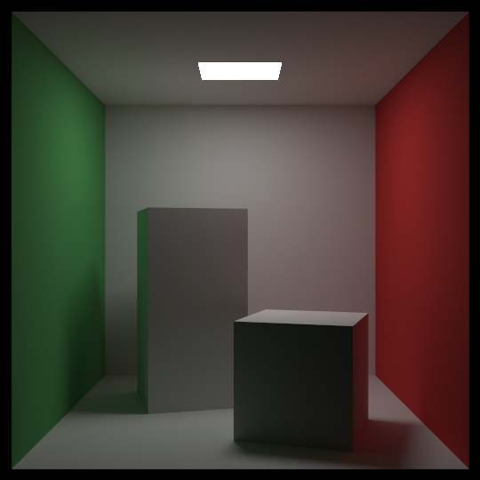
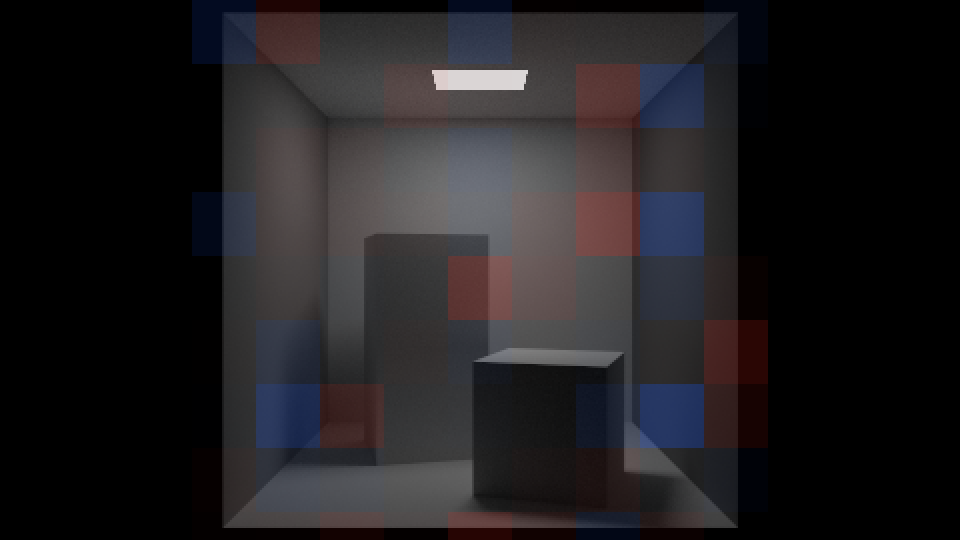
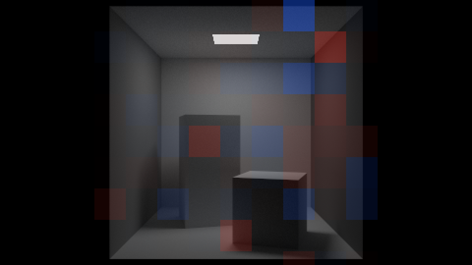
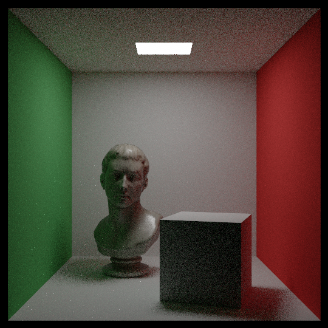
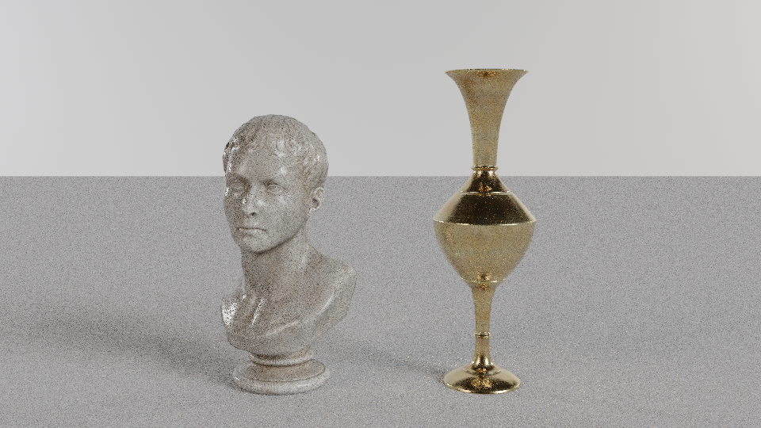
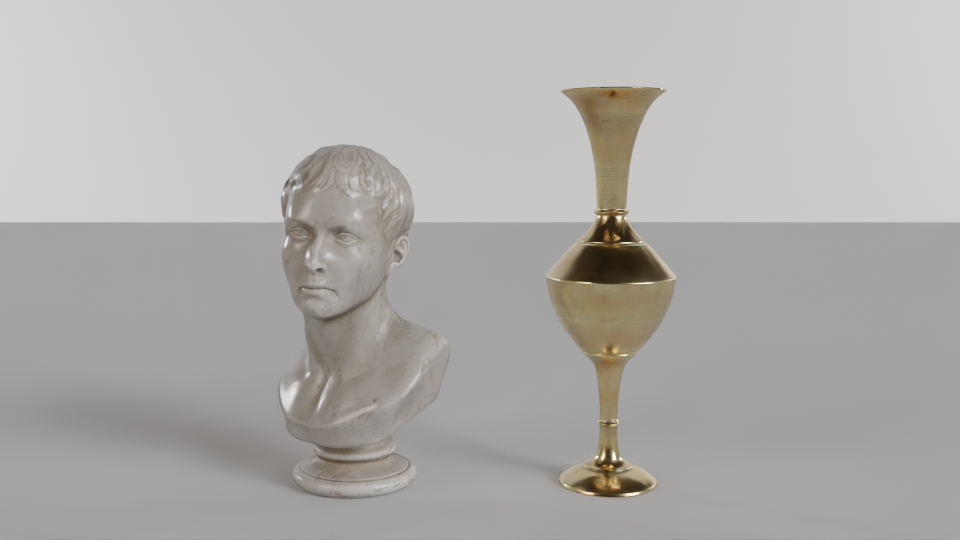

# OptiX, meshes and the denoiser

[RayTracing](../README.md) › OptiX, meshes and the denoiser

The quality kernel's integrator never asks how its rays find surfaces. It asks a `tracer` for the closest hit, the surface at it and how much of a light gets through ([why a third kernel](quality.md#why-a-third-kernel)). So hardware ray tracing came in as a second tracer around the same integrator, with triangles and a denoiser as programs and data beside it. For example, `RayTracingGPU cornell --optix -p mis` renders the Cornell box with NVIDIA's OptiX: the shading code is the quality kernel's, and only the way rays find surfaces is different. On GPUs with ray tracing cores, OptiX traverses its hierarchy on them and intersects triangles in hardware (other GPUs traverse in software); the books' spheres and quads call back into intersection programs that apply the books' own rules. This is the fifth GPU milestone, tagged `gpu-5` in [the development history](../README.md#development-history). Every kernel of the earlier milestones is unchanged, instruction for instruction: the books', the display kernel, the quality kernel and the tone-map kernel.

| | Names | What they do |
|---|---|---|
| OptiX | `--optix` | the quality kernel's integrator in an OptiX program, in `float`, under `-p material`, `nee` or `mis`; the scenes with triangle meshes always use it |
| A model | `FILE.glb` or `FILE.gltf` where a scene's name goes | a glTF 2.0 model, within the limits below, scaled to a unit sphere on a gray ground in the photo studio's light |
| The denoiser | `--denoise` | each output's twin, `NAME-denoised.png` or `.pfm`, denoised by OptiX's AI denoiser; the plain files stay as rendered |
| Scenes with meshes | `still-life`, `busts`, `cornell-bust` | a marble bust and a brass vase in a photo studio; three busts in the sun (one mesh, three instances); the Cornell box with the bust |
| Test scenes | `cornell-triangles`, `mesh-furnace`, `mesh-furnace-smooth`, `instances`, `instances-baked`, `pbr-test`, `pbr-reference` | the Cornell box of 34 triangles, white furnaces of triangles, instances against their copies baked into the world, glTF's materials against the scene materials they map to |
| The window | O, N | OptiX on or off for the scene shown, the denoised image on or off ([the viewer](viewer.md)) |

Every image on this page but ImageCompare's two maps was rendered by `RayTracingGPU` in `float` with the default seed. The command beside each, with `-o docs/optix/NAME.png` added, gives its PNG byte for byte on the same graphics driver: OptiX compiles its programs in the driver, and the denoiser's weights come with it, so a driver update can change these bytes, and the statistics below are what to check again after one. The two maps are ImageCompare's, of the protocol's renders, enlarged 2× by repeating each pixel. The images illustrate; the verdicts come from the protocols at 480×270 in [how it was verified](#how-it-was-verified).

- [One integrator, two tracers](#one-integrator-two-tracers)
- [The books' shapes as custom primitives](#the-books-shapes-as-custom-primitives)
- [Triangles](#triangles)
- [glTF models and their materials](#gltf-models-and-their-materials)
- [The denoiser](#the-denoiser)
- [Building](#building)
- [How it was verified](#how-it-was-verified)
- [Known limits](#known-limits)

| | |
|---|---|
|  |  |
| *`RayTracingGPU busts -w 960 --height 540 -s 4096`: one mesh of 17,456 triangles, one acceleration structure, three instances, in the sun of an HDR sky (`-p mis`, AgX at −0.5 EV).* | *`RayTracingGPU pbr-test -w 960 --height 540 -s 1024`: spheres of triangles in glTF's metallic-roughness materials, the test scene whose reference is the same spheres in the materials they map to (`-p mis`, the books' display).* |

## One integrator, two tracers

`__raygen__render` (`src/gpu/optix/raygen_render.cuh`) is the quality kernel's loop, line for line, with `optix_tracer` in place of `bvh_tracer`: the pixel from OptiX's launch index, the same sample generator per pixel and pass, the NaN rule, the pixel's sums read and written once per launch, the rays and shadow rays counted with two atomic additions per thread. The session plans its launches as it does for the CUDA kernels, so the window's pacing, the limit on a launch's length and the rows of a pass in progress work the same.

`optix_tracer` answers the three questions of the `tracer` concept (`src/gpu/optix/optix_tracer.cuh`):

- **`closest`** traces with `optixTraverse` and reads the hit object it returns; then the books' loop over smoke and fog, copied from `camera.cuh`, draws its random numbers exactly as the BVH's tracer does.
- **`surface_of`** hands a hit on one of the books' shapes to the CUDA kernel's own `surface_at`, and a triangle's to `triangle_surface`.
- **`visibility`** traces with `OPTIX_RAY_FLAG_TERMINATE_ON_FIRST_HIT`, then computes the transmittance of the media with the function the quality kernel uses.

No closest-hit, any-hit or miss program runs. A ray-generation program that calls `optixTraverse` and decodes the hit object itself keeps the integrator one loop in one program, as in the CUDA kernel, so its state (the throughput, the random numbers, the running sum) never travels through a payload. What a hit on a triangle needs beyond the integrator's small `bvh_hit` (its instance, primitive and barycentrics, the normal of the face, the lobe of its material) waits in a side record, `triangle_memo`, in the ray-generation program's frame; the tracer holds a reference to it, so the tracer object stays as `const` as the concept asks.

The payload carries only what the books' intersection tests need, in five words:

| Word | What it holds | Who reads it |
|---|---|---|
| 0 | the id of the primitive the ray leaves | the spheres and quads: a ray never hits the quad it leaves, and a ray going out of its own sphere never hits that sphere |
| 1 | whether the ray goes into that primitive | the spheres: only a ray going in may hit its own sphere, at the far root |
| 2 | the id to skip | the lamp a shadow ray aims at never blocks it |
| 3 | the ray's time | moving spheres, and every test's ray |
| 4 | 1/\|d\|² | the sphere test, as the BVH computes it once per ray |

The device programs are one module, `src/gpu/optix/programs.cu`, compiled by `nvcc` to PTX, an intermediate form, for the lowest architecture CUDA 13 compiles for. It is embedded in the programs with its SHA-256; the graphics driver compiles it for the GPU it runs on and caches the result, so the first OptiX run on a driver takes a few seconds more than the others. `RayTracingGPU`'s line `Kernel: optix, programs 24bbc2ef compiled by the graphics driver, 288 bytes of continuation stack per thread` names the module by its hash, which depends on the folder it was built in, as `nvcc` names an internal variable after the source's path; a clone in another folder rendered `still-life`'s same bytes under another hash. Every call of OptiX's host API is in three files that `cl.exe` compiles (`runtime.cpp`, `accel.cpp`, `denoiser.cpp`), behind plain types; the host files `nvcc` compiles (`scene.cu`, `meshes.cu`) only fill the device structures. The programs say why OptiX can't run, in order: no headers in this build, then a driver older than CUDA 13.4 needs, no OptiX in the driver, an OptiX older than these headers, or the log of a failed compile. OptiX starts only when something asks for it: `--optix`, `--denoise`, a scene with meshes, or the window's O and N. Without them, the programs render as they did before.

Under `--optix` the program renders every GPU scene the quality kernel renders, under `-p material`, `nee` or `mis`, and refuses, before CUDA or OptiX start, what it can't do: `--fp64`, `--all-books-kernel`, `--quality-kernel`, and the books' other strategies, or a scene whose own strategy is one of those when `-p` doesn't name one.

## The books' shapes as custom primitives

OptiX builds its own hierarchy, on the GPU; what it can't do is intersect the books' shapes, so they go in as custom primitives. One build input holds every primitive in the BVH's global-id order, still spheres, moving spheres, then quads, so that `optixGetPrimitiveIndex()` is the id every table of the integrator is indexed by, and a byte per primitive picks its kind's program among three records. Each primitive's box is the one the BVH builder gives its leaf, computed in `double` and rounded outward to `float`. A scene without the books' shapes builds no such structure.

The intersection programs (`intersections.cuh`) are the leaves of the BVH's two searches: the same functions, the same open interval for spheres and closed one for quads, a ray leaving its own sphere skipped unless it goes inward (then only the far root counts), the quad it leaves and the lamp a shadow ray aims at never hit, a moving sphere taken at the ray's time. `optixGetRayTmax()` is exactly the upper end those searches use, the nearest t reported so far, so the books' interval tests decide, as they do in the BVH. A ray-tracing pipeline here has no motion blur of its own: the ray's time rides in the payload, and a moving sphere's box is its swept box, as in the BVH.

Smoke and fog stay outside the hierarchy, as in the BVH: after the closest surface is found, the media's own loop decides whether the ray scattered first.

## Triangles

Triangles are what the ray tracing cores intersect themselves. Each mesh is one triangle acceleration structure, compacted after its build, and a scene with meshes has an instance hierarchy above: instance 0 is the books' structure under the identity, then one instance per placement of a mesh, with its 3×4 transform. A mesh placed three times is one structure under three instances. Every placement's triangles take global ids above the books' primitives and the particles, after one more id for the absorber (below). Before anything is allocated, every byte is planned and refused past 2048 MiB, or without 256 MiB of the GPU's memory left free, with the sizes in the message.

**What a hit is** (`triangles.cuh`). The point comes from the barycentrics, so it lies on the triangle's plane whatever the rounding of t. The face normal comes from the corners under the inverse transpose, so it stays outside under a mirroring placement. The shading normal is interpolated and turned to the side the ray came from, when the mesh has normals, else it is the face's. A triangle may wear the books' matte or metal, a GGX conductor or coat, or a glTF material; glass, lamps and smoke on triangles are refused, because a lamp would need a light sampler of its own.

**Leaving a triangle.** A ray leaving a triangle starts a little off it, on the side it leaves, with `tmin` 0: at δ = 2⁻¹⁶·max(reach, |p|∞, 1) along the face's normal, where reach is the larger of the hit triangle's largest world coordinate and its largest coordinate in its mesh's frame times the largest row sum of the placement's linear part. The hardware's watertight test rounds at the size of the coordinates it works on, and a per-coordinate offset (Wächter and Binder's, in *Ray Tracing Gems*, 2019) moved a coordinate near 0 by too little: at the Cornell box's scale, rays leaving the floor met it again from below. Every mesh is centred on its bounds at upload, its centre moved into its placements, so the coordinates OptiX tests a triangle with stay at the mesh's own size.

**The through-rule.** A smooth normal can send a ray through the face it arrived at. An opaque face carries no light that way: the ray ends at the absorber, a black lamp with a global id of its own, and its light sample is blocked too, so both of multiple importance sampling's techniques see the same integrand and the integrator needs no change. It costs a little energy at the silhouettes of coarse smooth meshes, which `mesh-furnace-smooth` measures.

**What the Cornell box of triangles caught.** `cornell-triangles`, the books' walls and blocks as 34 triangles with the lamp still a quad, came out a third darker than `cornell` at first (a mean of 0.059 against 0.088). OptiX 9.0's header writes `optixHitObjectGetTriangleBarycentrics` as an `asm` without `volatile`, so `nvcc` moved its read ahead of the first traversal of the loop and every triangle got the barycentrics of an empty hit; reading the hit's attributes, which are `volatile`, fixed it. The second defect was the per-coordinate offset above. A closed block seen from inside now tests both: the paths must stay trapped, with at most 1% of their rays missing and at most one of the 64 pixels lit, since a path may still slip through an edge where a hit point rounds outside its face, as on the books' quads.

| | |
|---|---|
|  |  |
| *`RayTracingGPU cornell -p mis --quality-kernel -w 540 --height 540 -s 4096`: the books' quads, in the quality kernel's BVH.* | *`RayTracingGPU cornell-triangles -w 540 --height 540 -s 4096`: the walls and blocks as 34 triangles under OptiX.* |
|  |  |
| ***The test:** the quads (seed 1) against the triangles (seed 3)* | ***The control:** the triangles (seed 3) against the triangles (seed 4), the noise alone* |

*Top row, 540×540 with 4096 rays per pixel. Bottom row, from the protocol's renders at 480×270 with 1024 rays per pixel, enlarged 2×: each map shows the first render in gray, tinted red where the second is brighter and blue where it is darker, in tiles of 32×32 pixels. The two maps look alike. The mean radiances are 0.087673 and 0.087681 in the test, 0.087681 and 0.087677 in the control; the mean of the difference is +1.29 and −0.66 standard errors; none of the 81 tested tiles differs by more than 3 standard errors in either map, where noise alone gives 0.2 on average. Both verdicts: consistent.*

## glTF models and their materials

**The loader.** Triangles come from glTF 2.0 files, the format most tools export, and from meshes made in code for the tests. Both are host code in a library of their own, `mesh_io` (`src/meshes.ixx`, `src/gltf.ixx`): two C++23 modules with no CUDA, so they build and are tested on any computer. `gltf` reads a `.glb` or a `.gltf` with its `.bin` and images through [cgltf](https://github.com/jkuhlmann/cgltf) and a private copy of stb_image, 8 bits per channel only, because glTF's base colors are sRGB bytes. Strips and fans become triangles; triangles with a non-finite corner or no area are dropped and counted; images are decoded once each, and only for the materials something wears.

A model's file is untrusted input, so every size is checked before anything is allocated for it, in arithmetic that can't wrap: each buffer view inside its buffer, each accessor inside its view, the file's size (at most 256 MiB), the triangles (at most 8,000,000 in a model and 64,000,000 placed), the images (at most 4096 on a side and 512 MiB decoded). What the renderer can't show (normal, occlusion and emissive maps, skins, morph targets, vertex colors, a second UV set, material extensions) loads with one warning line each; what it can't read is an error that names the file and the glTF object, and files that require compression (Draco, meshopt, KTX2, WebP) are refused with the advice to export them without compression; a file that only uses such an extension loads with a warning.

**A material per texel.** A glTF material is a mix: (1 − metallic)·a dielectric + metallic·a conductor, both of one base color and roughness, each of them possibly a texture. The integrator reads materials by index from tables, and a material that changes from texel to texel has no entry there. So each pixel gets a scratch slot past the scene's materials and the absorber, and at a glTF hit `triangle_surface` writes into the pixel's slot the material the hit's texels make: base = factor ⊙ the base color texel, clamped to [0, 1], metallic = factor · the metallic-roughness texel's B, roughness = factor · its G. With probability metallic, a number drawn only at glTF hits, it is the conductor, a GGX metal of F0 = base and α = roughness²; otherwise a matte surface of the base color under the quality kernel's glossy coat. The choice is unbiased for the mix. The slot is written before every read of it at the same vertex, and no other thread writes that pixel's slot, so the integrator reads it as any other material, with no change.

**Textures.** glTF's images become CUDA texture objects, one 8-bit RGBA array each, with glTF's sampler as the texture unit's modes (wrap per axis, bilinear or point), the base color decoded from sRGB by the hardware and metallic-roughness read linearly. They are read only by the OptiX programs: the quality kernel's texture code is unchanged.

**Two models and three scenes.** Two models from [Poly Haven](https://polyhaven.com) (CC0) are committed as published, each the 1k glTF package with every texture it names: `marble_bust_01` (17,456 triangles; a textured dielectric, metallic 0, its roughness from a texture) and `brass_vase_01` (21,440 triangles; a textured metal). `RayTracingGPU` takes a model's path where a scene's name goes:

```
out\build\x64-release\RayTracingGPU.exe assets\models\marble_bust_01\marble_bust_01_1k.gltf
```

The model is scaled to a sphere of radius 1 on a gray ground in the studio's light, with the camera 4.24 from its middle (0.6 up and 4.2 in front, from higher for a model less than 1 tall), under `-p mis` and AgX, and the image is saved in the current folder as `NAME-gpu.png`. A second build of the same file, such as the window's next scene, shares its meshes and textures: `gpu_scene` keeps the last two models read, by canonical path, size and write time.

## The denoiser

OptiX's AI denoiser is a neural network that estimates the converged image from a noisy one. It is biased: its result isn't an average of samples and doesn't converge to the true image as samples grow. So it only makes what you look at, the window's N and the extra `-denoised` files. Every PFM, statistic and check uses the image without it. Its weights ship with NVIDIA's driver, so a denoised image's bytes can change with a driver update.

| | |
|---|---|
|  |  |
| *`RayTracingGPU cornell-bust -w 540 --height 540 -s 16 --denoise`: the plain image, 16 samples per pixel.* | *The same 16 samples through the denoiser, `cornell-bust-16-denoised.png`.* |

*An illustration: these images are never measured, and the numbers below are from 480×270 renders of `cornell`, `studio`, `final` and `cornell-bust`. For the 4096-sample reference, see the next image.*


*`RayTracingGPU cornell-bust -w 540 --height 540 -s 4096`: the bust's marble under the box's lamp, `-p mis` and AgX.*

|  |  |
|---|---|
| *`RayTracingGPU still-life -w 960 --height 540 -s 16 --denoise`: the plain image, 16 samples per pixel.* | *The same 16 samples through the denoiser, `still-life-16-denoised.png`.* |

*The same illustration on the textured models of `still-life` ([its 1024-sample image](optix/still-life.png)).*

**The guides.** The denoiser takes a noisy beauty and two guides, an albedo and a world-space normal, from a pass of their own, so the quality kernel is unchanged. `guide_sample` follows the integrator's own camera ray, with its lens point and time, 16 samples per pixel summed pairwise, once per view at its first denoise, through either tracer: a CUDA kernel for the CUDA sessions and `__raygen__guides` for OptiX's. A matte surface, a particle, a glossy coat, a GGX metal of roughness 0.1 or more and the books' fuzzy metal stop there, with their color and shading normal (a particle has no normal, so it gives the reverse of the ray). A mirror, glass and a smoother metal pass the ray on, their weight multiplied in, up to eight such vertices. A lamp gives its color scaled into [0, 1], a miss the background clamped to [0, 1] and no normal.

**The network.** OptiX's AOV model with both guides, the intensity and the average color computed over the whole image before each invoke. An image of at most 2048 on a side is tried first as one invoke. If that plan doesn't fit, or the image is larger, tiles of 2048, 1024 and 512 with the network's overlap are tried in turn, and the first plan that fits within 1024 MiB with 256 MiB of the GPU's memory left free is taken. The beauty comes from the display's two bands, with NaN set to 0 and values clamped to [0, 10⁴]. The denoised floats go through the display kernels that already exist, so a denoised PNG is the display's bytes for those floats, under any tone map, and the exposure and the tone map apply after the denoiser.

**In the window,** N shows a still view denoised at its first still frame, whenever its complete passes have doubled since its last denoise (1, 2, 4, 8...), and once more when it is done or paused; a moving view shows the image itself, and the frames between two denoises show the last denoised bytes, kept on the host. T and the exposure re-tone the kept floats without denoising again ([the viewer](viewer.md#denoising-in-the-window)).

**How much it removes.** At 16 samples per pixel, 480×270, with both seeds of each scene, against two references of 2025 samples each, averaged and corrected for their own noise:

| Scene | Relative squared error removed (relMSE′), seeds 1 and 2 | Equivalent samples | Absolute squared error removed (MSE′) | Largest drift of the mean, in any channel |
|---|---|---|---|---|
| `cornell` | 57.9 and 60.3 times | 926 and 965 | 3.49 and 4.66 times | 0.10% |
| `studio` | 15.1 and 10.4 times | 241 and 166 | 2.47 and 2.50 times | 0.60% |
| `final` | 12.0 and 11.0 times | 192 and 175 | 11.4 and 14.5 times | 0.12% |
| `cornell-bust` | 30.5 and 30.2 times | 488 and 483 | 2.97 and 3.74 times | 0.06% |

*relMSE′ divides each pixel's squared error by R² + 0.01, R being the reference, so a dark wall counts as much as a lamp; MSE′ doesn't, and is dominated by the brightest pixels. Both have the reference's own variance removed. Equivalent samples: 16 times the relMSE′ gain. The pass criterion, fixed before the first run, was at least 4 times less error and a mean within 2% in every channel. It was first stated in MSE′, where it failed on 5 of 8 images, as almost all of the denoised MSE′ sits in the 1% brightest pixels; the measure was then changed to relMSE′, with the thresholds unchanged, and all 8 pass.*

So the denoiser softens the edges of lamps seen directly and of bright reflections, where most of the absolute error sits: on the pixels with R up to 1 the gain in MSE′ is 16 to 28 times. The mean drifts by at most 0.6% over a whole image, more in places: in a tile of 32×32 pixels up to 13% in `studio` and 11% in `final`. At 1024 samples per pixel (480×270, seed 1 only) it still removes relMSE′ on `cornell` (15 times less), hardly on `studio` (1.2 times), where its absolute squared error is 6.9 times larger than the plain image's: it is for the eye, and adds nothing to a render that has already converged.

## Building

OptiX needs nothing installed: CMake downloads its headers, and the programs use the OptiX in NVIDIA's driver, one for CUDA 13.4 or newer. Without OptiX the project builds as before, with `--optix`, the denoiser and the mesh scenes refused by name. [Building and running](building.md#optix) gives the three ways to get the headers, their license, and how to turn it off.

## How it was verified

Nothing was rendered on the CPU. The quality kernel's references were rendered once by the build at `gpu-4`, whose kernels the SASS gate proves the same as every later build's; the rows between mesh scenes below, and `cornell-bust`'s references for the denoiser, are OptiX's own. Every commit of the milestone passed these gates as they stood then (in `scripts/verify`, [the list](building.md#the-verification-scripts)); the table gives the last commit's:

| Gate | What it proves |
|---|---|
| Gate F (`frozen.ps1`) | The sources: the files of `gpu-3`'s list and those of the quality kernel are byte for byte `gpu-4`'s, but for `quality.cu`'s one accessor, pinned by its git blob; the CMake rules can't reach the CPU programs or the renderer's existing translation units. It renders nothing. |
| SASS gate (`sassgate.sh --all`) | The machine code: every function of `gpu-4`'s `RayTracingGPU`, `RayTracingViewer` and `GpuTests` is in the new build, with the same instructions and the same constants: the books' kernels, the display, quality and tone-map kernels and every test kernel. It renders nothing. |
| IR gate (`irgate.ps1`) | OptiX's programs: their PTX hashed and diffed from step to step, no source path in them, a Debug build's PTX equal to Release's. |
| Host gate (`hostgate.ps1`) | 144 command lines that stop before rendering, the window's scripts and replays and small renders, against `gpu-4`'s exes, and the README GIF's tour against its last accepted frames. OptiX's lines are stamped with the driver and the programs' hash: under another stamp they wait for review, and never pass silently. |
| Carry check (`carry.ps1`) | 16 CUDA configurations and 17 that use OptiX, 3 of them denoised, keep their bytes. The OptiX ones are bit for bit from process to process on the same driver, so these are byte gates, stamped like the host gate's. |

**The tracer check** (GpuTests `optix-tracer`) sends the same rays through both tracers on the geometry of the 22 GPU scenes without meshes, their textures folded to plain colors: each sample's camera ray and three bounces, plus a shadow query at each vertex, with the same spawn and the same random numbers, and every answer compared bit for bit on the test machine's driver (hit index, side, t, the media's random numbers left, visibility). 2,438,769 closest-hit queries: 0 mismatches and not one last-bit difference; 1,228,123 shadow queries: 0 differences. With the books' shapes under an instance root (`cornell`, `final` and `studio`), one tie of two coplanar faces at equal t differs, in `final`. Three faults planted on OptiX's side (the hit kind inverted, the media loop skipped, the lamp's skip dropped) show on 66%, 24% and 50% of the queries.

**ImageCompare's protocol** ([for two strategies](quality.md#how-it-was-verified)): at 480×270 with 1024 rays per pixel, each side with two seeds, two controls, two cross-seed tests and the RMS rule. The six rows against the quality kernel passed at their first run; `cornell-triangles` failed until the two defects above were fixed.

| Scene | Compared | Verdict | σ of one render | Largest whole-image \|z\| of the two tests (limit 3.42) | RMS of the tests, as a share of the rule's bound |
|---|---|---|---|---|---|
| `cornell -p mis` | quality kernel against OptiX | consistent | 0.00125 and 0.00125 | 1.35 | 0.908, 0.910 |
| `final -p mis` | the same | consistent | 0.00739 and 0.00727 | 1.24 | 0.900, 0.911 |
| `studio -p mis` | the same | consistent | 0.0142 and 0.0143 | 1.44 | 0.909, 0.908 |
| `veach -p mis` | the same | consistent | 0.0186 and 0.0187 | 1.26 | 0.902, 0.893 |
| `bouncing -p material` | the same | consistent | 0.00445 and 0.00444 | 1.34 | 0.906, 0.910 |
| `smoke -p nee` | the same | consistent | 0.00384 and 0.00384 | 3.10 | 0.906, 0.909 |
| `cornell` against `cornell-triangles`, `-p mis` | quads (quality kernel) against triangles (OptiX) | consistent | 0.00125 and 0.00125 | 1.40 | 0.908, 0.910 |
| `cornell` against `cornell-triangles`, `-p material` | the same | consistent | 0.0141 and 0.0141 | 0.69 | 0.908, 0.914 |
| `instances` against `instances-baked` | one mesh under four instances against the same four baked into the world | consistent | 0.0049 and 0.0049 | 1.08 | 0.908, 0.915 |
| `pbr-reference` against `pbr-test` | the scene materials against the glTF materials they map to | consistent | 0.0041 and 0.0042 | 1.96 | 0.913, 0.908 |
| `still-life`, `-p material` against `-p mis` | the two strategies on textured glTF materials | consistent | 0.0599 and 0.0084 | 2.78 | 0.893, 0.887 |

*σ: the trimmed standard deviation of one render, the first side and then the second. A whole-image |z| of 3.10 on `smoke` is within its limit of 3.42, and its other test gives 0.73. The Cornell box's two sides differ in their shapes and in their tracer alike.*

**With the same seed,** the two renderers trace the same paths where the same numbers come out, and 50% of the pixels of 22 scenes at 240×135 with 16 rays per pixel, 712,800 pixels in all, came out bit for bit equal on the test machine's driver, with rays and shadow rays within 0.5%, and nothing NaN or infinite. The hits are the BVH's, bit for bit on that driver (the tracer check). The rest is probably where the driver's compiler fused a multiply and an add where `nvcc` didn't, and a path then took another turn: inferred from what the rules allow, not measured. So OptiX is held to the quality kernel statistically, and to its own earlier bytes on the same driver.

**Exact checks.** `furnace`, `env-furnace` and `mesh-furnace` (two white icospheres of triangles, one mirrored, under a white sky) give every value exactly 1.0 under OptiX. `mesh-furnace-smooth` gives 0.99966, the light the through-rule takes at the silhouettes of a coarse smooth mesh.

**Device tests.** GpuTests' suites `optix-runtime`, `optix-tracer`, `optix-render`, `optix-triangles`, `optix-pbr`, `mesh-cache`, `guides`, `denoise`, `denoise-eval` and `optix-sessions` cover OptiX's start and refusals, a launch's indices, hits against brute force in `double` on an icosphere and a torus, a closed block and a closed corner seen from inside, their paths trapped within the allowance above, the mapping of glTF's materials bit for bit, a metal lobe's share against its binomial expectation, the hardware's sRGB decode (each byte held to half its own step through the curve), the guides of OptiX against CUDA's (0 of 57,600 pixels apart between `cornell-triangles` and `cornell`), a tiled denoise against one invoke, and sessions made and destroyed with no GPU memory lost over five of each kind. `MeshTests`, 259 checks with no GPU, covers the loader and the generators: glTF files built in the test, every limit on both sides of its boundary, every refusal and warning, each committed model's files by SHA-256. compute-sanitizer with OptiX's checks found 0 errors on `cornell`, `final`, `instances`, `pbr-test`, `still-life`, and `cornell` and `cornell-bust` with `--denoise`, each when its path was added.

**The window.** A viewer render equals `RayTracingGPU`'s, every float, on `cornell --optix -p mis` and `still-life`; two scripted live sessions, one through O, Tab to the mesh scenes and a double-click on the bust, one through N on `cornell`, replayed without a window, give the same frames, and P's printed commands render the same PFMs on the same driver.

**Debug = Release.** In the one Debug build compared, the OptiX modules' PTX are equal to Release's byte for byte, and the carried configurations, CUDA's and OptiX's, render the same bytes in both, on the same driver.

## Known limits

- **Bytes depend on the driver.** OptiX's output and the denoiser's are repeatable run to run on one graphics driver; another driver can compile the programs or run the network differently. The statistics were measured on one driver; `scripts/verify/optix-reverify.ps1` repeats most of them after an update, and none has happened yet.
- **`float` only,** as the quality kernel.
- **No lamps on triangles.** A mesh's emission is ignored with a warning: a mesh lamp needs a light sampler of its own.
- **No normal maps, alpha cutouts or mipmaps.** glTF's normal and occlusion textures are ignored with a warning, alpha is rendered opaque, and textures are read at their base level.
- **The materials are approximate.** A glTF dielectric wears the quality kernel's glossy coat, whose diffuse term differs from glTF's and darkens toward grazing angles; rough metals keep the light Turquin's compensation gives back, so they come out brighter than glTF viewers show them.
- **Smooth-shaded silhouettes lose a little light,** through the through-rule; flat meshes lose none.
- **Glass on triangles is refused.**
- **A blind zone off mesh faces.** Geometry closer to a mesh face than its rays' origin offset, about 2⁻¹⁶ of the coordinates, isn't seen from that face, and a books' shape hit by a ray leaving a triangle is placed within that offset of its surface. The offset assumes placements whose scales are similar: under strongly anisotropic ones (a ratio past about 100 along the axes) it is too small.
- **No temporal denoising.** A moving view is shown undenoised; each still view is denoised on its own.
- **The first OptiX run compiles its programs** for a few seconds, once per driver; OptiX caches the result.
