# Light and materials beyond the books

[RayTracing](../README.md) › Light and materials beyond the books

The books find light only where a path ends. A bounce off a matte wall reaches the Cornell box's small lamp only by chance, so their best strategy, the mixture, aims half of the bounces at the lamps instead ([four strategies](sampling.md#four-strategies)). Their metals are mirrors whose reflection is pushed off by a random fuzz, their sky is a gradient between two colors, and their bytes are the square root of the light, clamped below 1. A third CUDA kernel, the quality kernel, goes further: a shadow ray toward a light at every bounce, weighed against the material's own sample of the same light by multiple importance sampling; rough metals and glossy coats with the GGX microfacet model; HDR photographs of the surroundings as the sky, sampled by their brightness. Beside it, a tone-mapping kernel of its own shows light far brighter than 1, for any scene, the books' included. For example, `RayTracingGPU cornell -p mis` renders the Cornell box that way. This is the fourth GPU milestone, tagged `gpu-4` in [the development history](../README.md#development-history). The books' kernels are unchanged, instruction for instruction, and still render the books' scenes by default.

| | Names | What they do |
|---|---|---|
| Sampling strategies (`-p`) | `nee`, `mis` | a shadow ray to a light at every bounce, counted alone (`nee`) or weighed against the material's own sample (`mis`); the books' `uniform`, `material`, `lights` and `mixture` stay |
| The base mode | `--quality-kernel` | the quality kernel under the books' `-p material`: the check that it traces the books' paths |
| Scenes beyond the books | `cornell-ggx`, `veach`, `studio`, `sunlit` | rough metals and glossy coats under lamps and under HDR skies, with `-p mis` and AgX tone mapping by default |
| Test scenes | `furnace`, `ggx-furnace`, `gloss-furnace`, `env-furnace`, `sun-test` | white furnaces whose pixels have known values, and matte spheres in sunlight |
| Display | `--tonemap NAME`, `--exposure EV` | `books` (the books' scenes' default), `none`, `agx` or `neutral`, the light first multiplied by 2^EV |
| The window | M, T, `,` `.` `0` | the next sampling strategy, the next tone map, the exposure down, up and back to 0 ([the viewer](viewer.md)) |

Every image on this page but ImageCompare's two maps was rendered by `RayTracingGPU` in `float` with the default seed: the command beside it, with `-o docs/quality/NAME.png` added, gives its PNG byte for byte. The two maps are ImageCompare's, of the protocol's renders with seeds 1, 3 and 4, enlarged 2× by repeating each pixel. The images illustrate; the verdicts come from the protocols at 480×270 in [how it was verified](#how-it-was-verified). Methods are credited where they are used, as in the code's comments; pbrt-v4 was a source of ideas, not of code.

- [Why a third kernel](#why-a-third-kernel)
- [Next-event estimation and multiple importance sampling](#next-event-estimation-and-multiple-importance-sampling)
- [Shadow rays through smoke and fog](#shadow-rays-through-smoke-and-fog)
- [Rough metals and glossy coats](#rough-metals-and-glossy-coats)
- [The environment map](#the-environment-map)
- [Tone mapping](#tone-mapping)
- [How it was verified](#how-it-was-verified)
- [Known limits](#known-limits)

## Why a third kernel

`RayTracingGPU` renders the books' scenes with two kernels, one for the first book's scenes and one for all three books, each compiled for `float` and for `double`, and a fifth kernel, the display kernel, turns the image into bytes ([how it renders](gpu.md#how-it-renders)). These five are the project's reference on the GPU: the render kernels were verified against the CPU renderer scene by scene ([verification](gpu.md#verification)), and the gallery, the window's frames and the README's GIF are their bytes. A kernel takes as many registers per thread as the most demanding point of its code needs, and nvcc compiles the code of a translation unit together, so anything added to the books' kernels, even behind a branch that no book scene takes, could change how they compile, and every book scene with them. So they are frozen, and the new light and materials live in a kernel of their own.

The quality kernel is in `quality.cu`, a translation unit of its own, as `display.cu` is; `renderer.cu` sees only host declarations of it. It reuses the books' device code without editing it: the BVH's closest-hit search, the camera, the books' `scatter()` for metal and glass, the random numbers. No enumerator was added to an enum the books' kernels compile: a GGX material is a side entry beside the books' material it completes, and `nee` and `mis` are a light combination that only the quality kernel reads. Its loop is the all-books kernel's, and its path keeps three things more: a running sum of the light found, the density each ray was drawn with, and whether the ray left a vertex that has no density. It sees materials through one interface, a BSDF that draws a direction with its density and weight, evaluates f·cos θ and the density of a direction it didn't draw, or says that it has no density (a mirror, glass). It finds what rays meet through a `tracer` (the closest hit, its surface, a shadow ray's visibility) and never names the BVH, and [OptiX, on the ray tracing hardware](optix.md#one-integrator-two-tracers), later took the BVH's place with this integrator unchanged. Compiled for the GPU it is tested on, it takes 128 registers and 256 bytes of stack per thread, with no registers spilled (`RayTracingGPU`'s `Kernel:` line counts the stack as local memory); the all-books kernel takes 95 registers in `float`. Builds for other architectures can get other counts.

A render takes the quality kernel under `-p nee` and `-p mis` in a scene with a lamp or an environment map (elsewhere they fall back to `-p material` in the books' kernels, see [known limits](#known-limits)), with `--quality-kernel`, or when the scene needs it: a GGX material or an environment map, as in the four scenes beyond the books. It computes in `float` only. Both programs refuse, in one `Error:` line, what it can't do: `--fp64`, `--all-books-kernel`, and a books' strategy other than `material` (the scenes beyond the books take `material`, `nee` or `mis`). Under `-p material`, its base mode, matte surfaces and smoke draw exactly the numbers the all-books kernel draws, and metal and glass go through the books' `scatter()`, so it traces the books' paths, which [the verification](#how-it-was-verified) tests on all 13 scenes.

Four gates in `scripts/verify` guard the books' kernels and what was verified. The first two prove the kernels unchanged without rendering anything; the other two watch the code around them and the renders already verified:

| Gate | What it proves |
|---|---|
| Gate F (`frozen.ps1`) | The sources. The CPU modules and programs, the books' device headers, `display.cu`, the third-party code, the CMake modules and presets, the README's GIF and its script are byte for byte those of `gpu-3`, where the milestone began. `renderer.cu` still holds, verbatim, the device code of the books' kernels and the host lines they compile against, and `CMakeLists.txt` starts with `gpu-3`'s section for the CPU programs, with no later line that changes those targets or the C++ flags. It renders nothing. |
| SASS gate (`sassgate.sh`) | The machine code. `cuobjdump`, CUDA's disassembler, reads the GPU code in `RayTracingGPU` and `RayTracingViewer`: the first book's kernel and the all-books kernel, in `float` and in `double`, and the display kernel must be identical to those of the build at `gpu-3`, instruction for instruction and in their constant banks (doubles, jump tables). A planted change of one instruction is reported. The quality and tone-map kernels are compared with the previous build's wherever a commit says they are unchanged. It renders nothing. |
| Host gate (`hostgate.ps1`) | What the kernels are given and what is done with their results, against the previous build: 103 command lines by the end that stop before rendering (the help, every option's errors), the frames of a fixed window script, five small `RayTracingGPU` renders, a script of the window's tone maps, and the README GIF's tour, its 65 frames and its recording. A difference a commit means is reviewed, and accepted exactly as reviewed. |
| Carry check (`carry.ps1`) | Configurations verified once keep their bytes. Each is rendered at 480×270 with 64 rays per pixel and seed 3, and the SHA-256 of its PFM (and of its PNG under a tone map) must be the one recorded when it was verified. A difference sends that configuration back through its protocol. |

At every commit of the milestone the SASS gate found the books' four render kernels and the display kernel unchanged, instruction for instruction, in both programs.

## Next-event estimation and multiple importance sampling

The light leaving a point toward the camera is its own emission plus the light arriving from every direction ω, as the material reflects it: L_o = L_e + ∫ f(ω)·L_i(ω)·|cos θ| dω. A path tracer estimates the integral at every bounce with one direction drawn with some density p, as f·L_i·|cos θ| / p. Where L_i comes straight from a lamp, two densities are natural:

- **The material's sample**, with density p_B: a direction drawn as the material scatters, the books' `-p material`. It finds a large lamp easily and follows a narrow lobe exactly, but from a matte or rough surface a small lamp is a speck it rarely hits.
- **The light sample**, with density p_L: a point drawn on a lamp, and a shadow ray to check that nothing stands between (next-event estimation). A quad's point is uniform over its area, which as a direction from the vertex has the density d²/(cos θ_l·A) per steradian; a sphere's direction is uniform in the cone it fills, with the density 1/(2π(1 − cos θ_max)), as the books' light samplers draw them. It finds a small lamp at every bounce, but it doesn't know the material: a sharp metal reflects a large lamp toward the camera only from a sliver of it, where its points rarely fall.

Veach's multi-sample estimator takes one sample of each at every vertex and adds them, each weighted: F = w_L·f·L_e·V / p_L + w_B·f·L_e / p_B, where V is the shadow ray's verdict. It is unbiased whatever the weights, as long as they add up to 1 wherever both techniques can draw a direction, and a technique that can't draw it gets 0 (Eric Veach's thesis, 1997, chapter 9). `-p mis` uses his power heuristic, w_L = p_L² / (p_L² + p_B²), so that each sample counts where its technique's density dominates: the light sample for a small lamp far away, the material's ray for a large lamp up close or a narrow lobe. It is computed as 1/(1 + r²), r being the ratio of the two densities: a quad seen nearly edge on can have a density above √FLT_MAX ≈ 1.8·10¹⁹, whose square would overflow a `float`.

The books' mixture is the other model Veach describes, the one-sample model: one direction, drawn from the density ½p_B + ½p_L and weighted by f / p. Those weights are his balance heuristic, and his theorem 9.4 shows that no other weights do better with one sample. So `-p mis` doesn't gain by its weights. It gains by taking two samples at every vertex: the light sample, and the material's sample, which is also the path's next ray and finds light by itself. A bounce of the mixture either aims at the lamp, and a path that reaches it ends there, or follows the material; a bounce of `mis` does both.

The three strategies of the quality kernel share one estimator and differ only in the weights:

| `-p` | The light sample counts | The light a material's ray finds counts |
|---|---|---|
| `material` | none is taken (the base mode) | in full |
| `nee` | in full | only where no light sample could have drawn its direction: after the camera, a mirror or glass, or for a lamp outside the light set; elsewhere 0 |
| `mis` | p_L² / (p_L² + p_B²) | p_B² / (p_B² + p_L²) |

All three converge to the same image, the books' `-p material`'s ([how it was verified](#how-it-was-verified)). The details that keep it so:

- **The light set** is the world's own glowing primitives: every quad and every sphere that stands still whose material is a lamp of one solid color, found among the BVH's primitives, so a lamp inside a turned and moved instance counts too. The books' lights list isn't used: in `glass` it holds the glass ball, which doesn't glow. A light sample picks one light uniformly, 1/N each. A pick by power would starve some: in `light` the sphere lamp emits 4π times as much as the quad and would get 93% of the samples, though the quad gives a point 3 units in front of it an irradiance of 1.55, and the sphere gives a point 7 units below its center 1.03.
- **A ray that finds a lamp** is weighed with the density that lamp's light sample had from where the ray left, the very `float` point the light sample was drawn from. It isn't the sum over every lamp in that direction: a light sample of another lamp ends at its own lamp, so only this lamp's technique could have made the same path (path-space MIS, as pbrt-v4's path integrator weighs a ray that hits a light). The chance of picking the lamp, 1/N, counts on both sides of the weights.
- **Mirrors and glass** have no density: the books' metal at any fuzz (the fuzz is a look, not a density), glass, and GGX below α = 10⁻³. They take no light sample, since no light sample could find the one direction they reflect into, and the lamp or sky their ray finds next counts in full.
- **The depth rule.** A path traces at most `max_depth` rays, the camera ray included, as in the books. A light sample stands for one more ray, so it is taken only where the path may still trace one. A light sample at the last vertex would add paths of `max_depth` + 1 rays, which `-p material` never traces, and the strategies would converge to different images. GpuTests renders a small scene at depths 2 and 3 under all three strategies and finds them equal within noise, and the same renders show that a light sample at the last vertex would move the image by more than 8 standard errors, so the test would see that mistake.
- **Rays are counted as before.** `Rays traced` counts the closest-hit searches, the camera rays and their bounces, so rays per sample compare with the books' kernels. Under `nee` and `mis`, `RayTracingGPU` also prints the shadow rays, counted apart.

Veach's four plates, the picture that introduced multiple importance sampling (Veach 1997, chapter 9), show each technique failing where the other succeeds:

| | |
|---|---|
| 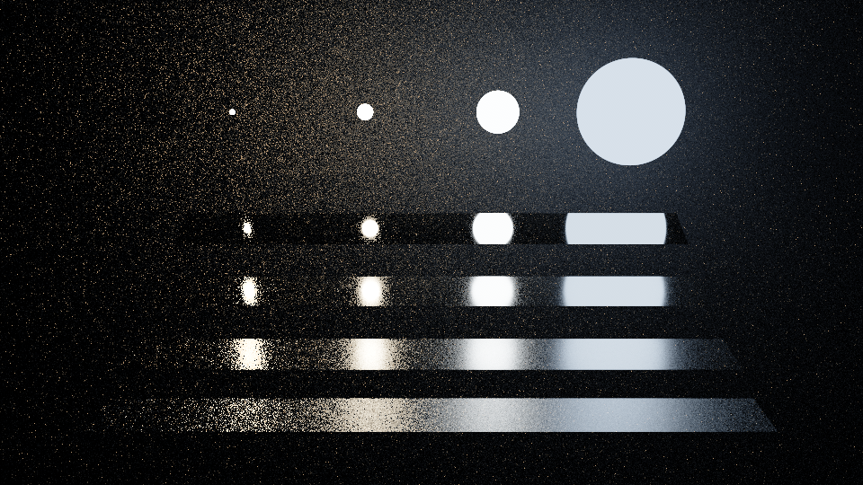 | 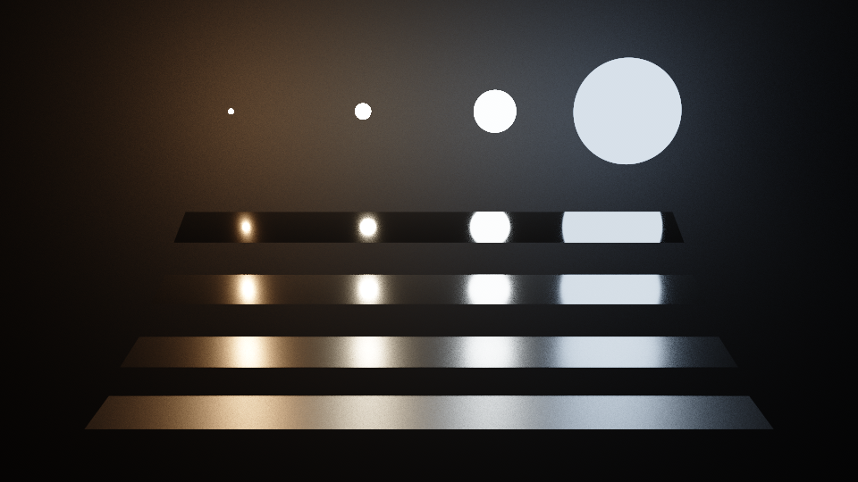 |
| *`RayTracingGPU veach -w 960 -s 256 -p material`: the materials' own samples. The sharp plates find even the small lamps; the rough plates and the wall are speckled by the rare rays that happen to hit a small, bright lamp.* | *`RayTracingGPU veach -w 960 -s 256 -p mis`: both samples, weighed by the power heuristic. All sixteen highlights are clean.* |
| 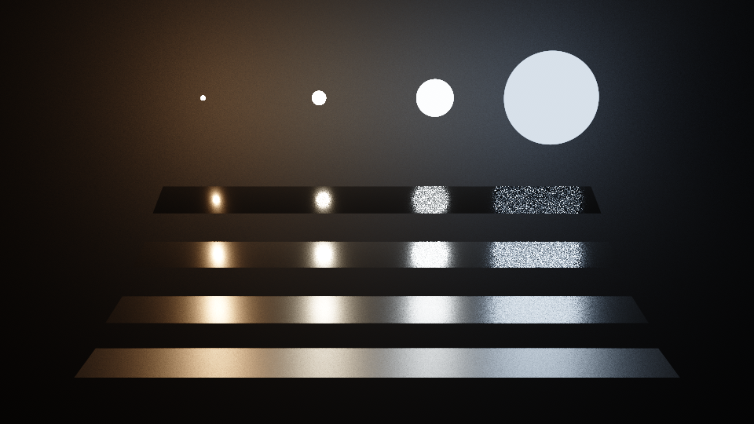 | **`veach`**: four plates of one metal, F0 (0.95, 0.93, 0.88), from sharp at the top (roughness r = 0.05) to rough at the bottom (r = 0.35), each tilted so that it mirrors the row of lamps toward the camera. The four sphere lamps have the radii 0.05, 0.15, 0.4 and 1 and one power: their radiance is 4/r², tinted from warm to cool, so the smallest is 400 times as bright as the largest. A dark matte wall stands behind them. |
| *`RayTracingGPU veach -w 960 -s 256 -p nee`: light samples alone. The rough plates and the wall are smooth, but the sharp plates' images of the large lamps are grainy: few points of a large lamp fall in a sharp plate's narrow lobe.* | |

*960×540, 256 rays per pixel each, AgX at −1 EV, the scene's own display. The material's sample continues every path under all three, so each traces 2.15 rays per sample.*

On the Cornell box the light comes from one small lamp, the case the books' mixture was made for:

| | |
|---|---|
| 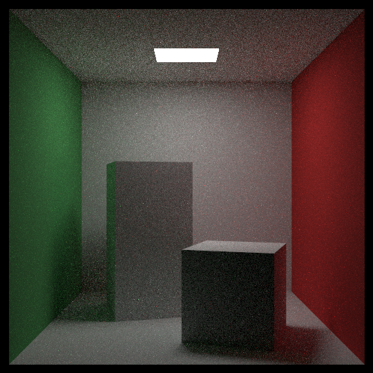 | 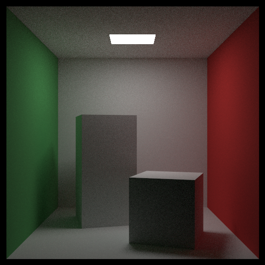 |
| *`RayTracingGPU cornell -w 540 -s 64 -p mixture`: the books' best strategy, rendered by the books' kernel; 2.44 rays per sample.* | *`RayTracingGPU cornell -w 540 -s 64 -p mis`: a shadow ray to the lamp at every bounce, weighed against the material's sample; 6.60 rays and 4.00 shadow rays per sample.* |

*540×540, 64 rays per pixel each: equal samples, not equal time. A sample of `mis` traces more rays: half of the mixture's bounces aim at the lamp, and a path that reaches the lamp ends there, while the paths of `mis` follow the material and add a shadow ray at their bounces. The noise is measured on the protocol's renders at 480×270 with 1024 rays per pixel, as σ, the trimmed standard deviation of one render: two renders with different seeds, the RMS of their difference divided by √2, leaving out the largest 1% of the squared differences. It is 0.00315 under the mixture and 0.00125 under `mis`, 2.5 times less. On `light` it is 0.00236 against 0.00139.*

And the test that the two converge to the same picture, from the protocol's renders:

| | |
|---|---|
| 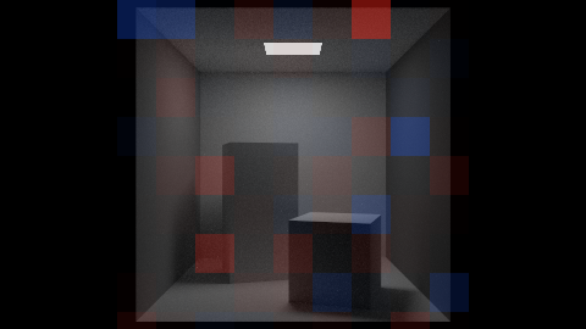 | 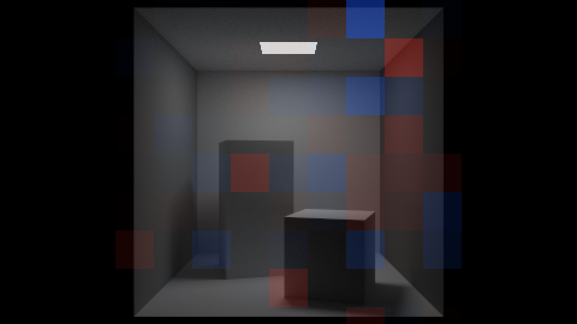 |
| ***The test:** the mixture (seed 1) against `mis` (seed 3)* | ***The control:** `mis` (seed 3) against `mis` (seed 4), the noise alone* |

*`cornell` at 480×270 with 1024 rays per pixel, ImageCompare's maps enlarged 2× by repeating each pixel. Each map shows the first render in gray, tinted red where the second is brighter and blue where it is darker, in tiles of 32×32 pixels, in full color only where a tile differs by more than noise could explain ([how ImageCompare decides](image-compare.md#how-it-decides)). The two maps look alike. The mean radiances are 0.087674 and 0.087681 in the test, 0.087681 and 0.087676 in the control; the mean of the difference is +0.58 and −0.67 standard errors; the RMS of the difference is 0.004107 and 0.002487. Of the 81 tiles tested (the 54 black tiles beside the box are identical in both renders and aren't tested), none differs by more than 3 standard errors in either map, where noise alone gives 0.2 on average; the largest |z| is 2.75 and 2.74, and all tiles together give Σz/√T = +0.90 and −0.55. Both verdicts: consistent.*

```
RayTracingGPU cornell -w 480 --height 270 -s 1024 -p mixture --seed 1 -o a.pfm
RayTracingGPU cornell -w 480 --height 270 -s 1024 -p mis --seed 3 -o b.pfm
RayTracingGPU cornell -w 480 --height 270 -s 1024 -p mis --seed 4 -o c.pfm
ImageCompare a.pfm b.pfm --zmap cornell-zmap.png
ImageCompare b.pfm c.pfm --zmap cornell-zmap-control.png
```

The first render is the books' kernel's. One line of the test's report stands out: its sign test gives z = +12.11, where noise of the same shape gives about 0. The two strategies' noise has different shapes, which ImageCompare's note explains: its checks assume two renders whose noise has one distribution ([using it correctly](image-compare.md#using-it-correctly)). That is why the protocol for two strategies adds controls, tests across seeds and a rule on the RMS of the difference ([how it was verified](#how-it-was-verified)).

## Shadow rays through smoke and fog

A shadow ray asks a question with a yes-or-no answer: does anything lie between the vertex and the sampled point of the light? So it is an any-hit search (`occluded` in `shadow.cuh`): the closest-hit search's walk of the BVH with a fixed t_max, the distance to the sampled point, that returns at the first primitive it finds. Every primitive of the BVH blocks it, glass, metal and the other lamps included: light through glass or off a mirror arrives by the material's own rays, which a light sample can't draw. The lamp it aims at is skipped by its id, so that the sampled point itself, a rounding before or beyond t_max, can't shadow it. It leaves the vertex by the closest-hit search's rules for the surface a ray leaves ([what float costs](gpu.md#what-float-costs)), and meets a moving sphere where the sphere is at the path's time. With t_max fixed, every node it pushes is visited, so its stack holds node ids alone, half the size of the closest-hit search's. OptiX's `OPTIX_RAY_FLAG_TERMINATE_ON_FIRST_HIT` does the same on ray-tracing hardware.

Smoke and fog aren't in the BVH. In a volume of density ρ, the books' free-flight test (`medium_collision`) lets a ray through a stretch of length L with the probability e^(−ρL). A shadow ray computes that probability instead of drawing it: the transmittance T = exp(−Σ ρ_k·L_k), over each volume's chord within the ray's own segment, from 0.001 to the lamp, found by `medium_collision`'s own rules for where a ray enters and leaves a sphere or a box of quads. Its expected value is the same, and it draws no random number. The drawn test answers 0 or 1, which would add a relative noise of √((1 − T)/T) to every light sample: 23% through the haze of the second book's final scene (T ≈ 0.95), and 206% through a block of `smoke` (T ≈ 0.19). This is the expected-value estimator of Novák et al., "Monte Carlo Methods for Volumetric Light Transport Simulation" (Eurographics STAR 2018).

A particle of smoke takes a light sample too, as a matte surface does. Its phase function scatters equally in every direction, f = albedo/(4π), and its own sample has the density 1/(4π), so the weights work there unchanged; the transmittance is common to both techniques and cancels from them. The path's next ray stays the particle's own sample, with the weight albedo. That is the remedy [where the mixture can't help](sampling.md#where-the-mixture-cant-help) names for thin haze: the mixture's weights of up to 2 per bounce would multiply along a path that scatters again and again, so under the mixture volumes keep their own density, while a light sample is a separate ray that leaves the path's weights alone. Under `nee` and `mis`, a path whose throughput becomes exactly 0, in the black block of albedo 0 in `smoke`, ends there: nothing it could find would count, so the image is the same, with 13 to 22% fewer rays in a test scene of black smoke. `-p material` traces on, as the books' kernels do, so its rays per sample stay theirs.

On `final`, at 480×270 with 1024 rays per pixel, σ of one render is 0.0123 under the mixture, 0.0073 under `mis` and 0.0083 under `nee`, with 3.68 rays (as under `-p material`) and 1.90 shadow rays per sample under `mis` (equal samples, not equal time).

## Rough metals and glossy coats

The books' metal is a mirror whose reflected ray is pushed off by a random amount, its fuzz: a look, not a model of a rough surface, with no density a light sample could be weighed against. The rough metals here are the microfacet model of Walter et al. (2007): a surface of tiny mirrors whose normals spread around the surface's normal n. Light from l leaves toward v off the facets whose normal is the half vector h between them, so f = F·D·G2 / (4 (n·v)(n·l)):

- **D**, the density of the facets' normals, is GGX (also called Trowbridge–Reitz), of width α = r², r being the roughness in [0, 1] (Burley 2012, as in OpenPBR and Filament; pbrt-v4's roughness is another scale). The sine of h's angle comes from a cross product, not from 1 − cos²: near the peak a `float` cosine just below 1 leaves 1 − cos² in steps of 1.2·10⁻⁷, 12% of α² at α = 10⁻³.
- **G2**, the share of those facets that both v and l see, is Smith's masking and shadowing in its height-correlated form (Heitz 2014): a facet low in the surface is likely hidden from both directions at once, which the product of two separate terms would count twice, darkening rough metals.
- **F**, how much a facet reflects, is Schlick's approximation (1994) with the metal's color at normal incidence, F0, per channel. Aluminum, gold, silver and copper take their measured F0 from the Unreal Engine's documentation, aluminum's (0.913, 0.921, 0.925) among them.

A direction is drawn among the facets' normals that the viewer sees, the visible normals (Heitz 2018), with the spherical caps of Dupuy and Benyoub (HPG 2023): two random numbers and no tangent frame. Each sample's weight f·cos θ_l / p is then F·G2/G1(v), at most F, where drawing h by D alone gives weights that reach the hundreds at grazing angles. Its density, D(h) / (2(n·v + A_v)) with A_v = √((n·v)²(1 − α²) + α²), is known in closed form, so a light sample can be weighed against it. Below α = 10⁻³ the lobe is the perfect mirror with Schlick's F, a delta lobe (pbrt-v4 switches at the same width). The code is re-derived from the papers' equations; no listing is copied.

The CPU renderer's classes can't describe these materials, and they are frozen, so a scene of the GPU's own gives each one a placeholder, a books' metal of fuzz 0 whose color is F0 (a matte material for a glossy coat), and a side entry with its roughness, found by the placeholder's address when the scene is translated. A scene with side entries renders with the quality kernel; the books' scenes have none.

**Energy.** A white furnace shows what a lobe keeps. In `ggx-furnace` five spheres of a metal with F0 = 1 stand under a sky of radiance 1; the spheres stand far enough apart that the centre of each sees the sky alone but for its neighbours low on its horizon (at most about 13° above it), so a centre's expected value is the light its lobe keeps at that angle, and the checks read the centres. Single scattering, the light that leaves after one facet, loses the light the facets pass on to one another: averaged over the angles of view, a white GGX metal keeps about 0.97 of the light at α = 0.1 and 0.41 at α = 1. Turquin (2019) puts it back: the lobe is scaled by 1 + F0·(1 − E)/E per channel, E being the share a white metal's single scattering keeps at the view's angle, read from a 32×32 table over that angle and the roughness, which GpuTests computes on the GPU by a fixed quadrature and checks against the committed file. A white metal then keeps all of its light at every angle, and in a colored one the light given back is tinted by F0. Only the sample's weight and the evaluated f change: directions are drawn as before, with the same density, so the weights of multiple importance sampling hold.

| A sphere of `ggx-furnace` | The light single scattering keeps, head-on | With Turquin's compensation |
|---|---|---|
| the perfect mirror, r = 0 | 1: its centre exactly 1.0, every value | 1: its centre the same bytes |
| GGX, α = 0.05 | 0.9973 | 1 |
| GGX, α = 0.3 | 0.8771 | 1 |
| GGX, α = 0.6 | 0.5906 | 1 |
| GGX, α = 1 | 0.3069 | 1 |

*The middle column is an independent reference table, which GpuTests' quadrature matches within 9.2·10⁻⁴. The scene at its default size, 480×270 with 256 rays per pixel: without the compensation, each rough sphere's centre came within 0.0022 of the light its lobe keeps there (allowed: 4 standard errors + 0.003); with it, within 0.0070 of 1 (allowed: 4 standard errors + 0.005). Single pixels of a compensated sphere exceed 1: a sample's weight reaches the factor, 3.3 at α = 1. GpuTests finds the compensated energy within 3·10⁻³ of 1 for views up to 80° from the normal and within 2.8·10⁻³ at 89°, over 7 widths.*

The table's columns are spaced evenly in √(cos θ_v), not in cos θ_v, so that they crowd near grazing, where a smooth metal's energy falls; spaced evenly in cos θ_v, near-mirror metals at 89° kept 0.94 to 1.05 of their light. Between the angles and widths GpuTests checks, within about a degree of the horizon, a smooth metal's compensated energy can still be a few percent off 1.

**The glossy coat.** Glossy paint, plastic, a glazed tile: a clear varnish over a colored matte surface. The varnish reflects as a dielectric's GGX lobe with F0 = 0.04 in every channel (glass seen head-on), more at grazing angles, and the rest of the light crosses it into the matte base and back out. That crossing is Ashikhmin and Shirley's coupled diffuse term (2000), with ρ the base's color: f = f_GGX + (28ρ/(23π))·(1 − 0.04)·(1 − (1 − n·l/2)⁵)·(1 − (1 − n·v/2)⁵). It is symmetric in v and l, deterministic, and needs no table, unlike a random walk between the layers, whose f and density would themselves be random estimates, poor for weighing light samples. It was derived for a Phong-like coat, so with GGX it is an approximation that loses a few percent of the light and never adds any: over the grid GpuTests checks, coat and base keep at most 0.969996 of the light, and 0.970 head-on under a smooth coat. A direction is drawn from the coat's lobe or the base's cosine lobe, half the time each, and its weight and density come from the mixture's evaluation at that direction, whichever lobe drew it. In `gloss-furnace`, four white matte spheres under coats of α = 0.01, 0.1, 0.3 and 1, the centres came within 0.0067, 0.0109, 0.0006 and 0.0039 of the energy their coats keep there (0.9688, 0.9683, 0.9639 and 0.9412), with standard errors of 0.0102, 0.0065, 0.0041 and 0.0081.

The coat darkens at grazing angles. The base's light leaves through the factor 1 − (1 − n·v/2)⁵, which is 31/32 head-on and 0 at the horizon, so a matte base under a coat reflects 0.93ρ head-on and less and less toward the horizon. In `cornell-ggx` the camera sees the short block's top at a grazing angle, where the coat lets out about a third of a matte surface's light, so the block renders dark, as it should.

| | |
|---|---|
| 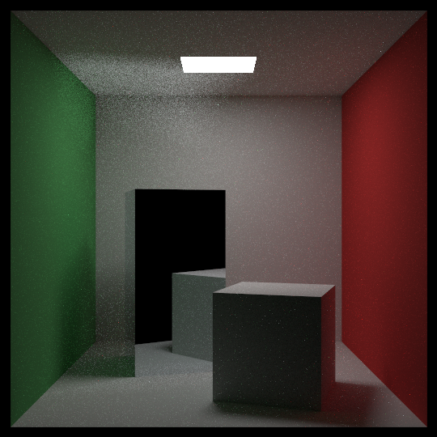 | 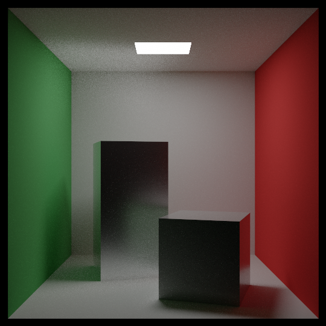 |
| *`RayTracingGPU aluminum -w 540 -s 1024`: the books' mirror block, under the books' mixture and display. The light the mirror throws onto the ceiling stays grainy: no light sample can use a mirror.* | *`RayTracingGPU cornell-ggx -w 540 -s 1024`: a tall block of rough aluminum (r = 0.3) and a short one under a white glossy coat (r = 0.2), under the scene's defaults, `-p mis` and AgX at 0 EV. Both blocks have a density, so they take a light sample at every bounce.* |

*540×540, 1024 rays per pixel each. Both tall blocks mirror the box's open front, which is dark. At 480×270 with 1024 rays per pixel, `cornell-ggx` passes the protocol of `-p material` against `-p mis`, the check of the GGX lobes under a lamp: σ of one render is 0.0145 under `material` and 0.0033 under `mis`, at 4.02 rays per sample for both (equal samples, not equal time).*

## The environment map

The books' sky is a gradient between two colors. A scene beyond the books can have a photograph of real surroundings instead: an equirectangular HDR map of the light arriving from every direction, which is what makes rough metals look like metal. Two maps from [Poly Haven](https://polyhaven.com), CC0, are committed under `assets/`, so the programs and the tests need no download: `studio_small_09`, a photographer's studio lit by softboxes, and `kloofendal_48d_partly_cloudy_puresky`, a partly cloudy sky with the sun 48° above the horizon and the ground replaced by sky, each the 1k file of 1024×512 texels. A map is loaded on the host by the CPU renderer's own image loader, which reads Radiance .hdr files: at most 2048×1024 texels, each a finite radiance ≥ 0. A scene may turn it about the vertical and scale it; both scenes use the maps as they are.

**The mapping.** +y is up and the map is seen from inside: a direction has the longitude φ′ = atan2(z, x) and the polar angle θ = atan2(√(x² + z²), y), and its texel lies at u = 0.5 + φ′/(2π) of the map's width from the left and θ/π of its height from the top. Looking along +x with +y up, +z is on the right, so the photograph appears as it was taken: Blender's convention, turned to +y up. The books' `sphere_uv` maps a globe seen from outside and would mirror it. Both atan2 forms take a direction of any length, so the books' rays, which aren't unit vectors, find the same texel. GpuTests pins the convention on 9 directions and finds the sun at 47.99° of elevation, where the photograph has it.

**Sampling by brightness.** Under the sun, a matte floor's own samples find it about once in 40,000 bounces: the sun's 4 brightest texels hold 42% of the map's light in 10⁻⁴ sr. That gives a sample a relative deviation of 127, so the material's samples alone would need 1.6·10⁸ samples for an error of 1%. So the map joins the light set, one light among the lamps, and its light samples draw directions by brightness. Each texel's cell has its exact solid angle, Ω_j = (2π/W)(cos θ_j − cos θ_(j+1)), from its rows' cosines in `double`. A cell is picked with the chance Y·Ω/S, its luminance Y (Rec. 709's weights) times its solid angle, over the map's total S, and then a direction uniform over the cell's solid angle. The density is then Y/S per steradian, constant over the cell, with no 1/sin θ and no guard at the poles, and the luminance of a sample's radiance over its density is S for every sample; a constant map gives exactly 1/(4π). (pbrt-v3 divides by 2π² sin θ, which isn't constant over a cell and needs a guard at the poles; pbrt-v4 resamples the map to an equal-area one, which this avoids.) The tables are built on the host in `double`: a sun of 61,184 over a sky of 10⁻³ spans eight orders of magnitude, and in `float` the dim texels' share of S would be lost.

**The alias table.** The cell comes from Vose's alias table (1991), in the stable form Schwarz describes in "Darts, Dice, and Coins" (pbrt-v4's alias table is the same method). Every bin holds a cell, a coin and an alias; a sample takes its bin from the top k bits of one random number, exactly uniform over the 2^k bins (padded with empty ones; a 1k map's 2¹⁹ cells need none), and tosses the bin's coin between its cell and its alias. That is two dependent loads per sample instead of about 20 for the search of a cumulative table, and no dim cell's chance is lost in a `float` sum's last bit: the studio map has 197,368 cells below 2⁻²⁴. Each coin is rounded to the 2⁻²⁴ steps of the random number that tosses it, the rounding errors diffused from bin to bin, so that the sun's cell, the alias of some 50,000 bins, doesn't gather their roundings, and every cell with any light keeps at least one step, so every lit direction can be drawn.

**One cell for both sides.** A light sample takes its radiance and its density from the cell its direction lands in, and a ray that escapes along the same direction gets the same two numbers from the same lookup (`env_cell`), so the weights of multiple importance sampling see one function. The chance of picking the map, 1/(N + 1) beside N lamps, counts on both sides.

**The filtered background.** The rays that multiple importance sampling weighs see the nearest texel, the one their density is constant over. Camera rays and rays after a mirror or glass see the four nearest texels blended instead: no light sample competes for them, and a background seen directly would otherwise show the texels' squares (a 1k map spans about 4 pixels per texel at 480 pixels across 40°). Which lookup a ray gets is a property of the material it left, never inferred from a density: under `-p material` no vertex stores one, and its escapes must see the same map as those of `mis`, or the two strategies would render two environments. The blend is computed in software, in `float`; the GPU's texture units weigh with 8-bit fractions. In `env-furnace`, the white sphere under a map of 1 everywhere, `-p material` gives `furnace`'s image bit for bit, and under `-p mis`, where the map is a light, the sphere's centre measures 1.0008 ± 0.0007 and its interior 1.0004 ± 0.0002.

| | |
|---|---|
| 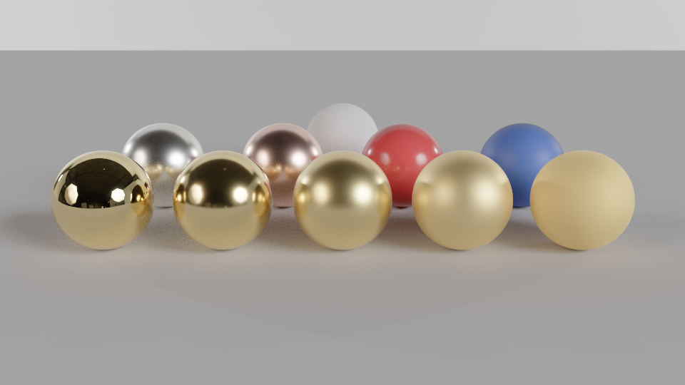 | 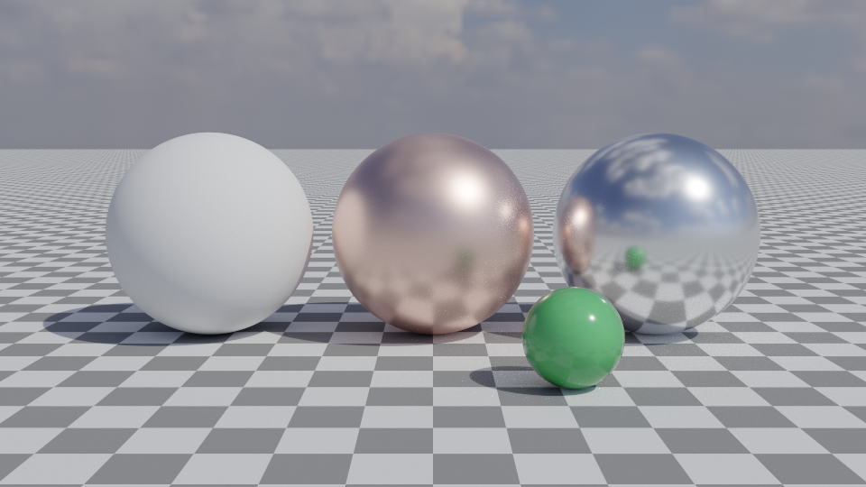 |
| *`RayTracingGPU studio -w 960 -s 4096`: in front, gold from the perfect mirror (r = 0) to rough (r = 0.8); behind, silver and copper (r = 0.25), red and blue glossy coats (r = 0.2 and 0.5) and a matte white sphere.* | *`RayTracingGPU sunlit -w 960 -s 4096`: matte white, copper (r = 0.35) and rough aluminum (r = 0.2), and a small green glossy sphere, on a checkered ground in the sun.* |

*960×540, 4096 rays per pixel, each scene's defaults: `-p mis` and AgX, at 0 EV for `studio` and −0.5 EV for `sunlit`. `sunlit` has no mirror and no glass: a path from the ground through a mirror to the sun has no light sample to find it, and would sparkle.*

| | |
|---|---|
| 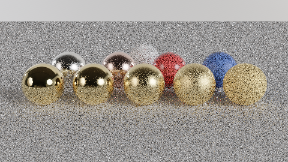 | 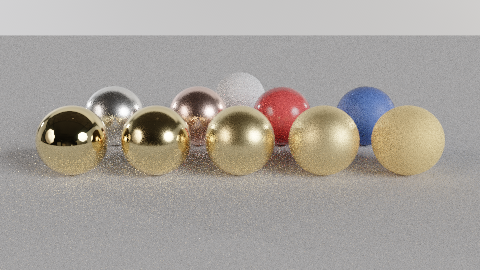 |
| *`RayTracingGPU studio -w 480 --height 270 -s 64 -p material`: the materials' own samples.* | *`RayTracingGPU studio -w 480 --height 270 -s 64 -p mis`: light samples drawn from the map by brightness, weighed against the materials' samples.* |

*480×270, 64 rays per pixel each: equal samples, not equal time. The studio's softboxes are large lights of moderate contrast, its 4096 brightest texels holding 42% of its light, so the materials' own samples find them often enough for a fair comparison. At 480×270 with 1024 rays per pixel the two pass the protocol, with σ of one render 0.0712 under `material` and 0.0143 under `mis`, 5 times less. Under the sun, `-p material` would be no fair partner: the test scene `sun-test`, matte spheres under `sunlit`'s sky, compares `-p nee` with `-p mis` instead, which both draw the sun at every bounce.*

## Tone mapping

The books turn light into bytes by the square root of each channel, clamped below 1: a byte is the integer part of 256·min(√x, 0.999). Everything brighter than 1 is plain white, one channel at a time, so a highlight loses its shape and its hue: a lamp-lit highlight of 4 in red and 1 in green turns from orange to yellow to white as it brightens. A lamp seen directly, a sun in a photograph and a metal's highlights are far brighter than 1. So the renderer has a display transform beside the books' bytes: the light times 2^EV, a tone curve made for compressing it, the display's encoding, and bytes rounded with a dither. The same `sunlit` render, through each:

| | |
|---|---|
| 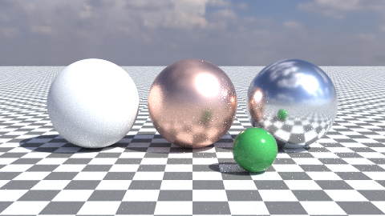 | 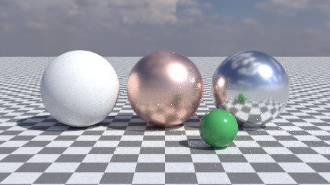 |
| *`RayTracingGPU sunlit -w 480 --height 270 -s 256 --tonemap books`: the books' bytes, the square root clamped below 1. The exposure doesn't apply.* | *`RayTracingGPU sunlit -w 480 --height 270 -s 256 --tonemap none --exposure -0.5`: no curve, the light clipped to [0, 1] and encoded with the sRGB curve.* |
|  | 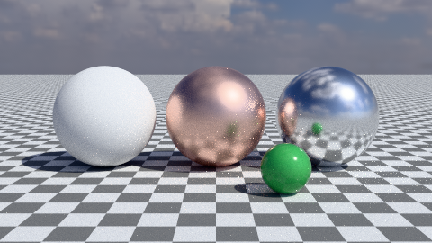 |
| *`RayTracingGPU sunlit -w 480 --height 270 -s 256 --tonemap agx --exposure -0.5`: AgX, the scene's own display.* | *`RayTracingGPU sunlit -w 480 --height 270 -s 256 --tonemap neutral --exposure -0.5`: Khronos PBR Neutral.* |

*480×270, 256 rays per pixel each. The four renders' PFMs (`-o x.pfm`) are byte-identical, with the mean radiance 0.616530: a tone map changes only the display.*

The tone maps beyond the books:

- **`none`** is the honest baseline: the light clipped to [0, 1] and encoded with the sRGB curve, as most image viewers expect (Blender's "Standard", pbrt-v4's PNG output).
- **`agx`** is Troy Sobotka's [AgX](https://github.com/sobotka/AgX), Blender 4's default view. It puts the light on a log2 scale of 16.5 stops around middle gray, from 0.000176 to 16.29, with 0.18 ten stops above the bottom, then applies an S-curve to each channel. Its inset matrix first pulls every primary a little toward gray, so that a very bright saturated color drifts toward white, as in a photograph, rather than toward the nearest of the six pure hues a per-channel curve would skew it to; the outset after the curve gives back some of the saturation. The matrices and structure are those of iolite's Minimal AgX (Benjamin Wrensch, © 2024 Missing Deadlines) and the curve is linlin's closed form (© 2024 linlin), both under the MIT License, whose notices are in `tone_curves.cuh`; the closed form matches the 4096 entries of Troy Sobotka's own curve to 5·10⁻⁸. Its output is already encoded for the display.
- **`neutral`** is [Khronos PBR Neutral](https://github.com/KhronosGroup/ToneMapping), written from its README's equations: colors up to 0.8 pass unchanged but for a constant offset of 0.04, so a base color comes out as authored, and above that only the brightest channel is compressed, all three by one factor, so the hue never changes. Then the sRGB curve.

**Exposure.** `--exposure EV`, from −24 to 24, multiplies the light by 2^EV before the curve, 0 EV being an exact ×1. It needs a tone map: with `books` it is refused, since the books' bytes have no exposure. The scenes beyond the books open in AgX at their own exposure (`cornell-ggx` and `studio` at 0 EV, `veach` at −1, `sunlit` at −0.5), the books' scenes and the test scenes in `books`; `--tonemap` and `--exposure`, or the window's keys, override them.

**Dither.** A byte is round(255·v + d), where d is the pixel's interleaved gradient noise (Jimenez 2014) minus one half, one value for the three channels so that a gray stays gray. A smooth gradient shows a fine grain instead of the bands of 8-bit levels, and over many pixels the bytes average 255·v. Black stays 0 and an encoded 1 is 255, never dithered. The noise is a function of the pixel alone, with no frame number, so the same pixel of the same image always gets the same byte.

**The byte path.** Every tone-mapped byte comes from one GPU kernel, `tone_map_kernel` in `tonemap.cu`, a translation unit of its own compiled with `-fmad=false`, so that its bytes follow from the code as written, every product and sum rounded on its own, with no multiplication and addition fused by the compiler. `RayTracingGPU` and the window show the same bytes: a frame of the window equals `RayTracingGPU`'s PNG at the same size and samples, and the command the window's P prints carries `--tonemap` and `--exposure`. The PNG is written by the books' own writer: each byte b becomes the linear value ((b + 0.5)/256)², exact in `double`, which the writer's square root, ×256 and truncation turn back into exactly b. A PFM stays linear, before any display.

**Why `books` stays the default** for the books' scenes: with it, every existing output, the gallery, the GIF and the window's frames, keeps its bytes. The books' display is the frozen display kernel itself, in gate F and the SASS gate, and the new kernel never touches it. The scenes beyond the books have no old bytes to keep, and an HDR map under a clamped square root looks broken, so they open in AgX. The tone maps compute in `float` only: with `--fp64`, a tone map other than `books` is refused.

## How it was verified

Every commit of the milestone passed the gates of [why a third kernel](#why-a-third-kernel) (the carry check from the first configuration it held), and in every commit that added device code, compute-sanitizer's memcheck and initcheck found 0 errors in small renders of the new paths and in GpuTests' quick run. Its new code was then checked twice over: on the GPU, function by function, by GpuTests, and image by image, by ImageCompare's protocols against the books' kernels and between the strategies. Nothing was rendered on the CPU: GpuTests' reference values are quadratures and closed forms, and the references of the protocols were rendered once by the build at `gpu-3`, whose kernels the SASS gate proves the same as every later build's.

**GpuTests** tests the renderer's device functions on the GPU, the very functions the kernels inline, in 12 suites in the files `tests/*_tests.cu` (three files hold two: `lamps` and `media`, `ggx` and `ggx-energy`, `env-map` and `env-sampling`), with 1131 checks in all. A check is a Monte Carlo mean (|z| at most 4), Pearson's χ² test, with each cell's expected count the density integrated over it by Gauss–Legendre quadrature on the GPU, from the shipped density function (the p-value at least 1 − 0.99^(1/T) for a suite's T tests, Šidák's correction), an exact identity, or a count of events that mustn't happen. The statistical suites also plant faults that the same checks must reject. Seeds are fixed and means are added in a fixed order, so every run prints the same numbers; `ctest` runs the suites, and skips them on a computer without a GPU.

| Suite | What it checks | Results |
|---|---|---|
| `harness` | the machinery itself, on the books' own samplers: cosine directions around a tilted normal, uniform directions, a sphere light from near and far, a quad light | χ² p-values 0.21 to 0.73 against a threshold of 0.002; directions drawn with the density cos^1.05 θ, tested against the cosine, rejected at p = 3·10⁻¹⁴ |
| `bsdf` | the quality kernel's matte, smoke, metal and glass lobes: weight = f·cos θ / p, densities that integrate to 1, χ² of the draws, and the draws against the books' own | χ² p-values 0.69 and 0.59; a planted anisotropic density rejected at p = 5·10⁻¹⁶; matte, smoke, metal at three fuzzes and glass draw the books' directions bit for bit, 10⁶ cases each |
| `routing` | which kernel a session takes, and what it refuses | |
| `services` | a scene on the GPU for the tests; the translator's GGX side entries, and the two mistakes a scene's code could make with them, refused | |
| `tone` | each tone map against a reference in `double` written from its equations; AgX's anchors and monotonicity; a reference with the matrices transposed, which must differ; the quantizer's edges; the dither; the PNG's bytes through `RayTracingGPU`'s own function | within 1.1·10⁻⁷ (`none`), 2.7·10⁻⁷ (`agx`) and 9.2·10⁻⁷ (`neutral`) on 10⁵ colors, the limit 2·10⁻⁶; AgX monotonic on 2²⁰ points; the transposed matrices differ by 0.076; the dither's means within 2.3·10⁻⁴ of 255·v |
| `lamps` | the light set; the densities against closed forms (the solid angle of a rectangle and of a sphere's cap); Veach's condition that the two weights add up to 1; one vertex's estimate against Lambert's polygon formula and a sphere's irradiance; the depth and counting rules, through renders; the shadow ray against a loop over every primitive | densities within \|z\| 2.3; the estimate within \|z\| 2.1 on 4 setups; the weights on 6·10⁶ directions; `nee` and `mis` against `material` at depths 2 and 3 within \|z\| 2.7; the shadow ray the same as the loop on 2·10⁶ rays; planted faults rejected: the pick's chance left out of a hit's density, and a lamp counted twice under `nee` |
| `media` | chords through fog in closed form; the transmittance against `medium_collision`'s own free flights on five media (spheres, boxes, a turned box, a moving one, two overlapping); the integrator through smoke | chords within 4.4·10⁻⁷; the transmittance within \|z\| 1.2; through gray and black smoke at depths 2 and 3, `nee` and `mis` within \|z\| 2.3 of `material`; a planted fault in the segment rejected |
| `ggx` | the weak furnace and ∫D cos θ_h = 1 by quadrature; χ² of the drawn directions and of their slopes on 35 cases; weight = f·cos θ / p; the sampled density = the evaluated one; reciprocity; the energy kept against an independent table; under the lamps, Veach's conditions with the conductor at 8 widths and the coat at 6 | within 8.6·10⁻⁷ of 1; the energy within 9.2·10⁻⁴ of the table (limit 2·10⁻³); every χ² passes; a wrong width rejected; the two weights add up to 1 within 3.6·10⁻⁷ over light-drawn directions and 4.1·10⁻⁵ over lobe-drawn ones; a lobe density 5% too wide rejected |
| `ggx-energy` | Turquin's table regenerated against the committed file; its resolution; the compensated energy over a grid of roughness and angle | the regenerated table equals the file (within 10⁻⁶); resolution 5.4·10⁻⁵ (limit 2·10⁻⁴); the energy within 3·10⁻³ of 1 up to 80° and 2.8·10⁻³ at 89°; a table shifted by one node rejected (largest error 0.044) |
| `gloss` | χ² of the coat's draws against the mixture's density; weight and density; reciprocity; the base's albedo; the energy kept | 24 χ² tests; the energy at most 0.969996, 0.970 head-on within 4·10⁻⁶; a mixture of 0.45/0.55 in place of ½/½ rejected at p = 4·10⁻⁶⁸ |
| `env-map` | the cells' solid angles and densities; every cell's centre mapped back to itself, at two yaws, on both maps and a synthetic one; the convention on 9 directions; the blend; the sun's position; the loader's refusals; a mirrored mapping, which must fail | the solid angles add up to 4π within 10⁻¹², the densities to 1 within 10⁻⁶; the sun at 47.99° |
| `env-sampling` | the alias table against the cells' shares; every lit cell reachable; χ² of the drawn cells; Y/p = S; irradiance against closed forms; lamps and the map together; the integrator under a lamp and the map | the table within 6·10⁻⁸ of a bin of the shares; Y/p = S within 6·10⁻⁸; irradiance within \|z\| 1.1; the integrator within \|z\| 1.9 of `-p material`, where leaving the map's pick out of an escape's density fails at \|z\| = 50; a cell 10⁻³⁰ as bright as the rest still drawn |

**The protocol for two strategies** (`compare.ps1`) asks whether two strategies, or two kernels, converge to the same image. Each is rendered with two seeds at 480×270 and the same rays per pixel, 1024 by default: A with seeds 1 and 2 (for the books' kernel, the references, rendered once by the build at `gpu-3`), B with seeds 3 and 4 (5 and 6 for a third strategy). The scenes with a 1:1 camera, such as `cornell`, show a wider view at that size, with the box in the middle. Four ImageCompare comparisons follow. Two controls compare each strategy with itself; a failing control says the comparison can't be trusted on that scene and voids the protocol. Two tests compare the strategies across seeds (A1 with B1, A2 with B2), pairs of independent renders. Then the RMS rule: each test's trimmed RMS of the difference may be at most 1.10 times what the controls predict for two strategies of unequal noise, √((R_A² + R_B²)/2), so that a pattern destroyed inside the tiles fails. The re-run rule was fixed before any result: one failing test or rule renders both strategies again with seeds 10 higher and repeats all four comparisons and the rule, with tiles of 64 on the pair that failed; it passes only if all of that passes, and two failures in the first run, or any in the re-run, fail the protocol. The noise of one render, σ, comes from each control: the RMS of the difference over √2, leaving out its largest 1% (`PfmStats`, which also gives the means, the RMS rule and byte comparisons of renders).

| Scene | Compared (rays per pixel) | Verdict | σ of one render | Rays and shadow rays per sample |
|---|---|---|---|---|
| `cornell`, `light`, `final` | the books' kernel against `--quality-kernel`, both `-p material` (1024) | passes on all three | | as the references: 4.15, 1.59, 3.68 |
| all 13 scenes | the books' kernel against `--quality-kernel`, `-p material` (256; seeds 1 and 3) | consistent on all 13; the largest whole-image \|z\| 2.59 | | |
| `cornell` | `-p mixture` against `-p mis`; `-p mis` against `-p nee` (1024) | both pass | mixture 0.00315, `mis` 0.00125, `nee` 0.00125 | `mis`: 4.15 and 2.25 |
| `light` | the same | both pass | mixture 0.00236, `mis` 0.00139, `nee` 0.00142 | `mis`: 1.59 and 0.46 |
| `final` | the same | both pass | mixture 0.0123, `mis` 0.0073, `nee` 0.0083 | `mis`: 3.68 and 1.90 |
| `cornell-ggx` | `-p material` against `-p mis` (1024) | passes | `material` 0.0145, `mis` 0.0033 | 4.02 for both |
| `studio` | `-p material` against `-p mis` (1024) | passes | `material` 0.0712, `mis` 0.0143 | |
| `sun-test` | `-p nee` against `-p mis` (1024) | passes | | |
| `veach`, `sunlit` | `-p mis`, seed 3 against seed 4 (256) | consistent, every value finite | | `veach`: 2.14 and 1.10 |
| `env-furnace` | `-p material` against `-p mis` (256) | consistent | | |

*All at 480×270. The books' kernel rendered the references; the 13-scene check compares one render of each kernel. The σ are at equal rays per pixel, not equal time; their ratios: the mixture's over `mis`'s 2.5 on `cornell`, 1.7 on `light` and 1.7 on `final`; `material`'s over `mis`'s 4.4 on `cornell-ggx` and 5.0 on `studio`.*

The base mode is the books' estimator in another kernel, so it is held to the books' images statistically, not to their bytes. With the references' own seeds it did reproduce them bit for bit when it was introduced (`cornell`, `light` and `final` at 1024 rays per pixel, all 13 scenes at 256), but byte identity is reported, not required: nvcc may contract the arithmetic of the shared functions differently in another translation unit. For a while it did. After the light samples were added, `final`'s base mode differed from the books' kernel's bytes in 68 of 129,600 pixels; after the rough metals, `glass` differed in 2, as nvcc merged the direction toward the viewer, then computed for every lobe, with the books' glass's own unit vector of the ray. Once that direction was computed for the GGX lobes only, `final` and `glass` gave the books' images bit for bit again, as `smoke`'s base mode had.

**Exact checks.** `furnace`, a matte sphere of albedo 1 under a sky of radiance 1, gives 388,800 of 388,800 values exactly 1.0 at 480×270, in the first book's kernel, in the all-books kernel and in the quality kernel; `env-furnace` gives the same image bit for bit. `ggx-furnace` and `gloss-furnace` are in [rough metals and glossy coats](#rough-metals-and-glossy-coats).

**The window.** The window renders through the same session as `RayTracingGPU`: in the quality kernel under `-p material` and `-p mis`, and with AgX at +0.5 EV, its renders of `cornell` at 160×90 gave the same PFMs as `RayTracingGPU`'s, and under AgX the same PNG. A recorded window session through the strategies, the scenes beyond the books and the float-only refusals (`tests/window-strategies.input`, 104 frames) replays without a window frame for frame, and the three views P saved in it, under `material`, `nee` and `mis`, are byte for byte `RayTracingGPU`'s renders of the commands P printed. Another session (`tests/window-tone.input`) does the same for the tone maps and the exposure keys.

**The carry check** held 16 configurations by the end, each at 480×270 with 64 rays per pixel and seed 3: the base mode of `cornell`, `light`, `final` and `smoke`; `cornell` under AgX at +0.5 EV, its PNG included; `cornell`, `light` and `final` under `-p mis`; `studio`'s base mode; `cornell-ggx`, `veach`, `studio` and `sunlit` under `-p mis`; and the three furnaces of the new code. Their bytes changed only where a commit explains it: `final`'s base mode for the 68 pixels above; `final` under `-p mis` with changes to the shared code and to the map's escapes, recorded again each time after its protocol against the books' mixture passed again; `ggx-furnace` with the compensation, by design.

**Debug = Release.** A Debug build rendered the carry set, the host gate's five small renders and `studio` at 160 pixels wide with 16 rays per pixel: the same PFM and PNG bytes as the Release build.

## Known limits

- **`float` only.** The quality kernel and the tone maps compute in `float`; `--fp64` is refused with them. The books' kernels keep `double` as the check of their floats; the quality kernel's checks are GpuTests and the comparisons with the books' images.
- **No Russian roulette.** Paths end at the scene's `max_depth`, as in the books: at equal samples, ending paths at random never lowers the noise.
- **No rough glass.** Glass is the books' dielectric, a delta lobe. A rough dielectric, anisotropic metals, Kulla and Conty's energy compensation and an F82 tint for metals are left for later.
- **Caustics through glass and mirrors can't be light-sampled.** A shadow ray stops at glass and mirrors, so light they focus or reflect arrives only by the materials' own rays: the light `aluminum`'s mirror throws onto the ceiling stays grainy under every strategy. Under `nee` and `mis`, `glass` finds its caustic only by the floor's own samples, without the books' mixture's aim at the ball.
- **Near-mirror GGX shows the map's nearest texels.** Only camera rays and rays after a delta vertex see the environment map blended. A GGX metal smooth enough to mirror the map still has a density, so its rays see the nearest texel, the one that density refers to, and the map's squares can show in its reflection.
- **The books' gradient sky is not a light.** It has no light sample, so under `nee` and `mis` the seven sky-lit book scenes fall back to `-p material`, and the program says so: "(no lights: the sky is the light)".
- **The light set leaves out textured and moving lamps.** A ray that finds one counts it in full, which is still unbiased; no scene has one. A light is picked uniformly, not by its power or by what it gives the point being lit.
- **The approximations of the materials.** The glossy coat loses a few percent of the light; Turquin's factor depends on the view alone, so the compensated metal isn't reciprocal (a path traced from the camera never notices); within about a degree of the horizon a smooth metal's compensated energy can be a few percent off 1.
- **The alias table's rounding.** A coin rounded to the 2⁻²⁴ steps of its random number gives a cell a chance that can differ by one step from the density its texel stores: at most about 2·10⁻⁸ of the map's light over a 1k map.
- **Maps come only with the GPU's own scenes**, each turned and scaled by the scene, at most 2048×1024 texels, and with [a glTF model's file](optix.md#gltf-models-and-their-materials), which is shown in the photo studio's map; no option puts a map behind another scene.
