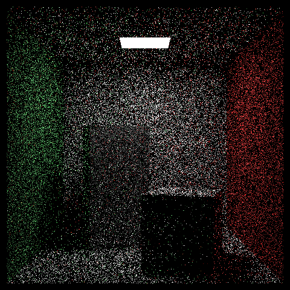
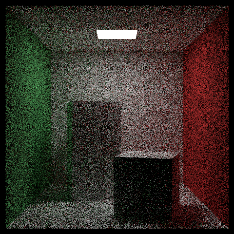
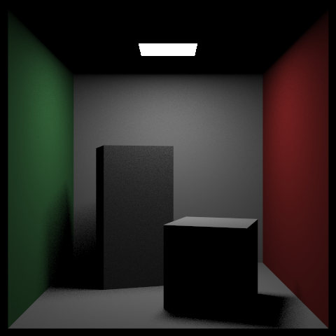
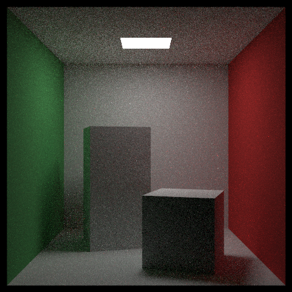

# Sampling

[RayTracing](../README.md) › Sampling

The third book, ["Ray Tracing: The Rest of Your Life"](https://raytracing.github.io/books/RayTracingTheRestOfYourLife.html) by Peter Shirley, Trevor David Black and Steve Hollasch, is about where to send a ray after a diffuse bounce, off a matte surface or a particle of smoke. This page shows the four strategies both renderers offer, where the default one falls short, the mistakes of the third book that the project fixes, and the program that runs the book's Monte Carlo experiments. The section numbers and the mistakes are those of the book's version 4.0.2 (2025-04-25).

- [Four strategies](#four-strategies)
- [Where the mixture can't help](#where-the-mixture-cant-help)
- [Fixes to the third book](#fixes-to-the-third-book)
- [The MonteCarlo program](#the-montecarlo-program)

## Four strategies

The new direction after a diffuse bounce may be drawn with any probability density p (a pdf: how likely each direction is to be drawn), as long as the light it brings back is then weighted by pScatter / p. Here pScatter is the material's own density: how much of the light it scatters goes that way. A direction that p draws more often than the material would counts for less, and one that p draws less often counts for more. So the image converges to the same result whatever p is, as long as p > 0 wherever the material scatters light: the estimate is unbiased. What p changes is the noise, and choosing a p that lowers it is called importance sampling. Here is the Cornell box with each strategy (`-p`), at 480×480 and 64 rays per pixel:

| `-p uniform` | `-p material` | `-p lights` | `-p mixture` (default) |
|---|---|---|---|
|  |  |  |  |
| the same density in every direction | as the surface scatters, as in the first two books | only toward the lamp | half as the material, half toward the lamp |
| error 0.175, 0.49 s | error 0.092, 2.0 s | error 0.045, 0.44 s, but the image is 21% too dark | error 0.022, 0.69 s |

*Error: the root-mean-square error (RMSE) of the pixels against a reference rendered with 16,384 rays per pixel, in linear light (before gamma correction). Time: the CPU renderer's, for these 64 rays per pixel, on all cores.*

`uniform` is the noisiest: half of its directions point into the surface and bring nothing. `lights` is far less noisy than `material`, but wrong: p is 0 in every direction that misses the lamp, which breaks the rule above. Its error is mostly missing light, not noise. All the light bounced off the walls is lost, and the ceiling, which sees only the dark back of the lamp (lamps glow on their front side only), is black.

The mixture keeps most of the low noise of `lights` and stays unbiased. Wherever the material scatters, p is at least half of pScatter, so p > 0 there and the weight pScatter / p is never more than 2. It is also faster for the same number of rays per pixel. Half of the bounces aim at the lamp, and since a lamp reflects nothing, a path that reaches it ends there, so paths get shorter.

In the scenes lit by small lamps (`light`, `cornell`, `smoke`, `final`, `aluminum`, `glass`), the default mixture aims half of the diffuse bounces off their surfaces at the lamps (`glass` also at its glass sphere). With `-p material` they are sampled as in the first two books: noisier, and all but `light` slower. The other scenes are lit by the sky and have no lamps to aim at, so `-p lights` and `-p mixture` render them as `-p material` does, and the program says so. Mirrors and glass stay a special case that skips the densities: the path continues along the one ray they choose, since a perfect mirror's density would be infinite in one direction and 0 in all others.

## Where the mixture can't help

In `aluminum` the mixture aims at the lamp, not at its reflection in the mirror, so the light the mirror throws onto the ceiling stays noisy. The book shows the same.

Smoke and fog don't mix the lamps in at all, which goes beyond the book. Deep in a dense volume, light comes from other particles rather than straight from a lamp. The mixture's weights of up to 2 per bounce would multiply along a path that scatters again and again, giving rare paths huge weights. In the `final` scene's blue fog that showed as bright specks and more than doubled the error. So volumes sample with their own density, where every weight is exactly 1.

The price is paid in thin haze, where light mostly scatters once, straight from the lamp, and aiming at the lamp would help. The haze that fills the whole `final` scene, the gray behind its objects, comes out a little noisier, though evenly so. Telling thin volumes from dense ones, or sending separate rays to the lamps, would avoid that cost; neither is implemented yet.

## Fixes to the third book

Mistakes in the third book are fixed rather than repeated, and a comment next to each fix explains it:

- The inverse CDF of section 3.7 for the quadratic density is 8·∛d instead of 2·∛d, so it draws x up to 8 instead of 2 (see [the `importance` experiment](#the-montecarlo-program)).
- Section 6.2 divides by the uniform density 1/(2π) but still draws the directions with the material's density cos θ / π, so each bounce gets the weight 2 cos θ instead of 1: 4/3 on average, and a white wall (albedo 0.73) acts like one of 0.97. The image comes out too bright, not just noisier; `-p uniform` divides by the density it really draws from.
- The book's code reads the first element of an empty list of lights.
- Light directions hundreds of units long: the search for a hit starts at t = 0.001 of their length, so they skip the first half unit of their way and anything there.
- A point inside a spherical lamp gets NaN from the square root of a negative number.

Two more changes go beyond the book. Translated and rotated instances can be sampled as lights, like quads, spheres and lists of them. And densities are small values on the stack, where the book creates them with `make_shared` at every bounce, so there is no heap allocation per bounce.

## The MonteCarlo program

The third book builds importance sampling up from Monte Carlo estimation (an integral as the average of random samples), on small problems with known answers. The `MonteCarlo` program runs those experiments with the renderer's own random numbers, directions and densities, and adds the error bars that the book's listings leave out: every estimate is printed next to the exact value, its standard error SE (how far a correct estimate typically lands from the exact value) and the error in SEs. Up to about 3 SE is noise; much more points to a bug.

For example, `MonteCarlo importance` integrates x² over [0, 2] with four sampling densities. The end of its output repeats each estimate 1000 times and compares the RMS error of these runs with σ/√N, the error predicted from the spread σ of a single sample f/p:

```
  The RMS error of 1000 runs with N = 100 samples each, next to σ/√N:
  PDF         p(x)                 σ of f/p      σ/√N       RMS  largest x
  uniform     1/2                  2.385139  0.238514  0.242261   1.999991
  two halves  1/(2√2) | 1/(4-2√2)  1.503819  0.150382  0.151427   1.999983
  linear      x/2                  0.942809  0.094281  0.091921   1.999998
  quadratic   3x²/8                0.000000  0.000000  0.000000   1.999990
```

The closer the density p is in shape to the function being integrated, f(x) = x², the smaller the error; a p proportional to f gives the exact answer with every sample. The last column, the largest x drawn, is a check that catches a mistake in the book. The book's inverse CDF for the quadratic density (the formula that turns a uniform random number d between 0 and 1 into an x with that density) is 8·∛d instead of ∛(8d) = 2·∛d, so it draws x up to 8, outside [0, 2], and would put almost 8 in that column. The program uses 2·∛d, so the column stays below 2. The estimate itself can't show the mistake, because f(x) / p(x) = 8/3 for every x.

| Experiment | Book section | What it shows |
|---|---|---|
| `pi` | 2.1 | estimate π from random points in a square |
| `convergence` | 2.2 | the law of diminishing returns: the error falls as 1/√N |
| `stratified` | 2.3 | one random point in each cell of a grid (jittering) vs points anywhere |
| `integrate` | 3.2 | integrals as averages of random samples: x², sin⁵ x and ln(sin x) over [0, 2] |
| `halfway` | 3.5 | the point that halves the area under a curve, found by sorting the samples |
| `importance` | 3.7 | ∫ x² dx with four densities: the closer p is to f, the smaller the error |
| `sphere` | 4 | ∫ cos²θ dω over the sphere of directions, with densities per steradian |
| `sphere-plot` | 7.1 | 200 random directions as "x y z" lines, the input of a 3D scatter plot |
| `cos-cubed` | 7.2 | ∫ cos³θ dω over the hemisphere: uniform vs cosine-distributed directions |
| `light-pdfs` | 9.1 | beyond the book: for quads, spheres, lists and instances, is `pdf_value()` the density of the directions `random()` draws? |

`light-pdfs` tests the light sampling itself: if a light's `pdf_value()` is not the density of the directions its `random()` draws, the image is biased. The lights it tests are a quad, a sphere seen from outside and from inside, a list of a quad and a sphere, and a turned and moved instance of a quad. For each, it checks four things, labeled as in its output:

- (a) the density integrates to 1;
- (b) the mean of 1/p over the drawn directions comes out as the solid angle the light covers;
- (c) no drawn direction has density 0;
- (d) an integral over the light comes out the same from the light's own directions as from uniform ones. This is the stricter check: (b) can pass even when the directions are spread wrongly over the light. For a sphere, whose density is the same for every direction it draws, every sample of (b) is the solid angle.

Run without arguments, `MonteCarlo` takes about 6 s in Release and runs every experiment except `sphere-plot`. `MonteCarlo importance sphere` runs only the named ones, `MonteCarlo sphere-plot -o points.txt` writes the plot's points to a file, and `MonteCarlo -h` lists them all. Its options:

```
MonteCarlo [experiment...] [options]
  -o, --output FILE  sphere-plot writes its points to FILE instead of the console: only the points,
                     the input of a plotting tool (on the console a header comes first)
  -h, --help         show this help
```
